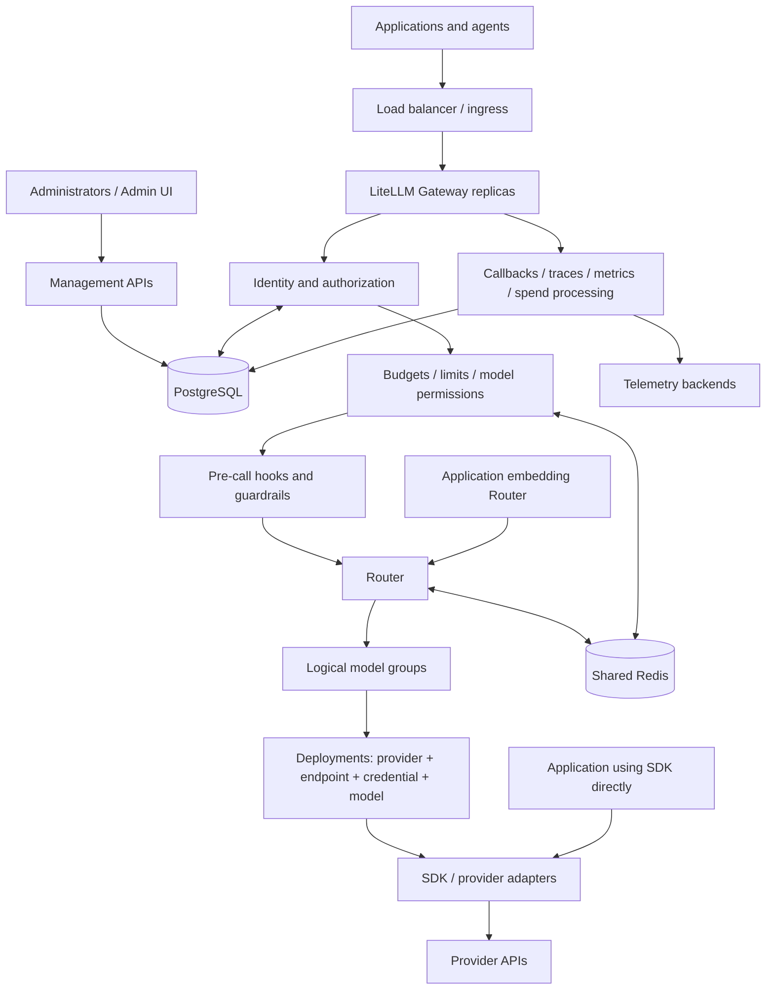
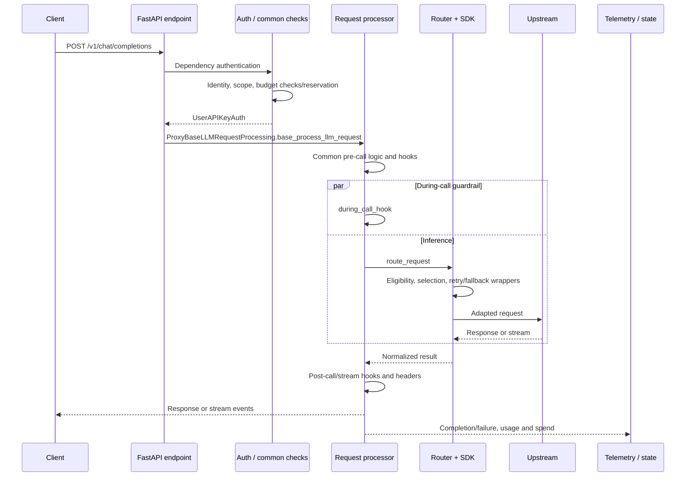
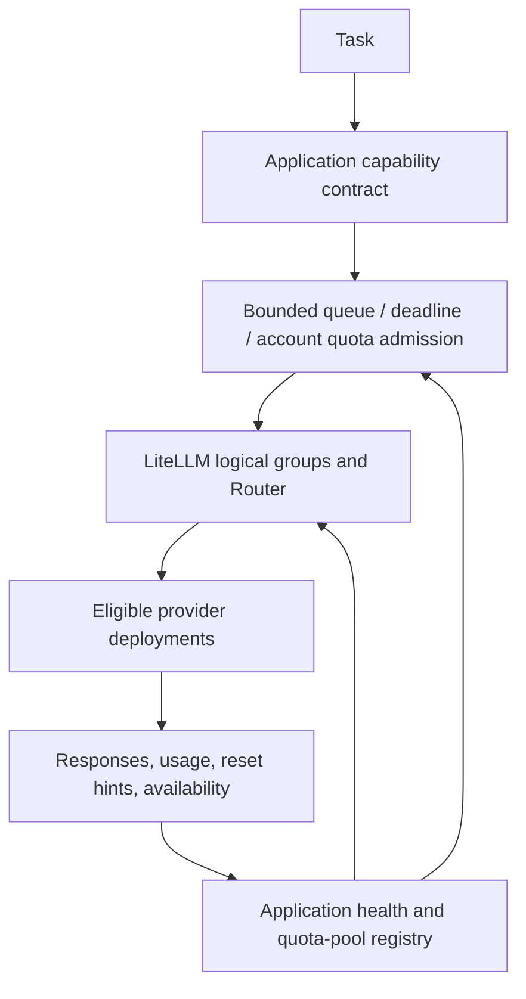
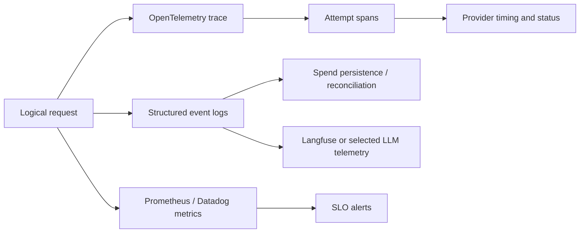
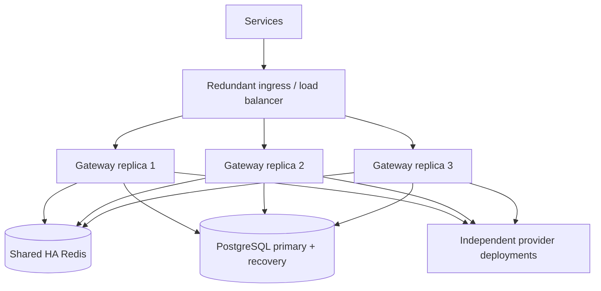
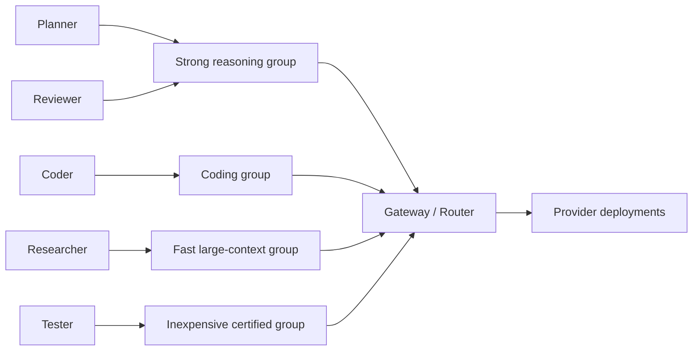
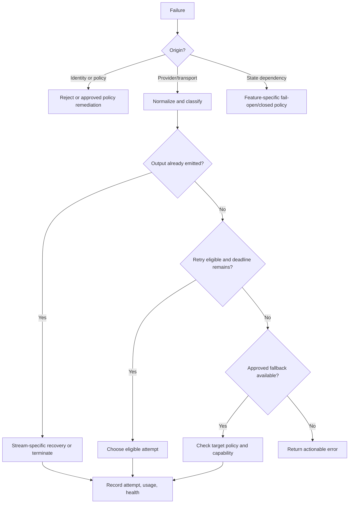
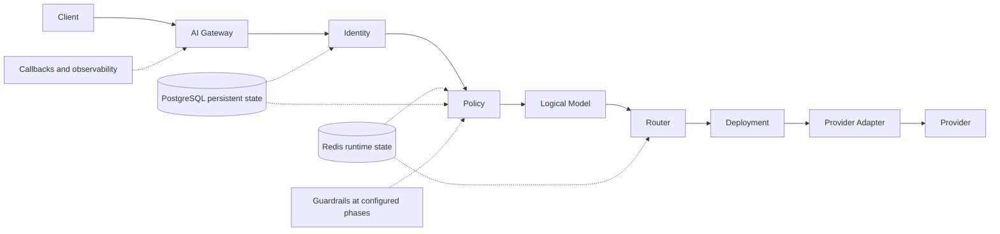

# LiteLLM Masterclass Reference Guide

**A technical handbook for application engineers, infrastructure architects, operators, and contributors**

Handbook edition: **21 October 2026**, based on official source and documentation snapshots dated **20 October 2026**. This is a standalone reference, not an interactive course.

## Version contract and how to read this book

This book examines the official Python repository at commit **`2773ef0084b85bced936d4174b10b1d70df6ae65`**, whose `pyproject.toml` declares **1.107.0**, and the official documentation repository at **`0c81f28cc2f9c9ec771151eadc28b3266ad5b06a`**. A version in development source does **not** prove that a corresponding stable package or container has been released. Deploy a tested, published release pinned by version and artifact digest; compare its source with this snapshot before applying newer options. This book does not claim to have executed paid provider calls or certified a production deployment.

The official documentation moves independently of the code. Source links in this book are immutable; documentation-source links are also pinned. The accompanying source checkouts make the material auditable offline. No current model name, free-tier entitlement, quota, or price is promised to remain available.

Labels used throughout:

| Label | Meaning |
|---|---|
| **SDK** | In-process Python translation and invocation APIs |
| **Router** | Deployment selection and reliability machinery, usable without the Proxy |
| **Gateway** | Network service, identity, policy, management APIs, and operational integration |
| **Provider** | Upstream service behavior or entitlement, outside LiteLLM's authority |
| **Application** | Logic you must supply or explicitly integrate |
| **Enterprise** | Feature documented as licensed; presence of source does not grant entitlement |
| **Snapshot-specific** | Verified in this revision; check your installed build |
| **Experimental/Beta** | Explicitly unstable surface; directory names alone do not determine product stability |
| **Illustrative** | Design or example, not a claim of native functionality |

Examples use environment variables for provider model identifiers because availability changes by account and region. `os.environ/NAME` is the Proxy YAML resolver syntax; in Python use `os.environ["NAME"]`. Numbers in configurations are **example operating policies**, not vendor quotas. Code blocks that define fragments, callbacks, or conceptual algorithms say so. The assembled baseline configuration appears in Part 15.

The current repository also includes `litellm/_v2`, `litellm/rust_bridge`, and `litellm-rust`. Do not assume every request runs through the same Python implementation. This book traces the public Python SDK and FastAPI Proxy path, then explains how to investigate alternate execution paths in Part 34.

[`pyproject.toml`](https://github.com/BerriAI/litellm/blob/2773ef0084b85bced936d4174b10b1d70df6ae65/pyproject.toml) [`docs/routing.md`](https://github.com/BerriAI/litellm-docs/blob/0c81f28cc2f9c9ec771151eadc28b3266ad5b06a/docs/routing.md) [`docs/enterprise.md`](https://github.com/BerriAI/litellm-docs/blob/0c81f28cc2f9c9ec771151eadc28b3266ad5b06a/docs/enterprise.md)

## Contents

- [Part 1 — Foundation](#part-1-foundation)
- [Part 2 — Complete Request Lifecycle](#part-2-complete-request-lifecycle)
- [Part 3 — Python SDK](#part-3-python-sdk)
- [Part 4 — Provider Abstraction](#part-4-provider-abstraction)
- [Part 5 — Models, Deployments, and Model Groups](#part-5-models-deployments-and-model-groups)
- [Part 6 — Router Masterclass](#part-6-router-masterclass)
- [Part 7 — Retries](#part-7-retries)
- [Part 8 — Fallbacks](#part-8-fallbacks)
- [Part 9 — Cooldowns and Failure Handling](#part-9-cooldowns-and-failure-handling)
- [Part 10 — Rate Limits and Quotas](#part-10-rate-limits-and-quotas)
- [Part 11 — Multiple API Keys](#part-11-multiple-api-keys)
- [Part 12 — Multi-Account Routing](#part-12-multi-account-routing)
- [Part 13 — Multi-Provider Routing](#part-13-multi-provider-routing)
- [Part 14 — Free-Tier Routing Architecture](#part-14-free-tier-routing-architecture)
- [Part 15 — AI Gateway / Proxy](#part-15-ai-gateway-proxy)
- [Part 16 — Virtual Keys](#part-16-virtual-keys)
- [Part 17 — Redis](#part-17-redis)
- [Part 18 — PostgreSQL and Persistent State](#part-18-postgresql-and-persistent-state)
- [Part 19 — Caching](#part-19-caching)
- [Part 20 — Cost Tracking and Budgets](#part-20-cost-tracking-and-budgets)
- [Part 21 — Observability](#part-21-observability)
- [Part 22 — Callbacks and Hooks](#part-22-callbacks-and-hooks)
- [Part 23 — Guardrails](#part-23-guardrails)
- [Part 24 — Security](#part-24-security)
- [Part 25 — Concurrency and Performance](#part-25-concurrency-and-performance)
- [Part 26 — Load Testing](#part-26-load-testing)
- [Part 27 — High Availability](#part-27-high-availability)
- [Part 28 — Multi-Region Architecture](#part-28-multi-region-architecture)
- [Part 29 — Capability-Aware Routing](#part-29-capability-aware-routing)
- [Part 30 — Multi-Agent Systems](#part-30-multi-agent-systems)
- [Part 31 — MCP and Agent Infrastructure](#part-31-mcp-and-agent-infrastructure)
- [Part 32 — Failure Engineering](#part-32-failure-engineering)
- [Part 33 — Debugging Masterclass](#part-33-debugging-masterclass)
- [Part 34 — Source-Code Masterclass](#part-34-source-code-masterclass)
- [Part 35 — Extending LiteLLM](#part-35-extending-litellm)
- [Part 36 — Testing](#part-36-testing)
- [Part 37 — Common Anti-Patterns](#part-37-common-anti-patterns)
- [Part 38 — LiteLLM Versus Building a Router](#part-38-litellm-versus-building-a-router)
- [Part 39 — Alternatives and Adoption Decisions](#part-39-alternatives-and-adoption-decisions)
- [Part 40 — Production Reference Architectures](#part-40-production-reference-architectures)
- [Part 41 — Master Reference Tables](#part-41-master-reference-tables)
- [Part 42 — A–Z Glossary](#part-42-az-glossary)
- [Part 43 — Final Mental Model](#part-43-final-mental-model)

## Part 1 — Foundation

### Simple Definition

LiteLLM gives applications a common interface to model providers and optionally operates that interface as a governed network service.

### Why It Exists

Providers disagree about authentication, messages, streaming events, errors, tool schemas, model names, usage, and billing. Reimplementing these differences in every service produces inconsistent behavior and scattered credentials. A shared adapter library centralizes translation; a Router centralizes deployment selection; a Gateway centralizes organizational access and operations.

### Mental Model

Think of three nested components. The SDK is a translator. The Router is a dispatcher using that translator. The Proxy is a staffed entrance around the dispatcher, checking identity and policy and recording activity. None of these makes a weak model good at reasoning or makes an unreliable upstream infallible.

### Architecture



The diagram shows responsibility, not a strictly serial execution order. Guardrails also operate during and after invocation. Telemetry often runs asynchronously.

### How It Works

A client requests a logical model. The Gateway authenticates the caller and applies applicable controls. The Router obtains eligible deployments and chooses one. The SDK translates the call into the upstream protocol, sends it, and normalizes the result. Usage feeds cost and spend accounting; callbacks update operational state. Failures can cause another attempt, another deployment, another model group, or an immediate error.

### Internal Implementation

| Concept | Concrete meaning and ownership |
|---|---|
| Provider | An upstream API integration, such as Anthropic or Bedrock |
| Model | A provider's inference offering; a name is not necessarily a stable version |
| Deployment | A routable model/endpoint/credential configuration |
| Model group | Deployments sharing a Router `model_name` |
| Provider API key | Credential authorizing access upstream |
| Account | Provider billing/security boundary; often application inventory metadata |
| Provider project | Upstream resource/quota boundary, distinct from a Gateway project |
| Organization | Gateway organizational entity, or a separate upstream concept depending on context |
| User | Authenticated Gateway principal or managed organizational record |
| End user | Application customer attributed to a call; not automatically a Gateway administrator |
| Team | Gateway grouping for access, spend, and limits |
| Gateway project | Application/use-case grouping; current project management is Enterprise |
| Virtual key | Gateway-issued credential with scope and limits; not an upstream credential |
| Redis | Shared runtime counters, cooldowns, selected caches, and coordination |
| PostgreSQL | Persistent identity, configuration, budgets, and accounting records |
| Callback | Code notified around request events |
| Hook | An invocation point where code may inspect, transform, reject, or observe |
| Guardrail | Policy integration invoked at configured phases |
| Budget | Spend policy over an entity and time window |
| Rate limit | Admission bound on requests/tokens or another measured resource |
| Cost tracking | Estimate or calculation using reported usage and pricing metadata |
| Observability | Logs, metrics, and traces that explain the system's behavior |

The Router does not automatically discover that five credentials share one upstream quota pool. A PostgreSQL table does not imply all of its management features are unlicensed. A successful API response does not imply final billing records have already committed.

### Configuration

```python
import os
import litellm

response = litellm.completion(
    model=os.environ["CHAT_MODEL"],
    messages=[{"role": "user", "content": "Explain a cache in one sentence."}],
)
```

`CHAT_MODEL` should include a verified provider prefix, for example `openai/<enabled-model>`. Configure that provider's credentials in the process environment.

```yaml
model_list:
  - model_name: general
    litellm_params:
      model: os.environ/CHAT_MODEL
      api_key: os.environ/CHAT_PROVIDER_KEY
```

### Example

A small service uses `litellm.acompletion` directly and owns its own authentication. Adding a Router gives the same service redundant deployments without creating a network hop.

### Production Example

Several services call `general` through a Gateway using different virtual keys. Operations changes deployments behind `general` while service code stays unchanged. Access to a more expensive `reasoning` group is granted separately.

### Failure Scenarios

Translation can fail on unsupported parameters. All deployments can share one outage. Identity caches can become stale. An upstream can accept a request but disconnect before returning usage. These are different failures requiring different controls.

### Debugging

Identify the layer first: client validation, Gateway admission, Router eligibility, adapter transformation, transport, provider, or postprocessing. Record request ID, logical group, deployment ID, attempt number, upstream status, and normalized exception.

### Common Mistakes

Treating LiteLLM as an agent orchestrator; assuming PostgreSQL is needed for every SDK call; equating four keys with four quota pools; assuming every provider supports every standardized field.

### Best Practices

Keep application contracts capability-based, credentials centralized, and version evidence explicit. Maintain contract tests for every deployment admitted to a group.

### Trade-offs

Centralization reduces duplication but increases the impact of Gateway failures and incorrect policy. Embedding the SDK avoids an extra hop but distributes operational responsibility.

### Source-Code References

[`litellm/main.py`](https://github.com/BerriAI/litellm/blob/2773ef0084b85bced936d4174b10b1d70df6ae65/litellm/main.py) [`litellm/router.py`](https://github.com/BerriAI/litellm/blob/2773ef0084b85bced936d4174b10b1d70df6ae65/litellm/router.py) [`litellm/proxy/proxy_server.py`](https://github.com/BerriAI/litellm/blob/2773ef0084b85bced936d4174b10b1d70df6ae65/litellm/proxy/proxy_server.py) [`litellm/proxy/schema.prisma`](https://github.com/BerriAI/litellm/blob/2773ef0084b85bced936d4174b10b1d70df6ae65/litellm/proxy/schema.prisma)

## Part 2 — Complete Request Lifecycle

### Simple Definition

The request lifecycle is the sequence and branching of admission, execution, recovery, and accounting for one logical operation.

### Why It Exists

Latency, rejected requests, missing spend, and information leakage can only be diagnosed correctly when you know which work happened before a failure.

### Mental Model

A logical request is an envelope containing zero or more provider attempts, followed by completion work that may outlive the client connection.

### Architecture



### How It Works

For the inspected chat endpoint, FastAPI resolves `user_api_key_auth` before running the endpoint body. Authentication constructs a `UserAPIKeyAuth` context and performs applicable common authorization and budget checks. Budget reservation is present in this snapshot and can be disabled by configuration. Rate-limit enforcement is also integrated through pre-call hooks rather than being one universal standalone instruction immediately after authentication.

The endpoint invokes the shared request handler. Common processing resolves request defaults, aliases and identity metadata, constructs logging context, merges model-level guardrails, and runs `pre_call_hook`. `_pre_call_with_fallbacks` can handle eligible pre-call failures. Consequently, even some fallback behavior can happen before a provider call.

The processor schedules `during_call_hook` and the routed LLM coroutine concurrently using `asyncio.gather`. A during-call denial cannot be interpreted as proof that no prompt reached the provider. Strict pre-egress checks must run before invocation.

The Router's recovery wrappers surround deployment selection and SDK execution. The adapter translates request/response formats; exceptions are normalized for recovery decisions. On ordinary nonstreaming completion the processor runs post-call success hooks and builds headers. With post-call guardrails, logging may be deferred so final telemetry incorporates guardrail metadata.

Streaming returns an iterator before the operation has finished. Later iterator errors, client cancellation, final usage, guardrails, reservation release, and logging have separate cleanup paths. Do not place “database update” before “application response” as a universal ordering guarantee.

### Internal Implementation

`proxy_server.chat_completion` calls `ProxyBaseLLMRequestProcessing.base_process_llm_request`. The handler delegates into `_process_llm_request`; `_pre_call_with_fallbacks` and `common_processing_pre_call_logic` prepare the call. `route_llm_request.route_request` selects an appropriate Router or SDK route. `ProxyLogging` supplies the hooks. `async_streaming_data_generator` participates in stream processing and cleanup.

Custom authentication changes the admission path. Native provider endpoints, Responses, MCP, and A2A are not identical to chat completions. A valid lifecycle analysis names the endpoint and runtime branch.

### Configuration

```yaml
general_settings:
  master_key: os.environ/LITELLM_MASTER_KEY
  database_url: os.environ/DATABASE_URL
  fail_closed_budget_enforcement: true
  cancel_on_disconnect: true
```

These policies trade availability for budget integrity and reduce unnecessary work after disconnects. Cancellation does not guarantee an upstream stops billing.

### Example

If authentication rejects a virtual key, no deployment should be selected. If an input guardrail rejects before routing, the provider should see no request. If a during-call guardrail rejects, the provider may already have received it.

### Production Example

Create a parent span for the logical call and a child span per attempt. Record pre-call admission separately from provider duration and post-call processing. Reconcile success/failure and reservation finalization for disconnected streams.

### Failure Scenarios

Missing final chunks can delay usage. An exception in a post-call hook can turn a paid upstream success into a client-visible failure. Client retries can then create additional paid requests.

### Debugging

Walk from the endpoint dependency to the handler, route dispatcher, Router entrypoint, adapter, and completion hooks. Compare timestamps and correlation IDs; do not infer ordering from interleaved asynchronous log lines alone.

### Common Mistakes

Assuming all guardrails run before transmission; assuming authentication and authorization are synonymous; assuming request success means DB durability; applying the chat lifecycle unchanged to MCP.

### Best Practices

Specify exactly which policies are pre-egress, pre-response, or observational. Test cancellation and post-response failures as first-class cases.

### Trade-offs

Concurrent checks reduce latency but cannot provide strict prevention of upstream disclosure. Buffering output enables whole-response validation but increases TTFT.

### Source-Code References

[`litellm/proxy/proxy_server.py`](https://github.com/BerriAI/litellm/blob/2773ef0084b85bced936d4174b10b1d70df6ae65/litellm/proxy/proxy_server.py) [`litellm/proxy/auth/user_api_key_auth.py`](https://github.com/BerriAI/litellm/blob/2773ef0084b85bced936d4174b10b1d70df6ae65/litellm/proxy/auth/user_api_key_auth.py) [`litellm/proxy/common_request_processing.py`](https://github.com/BerriAI/litellm/blob/2773ef0084b85bced936d4174b10b1d70df6ae65/litellm/proxy/common_request_processing.py) [`litellm/proxy/route_llm_request.py`](https://github.com/BerriAI/litellm/blob/2773ef0084b85bced936d4174b10b1d70df6ae65/litellm/proxy/route_llm_request.py) [`litellm/proxy/spend_tracking/budget_reservation.py`](https://github.com/BerriAI/litellm/blob/2773ef0084b85bced936d4174b10b1d70df6ae65/litellm/proxy/spend_tracking/budget_reservation.py)

**Direct SDK difference:** direct `completion`/`acompletion` bypasses FastAPI, virtual-key authentication, Gateway entity policy, and Gateway management/persistence. SDK callbacks and caches can still execute. A direct Router adds selection/recovery, but not automatic Gateway identity governance.

## Part 3 — Python SDK

### Simple Definition

The SDK is the Python interface that adapts supported inference and related API operations to provider protocols.

### Why It Exists

Applications should not need a separate message/response/error implementation for every upstream. They still must understand capability differences.

### Mental Model

A common socket with adapters: the socket standardizes connection shape, not every appliance's abilities.

### Architecture

Public functions in `litellm` dispatch into endpoint-specific modules, provider configs, HTTP handlers, response objects, and logging wrappers. Chat completions remain important, but Responses, images, audio, files, and batches have separate entrypoints.

### How It Works

Install the core package for SDK usage; install the `proxy` extra for a Gateway environment. Inspect `pyproject.toml` for the exact extras in the selected release rather than guessing package variants.

```powershell
$env:LITELLM_VERSION = "<tested-published-version>"
python -m venv .venv
.\.venv\Scripts\python -m pip install "litellm==$env:LITELLM_VERSION"
# Gateway environment instead:
.\.venv\Scripts\python -m pip install "litellm[proxy]==$env:LITELLM_VERSION"
```

Production builds should use a generated lockfile with hashes, a controlled package index, dependency scanning, and a pinned container digest. Installing a mutable source checkout and installing a published wheel are different reproducibility contracts.

### Internal Implementation

`completion` and `acompletion` enter translation and logging code in `main.py` and shared utilities. Async APIs must be awaited; stream iteration must also use the correct async protocol. Endpoint modules preserve operation-specific fields and often delegate into provider-specific handlers. `ModelResponse`, usage objects, and `CustomStreamWrapper` normalize common shapes.

| Operation | Typical SDK entrypoint | Critical provider dependency |
|---|---|---|
| Chat | `completion`, `acompletion` | Message roles, parameters, finish reasons |
| Embeddings | `embedding`, `aembedding` | Dimensions, normalization, token limits |
| Reranking | `rerank`, `arerank` | Document format, scores, top-N semantics |
| Images | `image_generation`, `aimage_generation` | Size, quality, output format; edits are separate |
| Speech | `speech`, `aspeech` | Voices, encodings, streaming support |
| Transcription | `transcription`, `atranscription` | File formats, timestamps, language options |
| Responses | `responses`, `aresponses` | State, tools, previous response IDs, reasoning |
| Batches | `create_batch`, `acreate_batch` and retrieval APIs | Supported endpoint, completion window, file ownership |
| Files | `create_file`, `acreate_file` and retrieval APIs | Purpose, account ownership, retention |
| Metadata | `get_model_info`, `get_supported_openai_params` | Registry freshness and provider/model variant |
| Counting/cost | `token_counter`, `completion_cost` | Tokenizer, pricing, usage completeness |

### Configuration

```python
import asyncio
import os
import litellm

async def main():
    result = await litellm.acompletion(
        model=os.environ["CHAT_MODEL"],
        api_key=os.environ["CHAT_PROVIDER_KEY"],
        messages=[{"role": "user", "content": "Return a concise summary."}],
        timeout=30,
        num_retries=0,
        max_tokens=256,
    )
    print(result.choices[0].message.content)
    print(result.usage)

if __name__ == "__main__":
    asyncio.run(main())
```

Timeout and retry values here are explicit application policy. A model may require a different output-budget parameter; inspect supported parameters and the adapter rather than blindly applying `max_tokens` to every reasoning model.

### Example

```python
async def stream_answer(model, messages):
    stream = await litellm.acompletion(
        model=model, messages=messages, stream=True,
        stream_options={"include_usage": True},
    )
    async for chunk in stream:
        if chunk.choices:
            text = chunk.choices[0].delta.content
            if text:
                print(text, end="", flush=True)
        if getattr(chunk, "usage", None):
            print(chunk.usage)
```

Usage chunks can have no choices. Tool-call deltas need assembly by index/ID; arguments can be incomplete JSON until the stream finishes. Synchronous streaming uses `for chunk in litellm.completion(..., stream=True)`.

```python
schema = {
    "type": "json_schema",
    "json_schema": {
        "name": "decision",
        "strict": True,
        "schema": {
            "type": "object",
            "properties": {"approved": {"type": "boolean"}},
            "required": ["approved"],
            "additionalProperties": False,
        },
    },
}
tools = [{
    "type": "function",
    "function": {
        "name": "lookup_order",
        "description": "Read an order by its opaque identifier.",
        "parameters": {
            "type": "object",
            "properties": {"order_id": {"type": "string"}},
            "required": ["order_id"],
            "additionalProperties": False,
        },
    },
}]
# Use separately, on deployments certified for each capability.
```

Tool calling returns proposed calls; the application validates arguments, authorizes the operation, executes it, and returns tool results. It is not permission to execute arbitrary model output. Legacy `functions`/`function_call` fields may remain compatibility surfaces; prefer `tools`/`tool_choice` for new integrations.

### Production Example

```python
async def embed_documents(texts):
    result = await litellm.aembedding(
        model=os.environ["EMBEDDING_MODEL"], input=texts,
    )
    return [item["embedding"] for item in result.data]

async def structured_decision(messages):
    response = await litellm.acompletion(
        model=os.environ["STRUCTURED_MODEL"],
        messages=messages, response_format=schema,
    )
    # Parse and validate against the same schema before acting.
    return response.choices[0].message.content
```

For images, audio and files, bound upload size, hold file handles open until awaited calls finish, and store returned URLs only within their validity period. Batch jobs need durable job IDs and polling state; submitting a batch is not completion.

Reasoning tokens may count toward output usage without appearing as ordinary text. Multimodal inputs may use URLs or encoded content depending on adapter; avoid remote fetches from untrusted URLs. Provider prompt caching, Gateway response caching, and SDK client pooling are three unrelated optimizations.

### Failure Scenarios

Unsupported parameters can be rejected locally or upstream. A Responses ID from one account may be unusable on another. Embedding fallback can silently corrupt retrieval if dimensions or embedding spaces change. Missing pricing produces unknown or inaccurate cost.

### Debugging

Inspect `get_supported_openai_params(model=...)`, the exact provider prefix, endpoint, and API version. Log safe parameter names, not credential values. Compare one direct provider request with one SDK request using the same account and payload.

### Common Mistakes

Creating a client per call; blocking an event loop with synchronous calls; parsing every stream chunk as complete JSON; enabling `drop_params` to conceal a capability mismatch.

### Best Practices

Use `acompletion` in async servers. Reuse transport clients. Set an overall application deadline and a bounded output budget. Validate structured results even when strict generation is supported.

### Trade-offs

`drop_params=True` improves compatibility by removing unsupported standardized parameters, but can silently remove the very constraint that made the request safe or useful. Provider-specific parameters reduce portability. Custom HTTP clients offer pooling and TLS control but must match the adapter's expected client type: `client`, SDK transport globals, and raw `httpx` clients are not interchangeable.

### Source-Code References

[`litellm/main.py`](https://github.com/BerriAI/litellm/blob/2773ef0084b85bced936d4174b10b1d70df6ae65/litellm/main.py) [`litellm/utils.py`](https://github.com/BerriAI/litellm/blob/2773ef0084b85bced936d4174b10b1d70df6ae65/litellm/utils.py) [`litellm/types/utils.py`](https://github.com/BerriAI/litellm/blob/2773ef0084b85bced936d4174b10b1d70df6ae65/litellm/types/utils.py) [`litellm/llms/custom_httpx/http_handler.py`](https://github.com/BerriAI/litellm/blob/2773ef0084b85bced936d4174b10b1d70df6ae65/litellm/llms/custom_httpx/http_handler.py) [`litellm/responses/main.py`](https://github.com/BerriAI/litellm/blob/2773ef0084b85bced936d4174b10b1d70df6ae65/litellm/responses/main.py) [`litellm/files/main.py`](https://github.com/BerriAI/litellm/blob/2773ef0084b85bced936d4174b10b1d70df6ae65/litellm/files/main.py) [`litellm/batches/main.py`](https://github.com/BerriAI/litellm/blob/2773ef0084b85bced936d4174b10b1d70df6ae65/litellm/batches/main.py) [`docs/completion/input.md`](https://github.com/BerriAI/litellm-docs/blob/0c81f28cc2f9c9ec771151eadc28b3266ad5b06a/docs/completion/input.md)

### Endpoint recipes and portability boundaries

The following recipes supplement the main SDK chapter. Each assumes `litellm` and `os` are imported and that the environment selects an enabled model certified for the operation. They are independent examples, not one script to run against every provider.

**Reranking** takes a query and candidate documents and returns a provider-defined ordering or relevance scores. It is not equivalent to generating embeddings and taking cosine similarity. Preserve the returned document indices so results map back to source records.

```python
async def rank_candidates(query, documents):
    result = await litellm.arerank(
        model=os.environ["RERANK_MODEL"],
        query=query,
        documents=documents,
        top_n=min(5, len(documents)),
    )
    return result
```

Production retrieval should keep embedding, search, reranking, and generation as separate measurable stages. Normalize score interpretation only if you have evaluated it; scores from different rerankers are not automatically calibrated probabilities.

**Image generation** returns provider-dependent image data or references. Input size, quality, background, image edits and variations are operation/model dependent. An image URL can expire; a returned base64 object can be large.

```python
async def make_image(prompt):
    return await litellm.aimage_generation(
        model=os.environ["IMAGE_MODEL"],
        prompt=prompt,
        n=1,
    )
```

Limit request/output size, avoid logging image contents, and store permitted artifacts in application-controlled storage. Treat image processing cost according to that provider's units instead of assuming text-token pricing.

**Transcription** consumes audio data. Keep the file open across the awaited operation and use a supported encoding. Timestamp granularity, diarization, languages and response formats vary.

```python
async def transcribe_file(path):
    with open(path, "rb") as audio_file:
        return await litellm.atranscription(
            model=os.environ["TRANSCRIPTION_MODEL"],
            file=audio_file,
        )
```

**Speech synthesis** returns binary content through the supported response abstraction. Choose a voice accepted by the selected model and explicitly manage playback/storage in the application.

```python
async def synthesize(text):
    return await litellm.aspeech(
        model=os.environ["SPEECH_MODEL"],
        voice=os.environ["SPEECH_VOICE"],
        input=text,
    )
```

Real-time conversational audio is a distinct streaming/session problem. A file transcription example does not prove support for a bidirectional realtime endpoint. Audio durations, connection lifetimes, and user cancellation need separate tests.

**Responses API** exposes structured output items, tool interactions and provider-dependent continuation/state features:

```python
async def response_operation(question):
    return await litellm.aresponses(
        model=os.environ["RESPONSES_MODEL"],
        input=question,
    )
```

Do not parse a Responses result using `choices[0].message`. Inspect its output items and the endpoint's response type. A normalized API can include emulation/bridging for some providers; that does not imply native provider persistence or support for every built-in tool. Provider-owned response IDs, files, containers, and encrypted reasoning need continuity and ownership handling when routing between deployments.

**Files and batches** separate submission from completion. This example illustrates the OpenAI file/batch path:

```python
async def submit_batch(jsonl_path):
    with open(jsonl_path, "rb") as input_file:
        uploaded = await litellm.acreate_file(
            file=input_file,
            purpose="batch",
            custom_llm_provider="openai",
        )
    batch = await litellm.acreate_batch(
        input_file_id=uploaded.id,
        endpoint="/v1/chat/completions",
        completion_window="24h",
        custom_llm_provider="openai",
    )
    return batch.id
```

The JSONL file must contain provider-valid requests and unique correlation identifiers. A production worker persists the batch ID, polls through the supported retrieval API, handles terminal failure/expiry, retrieves output and error files, and reconciles individual results. File IDs belong to the account/project that created them; random credential selection on retrieval can produce 404 even when the file exists. The accepted endpoint union in LiteLLM does not mean every provider supports every listed batch endpoint.

**Multimodal chat** uses content parts:

```python
async def describe_image(approved_image_url):
    return await litellm.acompletion(
        model=os.environ["VISION_MODEL"],
        messages=[{
            "role": "user",
            "content": [
                {"type": "text", "text": "Describe the visible objects."},
                {"type": "image_url", "image_url": {"url": approved_image_url}},
            ],
        }],
    )
```

Validate the URL and its data classification before sending it. Some providers fetch remote content themselves; others require conversion or embedded bytes. Token estimation for images/audio is model-specific, so text tokenizer counts alone are insufficient.

**Reasoning models** can expose `reasoning_effort`, thinking budgets, or provider-specific controls. Supported values and the interaction with output limits vary by model. An adapter may reject or map fields; it cannot guarantee that the same numeric setting produces equivalent reasoning across providers. Hidden reasoning may contribute to usage without appearing in user-visible output. Persist only the reasoning artifacts the provider contract permits, and do not assume they transfer across credentials.

**Metadata and pricing** are inspection tools, not live entitlement checks:

```python
model = os.environ["CHAT_MODEL"]
info = litellm.get_model_info(model=model)
supported = litellm.get_supported_openai_params(model=model)
```

Use the correct provider/model identifier for lookup. Custom deployments, aliases and newly released models can need explicit metadata. A successful metadata lookup does not prove account access, while absent metadata does not prove the provider cannot serve the model. Pricing provenance also matters: the checked-out JSON is a snapshot, while a runtime can load/update metadata differently according to its configuration.

**Custom headers, endpoints and versions** belong at the provider boundary. `api_base` selects an endpoint; Azure-style APIs may need `api_version`; endpoint APIs expose header parameters such as `extra_headers`. Inspect the exact function/adapter signature rather than assuming one field name propagates everywhere. Never allow client-supplied Authorization headers to override controlled provider identity unintentionally.

**Custom transport clients** must be configured at the transport actually used. The current custom HTTP-handler documentation explicitly scopes `BaseLLMAIOHTTPHandler` to `aiohttp_openai/` chat and a separate Topaz image path. Assigning a similarly named attribute on the top-level `litellm` module does not necessarily change the handler used by `litellm.main`. Plain `openai/` uses different transport code. For production, choose the provider path first, then configure its documented client injection/pooling/TLS mechanism and test that the client is actually used. Close owned sessions at application shutdown.

These distinctions also explain why **logging** and **caching** must be endpoint-aware: binary responses, delayed batch completion, provider-owned state and partial streams cannot all be treated as a completed chat text response.

[`litellm/rerank_api/main.py`](https://github.com/BerriAI/litellm/blob/2773ef0084b85bced936d4174b10b1d70df6ae65/litellm/rerank_api/main.py) [`litellm/images/main.py`](https://github.com/BerriAI/litellm/blob/2773ef0084b85bced936d4174b10b1d70df6ae65/litellm/images/main.py) [`litellm/main.py`](https://github.com/BerriAI/litellm/blob/2773ef0084b85bced936d4174b10b1d70df6ae65/litellm/main.py) [`litellm/responses/dispatch.py`](https://github.com/BerriAI/litellm/blob/2773ef0084b85bced936d4174b10b1d70df6ae65/litellm/responses/dispatch.py) [`litellm/files/main.py`](https://github.com/BerriAI/litellm/blob/2773ef0084b85bced936d4174b10b1d70df6ae65/litellm/files/main.py) [`litellm/batches/main.py`](https://github.com/BerriAI/litellm/blob/2773ef0084b85bced936d4174b10b1d70df6ae65/litellm/batches/main.py) [`docs/completion/http_handler_config.md`](https://github.com/BerriAI/litellm-docs/blob/0c81f28cc2f9c9ec771151eadc28b3266ad5b06a/docs/completion/http_handler_config.md)

## Part 4 — Provider Abstraction

### Simple Definition

A provider adapter translates a common operation into an upstream request and translates its result back.

### Why It Exists

Similar-looking APIs differ in consequential details: system prompts, tool-result order, streaming termination, authentication, and error semantics.

### Mental Model

An adapter is a protocol compiler, not just a URL substitution.

### Architecture

Provider detection and config selection precede provider-specific transformation. Endpoint families have base configuration interfaces; provider implementations override supported parameters, request mapping, response mapping, and streaming handling. OpenAI-compatible providers can reuse substantial transport logic while retaining provider-specific behavior.

### How It Works

Resolve provider/model, obtain credentials, construct endpoint and headers, validate/map parameters, transform messages, transmit, parse response/events, and map errors into LiteLLM exceptions. Credential discovery can involve explicit parameters, environment secrets, cloud identity, and provider SDK credential chains. Precedence varies by adapter; never assume one global precedence rule covers all cloud services.

### Internal Implementation

`get_llm_provider` resolves explicit prefixes and known model/provider metadata. Provider configs under `litellm/llms` define transformations. `BaseConfig` and related endpoint-specific base classes express the contract. Shared HTTP handlers provide transport and connection management. Exception mapping must retain useful upstream status while distinguishing authentication, throttling, context, and content-policy failures.

| Provider | Typical prefix / identity | Translation and operational concern |
|---|---|---|
| OpenAI | `openai/`; `OPENAI_API_KEY` | Chat and Responses differ; project/account-owned resources |
| Azure OpenAI | `azure/`; key or Entra identity | Deployment name, resource endpoint, API version, regional capacity |
| Anthropic | `anthropic/`; `ANTHROPIC_API_KEY` | Content blocks, system handling, tool results, thinking blocks |
| Gemini Developer API | `gemini/`; `GEMINI_API_KEY` | Parts, safety settings, project-scoped quotas |
| Vertex AI | `vertex_ai/`; Google credentials | Project/location/ADC and model family-specific paths |
| Bedrock | `bedrock/`; AWS identity chain | Region, signing, inference profiles and model access |
| Groq | `groq/`; `GROQ_API_KEY` | OpenAI-like chat plus model-specific parameter limits |
| OpenRouter | `openrouter/`; `OPENROUTER_API_KEY` | Additional upstream routing layer and provider policy |
| Cohere | `cohere/`; `COHERE_API_KEY` | Chat and rerank shapes; API-generation differences |
| Cloudflare Workers AI | `cloudflare/`; token and account endpoint | Account-scoped path and model identifiers |
| NVIDIA | `nvidia_nim/` | Hosted/self-hosted endpoint and model-specific schemas |
| Hugging Face | `huggingface/`; token | Inference provider, task, endpoint, and model availability |
| Ollama | `ollama/` or `ollama_chat/` | Local server, model pull state, native/chat differences |
| vLLM | Commonly `hosted_vllm/` or `openai/` with base URL | Server startup flags, chat template, tool parser |
| OpenAI-compatible | `openai/` with approved `api_base` | Compatibility must be tested, not inferred from branding |

A prefix identifies an adapter; it does not guarantee entitlement, availability, or every endpoint. Verify the chosen prefix against `get_llm_provider` and that provider's page for the installed version.

### Configuration

```yaml
model_list:
  - model_name: regional-chat
    litellm_params:
      model: os.environ/AZURE_DEPLOYMENT_MODEL
      api_base: os.environ/AZURE_API_BASE
      api_version: os.environ/AZURE_API_VERSION
      api_key: os.environ/AZURE_API_KEY
  - model_name: local-chat
    litellm_params:
      model: os.environ/LOCAL_OPENAI_MODEL
      api_base: os.environ/LOCAL_OPENAI_BASE
      api_key: os.environ/LOCAL_SERVER_KEY
```

### Example

`anthropic/<model>` tells LiteLLM to use Anthropic semantics even though the application supplies common chat messages. The adapter may move a system message into a dedicated upstream system field.

### Production Example

Maintain a per-deployment contract report: tool round trip, structured-output validation, multimodal sample, stream interruption, token usage, timeout mapping, and error behavior. Admit a deployment to a logical group only after it passes the group's requirements.

### Failure Scenarios

An OpenAI-compatible endpoint ignores `response_format`; an API version removes a field; a provider changes its error text; cloud credentials expire; a server's chat template mishandles tool results.

### Debugging

Locate the config class selected for the provider and operation. Trace `get_supported_openai_params`, parameter mapping, request transformation, and response/stream transformation. Reproduce with a minimal redacted request.

### Common Mistakes

Putting cloud project IDs into a Gateway `project_id`; using an Azure model marketing name where an Azure deployment name is required; forwarding arbitrary headers or base URLs from untrusted callers.

### Best Practices

Prefer explicit prefixes, least-privilege workload identity where supported, approved endpoint lists, and model-family contract tests.

### Trade-offs

Provider-specific options preserve capability but couple the application to an adapter. A lowest-common-denominator contract improves portability but may discard valuable features.

### Source-Code References

[`litellm/litellm_core_utils/get_llm_provider_logic.py`](https://github.com/BerriAI/litellm/blob/2773ef0084b85bced936d4174b10b1d70df6ae65/litellm/litellm_core_utils/get_llm_provider_logic.py) [`litellm/llms/base_llm/chat/transformation.py`](https://github.com/BerriAI/litellm/blob/2773ef0084b85bced936d4174b10b1d70df6ae65/litellm/llms/base_llm/chat/transformation.py) [`litellm/llms/anthropic/chat/transformation.py`](https://github.com/BerriAI/litellm/blob/2773ef0084b85bced936d4174b10b1d70df6ae65/litellm/llms/anthropic/chat/transformation.py) [`litellm/litellm_core_utils/exception_mapping_utils.py`](https://github.com/BerriAI/litellm/blob/2773ef0084b85bced936d4174b10b1d70df6ae65/litellm/litellm_core_utils/exception_mapping_utils.py) [`docs/providers`](https://github.com/BerriAI/litellm-docs/tree/0c81f28cc2f9c9ec771151eadc28b3266ad5b06a/docs/providers)

## Part 5 — Models, Deployments, and Model Groups

### Simple Definition

A model group is an application-facing name for one or more concrete ways to call a model service.

### Why It Exists

Applications need stable contracts while operators replace accounts, regions, model versions, and providers.

### Mental Model

`general-reasoning` is a service name; each deployment is one addressable implementation of that service.

### Architecture

```text
general-reasoning (logical model / model_name)
  g-account-1: Gemini model A, credential 1, provider project X
  g-account-2: Gemini model A, credential 2, provider project Y
  q-account-1: Groq model B, credential 3, account Z
  o-account-3: OpenRouter model C, credential 4, account W
```

### How It Works

`model_name` matches the client's model. `litellm_params.model` selects the actual provider/model. `model_info.id` identifies the deployment for logs and runtime state. Multiple entries with the same `model_name` form a group. An alias can map another client name to that group.

### Internal Implementation

Deployment types describe config structure; the Router builds lookup structures and initializes clients. Generated IDs can depend on configuration. Explicit stable IDs make operational continuity easier, but changing the identity behind an ID can preserve stale state incorrectly. Account and quota-pool relationships need a separate registry unless a particular native feature explicitly models them.

### Configuration

```yaml
model_list:
  - model_name: general-reasoning
    litellm_params:
      model: os.environ/GEMINI_MODEL
      api_key: os.environ/GEMINI_ACCOUNT_1_KEY
    model_info:
      id: gemini-project-x-reasoning
  - model_name: general-reasoning
    litellm_params:
      model: os.environ/GEMINI_MODEL
      api_key: os.environ/GEMINI_ACCOUNT_2_KEY
    model_info:
      id: gemini-project-y-reasoning
  - model_name: general-reasoning
    litellm_params:
      model: os.environ/GROQ_MODEL
      api_key: os.environ/GROQ_ACCOUNT_1_KEY
    model_info:
      id: groq-z-reasoning
  - model_name: general-reasoning
    litellm_params:
      model: os.environ/OPENROUTER_MODEL
      api_key: os.environ/OPENROUTER_ACCOUNT_3_KEY
    model_info:
      id: openrouter-w-reasoning
```

### Example

A caller sends `model="general-reasoning"`. It need not know whether Gemini or Groq fulfills the request.

### Production Example

Define the group contract as: text input, approved data region, tool calling, maximum accepted input size, valid JSON output when requested, and acceptable quality on a regression corpus. Provider membership follows that contract.

### Failure Scenarios

All deployments can be technically healthy yet incompatible with a tool schema. An alias can create an unexpected authorization boundary. Two deployments may differ only in keys that share quota.

### Debugging

Compare requested name, resolved group, deployment ID, upstream model, endpoint, credential version, and quota-pool ID. Redact credential values.

### Common Mistakes

Using one group for incompatible embedding spaces; reusing deployment IDs across unrelated backends; treating a provider endpoint as a model; assuming a region changes an account quota automatically.

### Best Practices

Separate service contracts from physical deployments. Use stable, opaque IDs and inventory credential/account/project/region relationships explicitly.

### Trade-offs

Heterogeneous groups offer capacity diversity but introduce quality and behavior variance. Homogeneous groups offer predictable output but may share correlated provider failures.

### Source-Code References

[`litellm/types/router.py`](https://github.com/BerriAI/litellm/blob/2773ef0084b85bced936d4174b10b1d70df6ae65/litellm/types/router.py) [`litellm/router.py`](https://github.com/BerriAI/litellm/blob/2773ef0084b85bced936d4174b10b1d70df6ae65/litellm/router.py) [`docs/routing.md`](https://github.com/BerriAI/litellm-docs/blob/0c81f28cc2f9c9ec771151eadc28b3266ad5b06a/docs/routing.md)

## Part 6 — Router Masterclass

### Simple Definition

The Router chooses an eligible deployment and coordinates recovery when that choice cannot fulfill the request.

### Why It Exists

Capacity, region, price, reliability, and model compatibility are deployment properties. A single hardcoded upstream cannot exploit alternative capacity or isolate failures.

### Mental Model

Selection is a pipeline: **resolve → filter → rank/sample → reserve/check → invoke → observe**. A routing strategy is only the rank/sample stage.

### Architecture

`Router(model_list=...)` owns deployment lookup, client initialization, caches, strategy handlers, retry policies, and fallback definitions. Each `model_name` ordinarily represents one model group. Newer **routing groups** bind multiple model names to a strategy and can themselves be called as virtual models.


### How It Works

The source's `RoutingStrategyName` contains seven names: `simple-shuffle`, `least-busy`, `usage-based-routing`, `usage-based-routing-v2`, `latency-based-routing`, `cost-based-routing`, and `lar1`. **Do not** turn every documented behavior into a made-up strategy string. Weighted routing belongs to simple shuffle. RPM/TPM awareness participates in selection/checks. Order, affinity, priority groups, and weighted failover are additional mechanisms.

| Strategy | Algorithm and required state | Advantages / ideal workload | Disadvantages and failure behavior |
|---|---|---|---|
| `simple-shuffle` | Weighted random choice over eligible deployments. Source tries scoped weights, then `weight`, `rpm`, `tpm`; otherwise uniform random | Low selection overhead; heterogeneous capacity with trustworthy weights | Weight is a preference, not a reservation. Short runs are uneven; stale capacity hints overload a pool |
| `least-busy` | Reads in-flight request counts; chooses among least busy; callbacks increment/decrement | Requests with variable duration; balanced active work | Requires correct finalization. Crashes, cancellation, and delayed updates distort counts; one long response differs from many short ones |
| `usage-based-routing` | Legacy usage-aware handler tracks recent usage and chooses lower-use eligible deployments | Existing deployments needing its behavior | Shared counter timing matters; do not assume its implementation is identical to v2 |
| `usage-based-routing-v2` | Fetches deployment RPM/TPM counters, estimates input tokens, excludes insufficient capacity, selects lowest used TPM with random ties; pre-call checks update/admit | Async Gateway workloads with known capacity and shared Redis | Estimate is not final usage or provider quota knowledge; selection and reservation paths must be evaluated for concurrency |
| `latency-based-routing` | Tracks observations; applies capacity checks; selects randomly within a buffer of the best observed latency. Streaming can use TTFT observations; configurable TTFT percentile exists here | Interactive workloads where measured latency matters | Cold starts, request-size skew, feedback loops, and stale windows; TTFT does not measure full generation time |
| `cost-based-routing` | Filters capacity, sorts eligible deployments by the sum of input and output token unit prices in the inspected handler | Cost preference among equivalent-capability deployments | Not a full expected-bill optimizer; ignores expected output/input ratio in its simple score. Unknown pricing gets a high default score; equal scores are not a fairness guarantee |
| `lar1` | Async custom strategy classifies agent metadata into `cloud-smart`, `cloud-fast`, `local`, or `deep`; selects first healthy deployment matching `model_info.type`, otherwise first healthy | Applications explicitly implementing the LAR-1 metadata protocol | Not a universal learned router. Invalid metadata uses defaults; sync raises `NotImplementedError`; untrusted confidence can steer selection |

The v2 usage selector in this revision contains boundary logic that is not mathematically identical across every check: for example one RPM candidate check uses `current + 1 >= limit`. This is why exact boundary and concurrency tests matter more than slogans such as “supports RPM.”

### Internal Implementation

`router_strategy` handlers often inherit `CustomLogger` because callbacks maintain the state used by later selections. `router_utils/pre_call_checks` contains affinity, rate, Responses continuity, and other eligibility checks. `router_utils/routing_groups.py` supports group behavior. Router methods resolve group membership and wrap calls with reliability behavior.

**Order-based selection:** put `order` under `litellm_params`. Lower order is preferred. The strategy selects within the current eligible tier; errors can advance through tiers, each with its retry behavior, before cross-group fallback.

**Priority routing groups:** `priority` is supported as a routing-group strategy, not a member of the top-level seven-name type. It orders member model choices. This differs from **request priority queueing**, documented as Beta, which schedules requests rather than ranking providers.

**Affinity:** `optional_pre_call_checks` can include `deployment_affinity` or `session_affinity`; the latter uses a session identifier and takes priority over caller affinity. `deployment_affinity_ttl_seconds` bounds pins. Responses IDs and encrypted reasoning introduce additional continuity checks. A pin is not an availability guarantee.

**Weighted failover:** `enable_weighted_failover=True` with simple shuffle re-picks remaining deployments in the same group after eligible failures, bounded by fallback limits. It is async-only in this snapshot and currently acts within the minimum-order tier before order escalation. It is separate from ordinary retries.

### Configuration

```python
from litellm import Router

router = Router(
    model_list=model_list,
    routing_strategy="simple-shuffle",
    num_retries=1,
    max_fallbacks=2,
    timeout=30,
    enable_pre_call_checks=True,
    enable_weighted_failover=True,
    fallbacks=[{"coding": ["coding-backup"]}],
)
```

Here `model_list` is the deployment list defined by the application, using the schema in Part 5. Reuse this Router rather than reconstructing it per request.

```yaml
router_settings:
  routing_strategy: simple-shuffle
  enable_weighted_failover: true
  routing_groups:
    - group_name: interactive
      models: [coding, general-reasoning]
      routing_strategy: latency-based-routing
      routing_strategy_args:
        ttl: 3600
  optional_pre_call_checks: [session_affinity]
  deployment_affinity_ttl_seconds: 1800
```

The `interactive` routing group is a separately authorized name. Access to it does not automatically grant direct access to every member, nor vice versa. Names must not collide with model names or aliases.

### Example

Two deployments with weights 3 and 1 receive approximately 75% and 25% over enough independent eligible selections. That is not a deterministic three-then-one schedule.

### Production Example

Use a simple-shuffle `coding` group with independently provisioned accounts, explicit deployment IDs, and a separately authorized `coding-backup`. Add latency selection only after measuring a representative workload and verifying callback state. Keep embeddings in a different group with one embedding-space contract.

### Failure Scenarios

All candidates can disappear before strategy selection due to cooldown, context, tags, or quota checks. A custom strategy can accidentally return an unauthorized or incompatible deployment. Affinity can concentrate traffic on a smaller subset.

### Debugging

Inspect candidate count after each filter, the effective group strategy, minimum order, weight source, counter window, and affinity key. A strategy cannot select a deployment excluded earlier.

### Common Mistakes

Passing `routing_strategy="weighted"`; treating `priority` as a universal top-level option; equating usage weighting with an atomic global quota guarantee; assuming sync and async feature parity.

### Best Practices

Start with a simple strategy, add filters intentionally, and test strategy interactions rather than each feature in isolation. Keep routing-group permissions and fallback permissions explicit.

### Trade-offs

Every additional signal can improve selection but adds state, latency, and failure modes. A statistically sophisticated ranker cannot compensate for an incorrect capability or quota registry.

### Source-Code References

[`litellm/types/litellm_params.py`](https://github.com/BerriAI/litellm/blob/2773ef0084b85bced936d4174b10b1d70df6ae65/litellm/types/litellm_params.py) [`litellm/router.py`](https://github.com/BerriAI/litellm/blob/2773ef0084b85bced936d4174b10b1d70df6ae65/litellm/router.py) [`litellm/router_strategy/simple_shuffle.py`](https://github.com/BerriAI/litellm/blob/2773ef0084b85bced936d4174b10b1d70df6ae65/litellm/router_strategy/simple_shuffle.py) [`litellm/router_strategy/least_busy.py`](https://github.com/BerriAI/litellm/blob/2773ef0084b85bced936d4174b10b1d70df6ae65/litellm/router_strategy/least_busy.py) [`litellm/router_strategy/lowest_tpm_rpm.py`](https://github.com/BerriAI/litellm/blob/2773ef0084b85bced936d4174b10b1d70df6ae65/litellm/router_strategy/lowest_tpm_rpm.py) [`litellm/router_strategy/lowest_tpm_rpm_v2.py`](https://github.com/BerriAI/litellm/blob/2773ef0084b85bced936d4174b10b1d70df6ae65/litellm/router_strategy/lowest_tpm_rpm_v2.py) [`litellm/router_strategy/lowest_latency.py`](https://github.com/BerriAI/litellm/blob/2773ef0084b85bced936d4174b10b1d70df6ae65/litellm/router_strategy/lowest_latency.py) [`litellm/router_strategy/lowest_cost.py`](https://github.com/BerriAI/litellm/blob/2773ef0084b85bced936d4174b10b1d70df6ae65/litellm/router_strategy/lowest_cost.py) [`litellm/router_strategy/lar1_routing.py`](https://github.com/BerriAI/litellm/blob/2773ef0084b85bced936d4174b10b1d70df6ae65/litellm/router_strategy/lar1_routing.py) [`docs/routing.md`](https://github.com/BerriAI/litellm-docs/blob/0c81f28cc2f9c9ec771151eadc28b3266ad5b06a/docs/routing.md)

## Part 7 — Retries

### Simple Definition

A retry is another attempt to fulfill the same logical request after a recoverable failure.

### Why It Exists

Transient transport failures and temporary upstream overload can disappear before the client's deadline.

### Mental Model

Retries spend a finite reliability budget consisting of time, money, quota, and extra provider work.

### Architecture

The client may retry the Gateway; the Router may retry an operation; an adapter or provider SDK may retry HTTP calls. These layers can multiply attempts unless ownership is explicit.

### How It Works

In `async_function_with_retries`, LiteLLM performs an initial call, catches an exception, examines deployment and request retry configuration, evaluates retry policy, obtains healthy deployments, calculates delay, and loops for the selected number of additional attempts.

Per-request `num_retries=0` prevents the inspected retry-policy override. Otherwise per-error policy can take precedence over ordinary retryability checks. A deployment-specific retry count can influence the value when the request did not specify one. Group policies allow different contracts for interactive and batch workloads.

The retried function can perform deployment selection again. Therefore **Router retry does not inherently mean retry the same deployment**. A retry inside a provider HTTP client generally retains the same endpoint and credential. Newer Router code tracks some failed deployment IDs to avoid repeating nonretryable failures.

### Internal Implementation

`should_retry_this_error` stops context/content errors on their specialized paths, rejects many nonretryable statuses, handles 401/403 specially when alternatives exist, and rejects when no healthy deployment remains. Policy overrides can alter this.

`_time_to_sleep_before_retry` may return zero if multiple-deployment recovery has healthy alternatives. Otherwise it delegates to `calculate_retry_after` with headers and a minimum timeout. Do not describe every Router retry as exponential backoff: the actual branch matters. Backoff helpers can incorporate server guidance and jitter; provider SDKs can have their own algorithms.

### Configuration

```yaml
router_settings:
  num_retries: 1
  retry_after: 1
  retry_policy:
    AuthenticationErrorRetries: 0
    BadRequestErrorRetries: 0
    TimeoutErrorRetries: 1
    RateLimitErrorRetries: 1
    InternalServerErrorRetries: 1
```

### Example

One transient 503 followed by success yields one logical success and two provider attempts. A 401 due to a revoked credential will not be fixed by sleeping and sending the same credential again.

### Production Example

For a 12-second client budget, allocate time across admission, attempts, and completion. Do not configure three 10-second attempts. A useful outer guard is:

```python
import asyncio

async def bounded_call(router, messages):
    async with asyncio.timeout(12):
        return await router.acompletion(
            model="coding", messages=messages,
            timeout=5, num_retries=1,
        )
```

Cancellation is best effort at the provider. Separate tool execution from model retries using application idempotency keys.

### Failure Scenarios

If application, Router, and provider SDK each allow two retries, a rough worst case is `3 × 3 × 3 = 27` attempts, before fallback groups add more work. This is an upper-bound model, not a claim that all LiteLLM paths actually use those layers simultaneously.

### Debugging

Correlate one logical ID with all attempt IDs. Inspect effective retry settings, exception class, healthy candidate count, Retry-After metadata, and client-library retry defaults.

### Common Mistakes

Retrying invalid JSON, unsupported schemas, exhausted daily quota, or completed tool side effects. Setting a long retry chain because average latency still looks good.

### Best Practices

Choose one owner for end-to-end recovery, cap the overall deadline, record attempt amplification, and use backpressure when failures rise.

### Trade-offs

Retries improve success rate for independent transient failures but worsen overload during correlated failure. A successful retry may still have incurred costs for the earlier attempt.

### Source-Code References

[`litellm/router.py`](https://github.com/BerriAI/litellm/blob/2773ef0084b85bced936d4174b10b1d70df6ae65/litellm/router.py) [`litellm/router_utils/get_retry_from_policy.py`](https://github.com/BerriAI/litellm/blob/2773ef0084b85bced936d4174b10b1d70df6ae65/litellm/router_utils/get_retry_from_policy.py) [`litellm/types/router.py`](https://github.com/BerriAI/litellm/blob/2773ef0084b85bced936d4174b10b1d70df6ae65/litellm/types/router.py) [`litellm/utils.py`](https://github.com/BerriAI/litellm/blob/2773ef0084b85bced936d4174b10b1d70df6ae65/litellm/utils.py)

## Part 8 — Fallbacks

### Simple Definition

A fallback moves a failed logical request to an alternative configured service target.

### Why It Exists

Another attempt at the same resource cannot repair a context-size mismatch, unavailable model family, or provider-wide outage.

### Mental Model

Retries ask again; fallback changes the plan. Within-group deployment recovery and cross-group fallback are related but distinct mechanisms.

### Architecture

The async fallback wrapper surrounds the retry wrapper. Ordered deployments and weighted failover can provide same-group alternatives; generic and specialized fallback maps provide other model groups.

### How It Works

An attempt fails. Retry policy may permit further attempts. If recovery does not return a result, the fallback wrapper classifies the error and selects a configured target. Context overflow and content-policy errors have dedicated maps; other failures use general fallbacks. Ordered fallback targets are tried in order, subject to bounds and checks.

This is not an unconditional rule to “retry N times first.” Nonretryable errors can skip retries; specialized fallback paths, pre-call fallback, order tiers, and weighted failover create branches. Guardrail interventions should not be bypassed merely by switching providers.

### Internal Implementation

`async_function_with_fallbacks`, its common utilities, and the sync counterpart coordinate recovery. The Router constructor exposes `fallback_access_check` and `fallback_budget_check` for async cross-group checks. Direct Router defaults do not manufacture Gateway identity policy; verify how the Gateway wires these checks for the endpoint.

### Configuration

```yaml
router_settings:
  num_retries: 1
  max_fallbacks: 2
  fallbacks:
    - coding: [coding-backup, coding-emergency]
  context_window_fallbacks:
    - coding: [coding-large-context]
  content_policy_fallbacks: []
```

Every target must exist and satisfy the original request's security/capability contract. An empty content-policy map is intentional here: policy denial is not automatically a reason to seek a more permissive model.

### Example

`coding` uses two Gemini deployments. `coding-backup` uses Groq. `coding-emergency` uses an approved OpenRouter deployment. This creates diversity only to the extent their underlying service and network dependencies are independent.

### Production Example

Define fallback edges with maximum spend, residency, tool compatibility, and quality requirements. Reject configuration cycles. Cap total attempts across the graph, not just the length of one list.

### Failure Scenarios

Fallback targets can be unauthorized, more expensive, context-incompatible, or dependent on the same failed upstream. Provider-owned file IDs and encrypted reasoning may be unusable at the target. The current fallback code includes handling for incompatible encrypted reasoning, but that is not general migration of conversation state or provider resources.

### Debugging

Inspect the normalized exception and the map it selects, the exact source group name after aliases, attempted targets, per-target authorization/budget checks, and the total fallback bound.

### Common Mistakes

Using fallback chains to distribute healthy traffic; expecting `fallbacks` to include every unused credential automatically; testing Proxy fallback using old `mock_testing_*` request flags.

### Best Practices

Use short, deliberate fallback graphs. Test actual controlled failures through a stub provider. Current docs state Proxy strips those mock fallback flags from v1.85.0 onward; direct Router testing retains them.

### Trade-offs

Fallback improves availability while introducing quality variance, extra latency, and potentially higher spend. For streaming, automatic recovery after output has escaped is fundamentally harder.

**Snapshot-specific streaming:** `enable_mid_stream_fallback_continuation` is optional, async-only, and restricted to eligible plain assistant text continued via assistant prefill. Streams involving tool calls, thinking, audio/images, or constrained output are excluded. Never generalize this into arbitrary transparent stream replay.

### Source-Code References

[`litellm/router.py`](https://github.com/BerriAI/litellm/blob/2773ef0084b85bced936d4174b10b1d70df6ae65/litellm/router.py) [`litellm/router_utils/fallback_event_handlers.py`](https://github.com/BerriAI/litellm/blob/2773ef0084b85bced936d4174b10b1d70df6ae65/litellm/router_utils/fallback_event_handlers.py) [`litellm/router_utils/pre_call_checks/continuation_prefill_check.py`](https://github.com/BerriAI/litellm/blob/2773ef0084b85bced936d4174b10b1d70df6ae65/litellm/router_utils/pre_call_checks/continuation_prefill_check.py) [`docs/proxy/reliability.md`](https://github.com/BerriAI/litellm-docs/blob/0c81f28cc2f9c9ec771151eadc28b3266ad5b06a/docs/proxy/reliability.md)

## Part 9 — Cooldowns and Failure Handling

### Simple Definition

A cooldown temporarily excludes a deployment after failures indicate that sending more traffic is unlikely to help.

### Why It Exists

Without exclusion, a failing deployment can consume a large fraction of traffic and recovery attempts.

### Mental Model

Cooldown is a temporary quarantine. It resembles a circuit breaker, but is not automatically a full closed/open/half-open state machine with a single coordinated probe.

### Architecture

Failure callbacks classify an attempt, update deployment failure metrics, and potentially write cooldown state. Selection excludes cooled deployments. TTL expiry makes them eligible again.

### How It Works

The current implementation has a default failure-rate path and an explicit allowed-failures path. It does **not** universally mean “after five failures, cool for sixty seconds.” Default logic considers 429s, failure ratios, minimum traffic, nonretryable statuses, and single-deployment safeguards. Earlier gates exclude failures that should not be attributed to deployment health.

Explicit per-deployment `allowed_fails_policy` or `allowed_fails` resides in `model_info`. Deployment-specific policy takes precedence; Router-wide settings provide another layer. `cooldown_time` can be in `model_info` or the existing `litellm_params` location, with `model_info` preferred by this code.

### Internal Implementation

`cooldown_handlers.py` contains `_is_cooldown_required`, `_should_cooldown_deployment`, and setters. Failure/success counters are maintained by `track_deployment_metrics.py`. `cooldown_cache.py` manages cached values.

The default path immediately considers 429 cooldown for groups with alternatives. Single-deployment behavior includes safeguards, but sustained complete failure can still trigger cooldown. Explicit named exception policy can override some safeguards. Distinguish this observed implementation from the recommended policies below.

### Configuration

```yaml
model_list:
  - model_name: coding
    litellm_params:
      model: os.environ/CODING_MODEL
      api_key: os.environ/CODING_KEY
    model_info:
      id: coding-primary
      cooldown_time: 30
      allowed_fails_policy:
        RateLimitErrorAllowedFails: 0
        TimeoutErrorAllowedFails: 2
```

This is an explicit policy example, not a claim about defaults. A zero allowed-fail count is intended to cool on the first matching counted failure.

### Example

A deployment returns 429 while a sibling remains eligible. Cooldown keeps subsequent calls from repeatedly selecting the throttled deployment. If both credentials share a project quota, the sibling can fail too.

### Production Example

Use deployment cooldown for isolated transient failure and an application-owned quota-pool suppression record for known shared daily exhaustion. Track the reason and expiry separately so an operator can distinguish temporary overload from revoked credentials.

### Failure Scenarios

| Failure | Typical operational response, not an unconditional built-in mapping |
|---|---|
| 429 transient throttling | Respect credible reset guidance, reduce load, try independent capacity |
| 429 quota exhausted | Suppress affected quota pool until reset/change; avoid rapid same-key retry |
| 401 / 403 | Fix credential/entitlement; isolate deployment; use authorized independent alternative |
| 408 / timeout | Bounded retry or alternative; original request may still execute |
| 500 / 502 / 503 / 504 | Bounded recovery; cool when evidence indicates deployment/upstream failure |
| DNS/network failure | Investigate local egress/DNS first; provider switching may not help |
| Context overflow | Change context or use approved larger-context group |
| Model unavailable / 404 | Verify model, region, account and endpoint; retire invalid deployment |
| Content-policy denial | Enforce policy; only use an explicitly approved remediation flow |

### Debugging

Inspect the normalized error, early cooldown gates, effective policy, current-minute successes/failures, deployment identity, and shared-cache TTL. Determine whether a failure belongs to the deployment or to application payload/policy.

### Common Mistakes

Cooling an entire provider for one bad key; never cooling a persistent failure; clearing all Redis data to “reset health”; treating TTL expiry as proof of recovery.

### Best Practices

Record cooldown reason and affected scope. Use jittered, low-volume health probes outside user traffic when appropriate. Alert on rapid repeated cooldown cycles.

### Trade-offs

Aggressive cooldown protects upstreams but can eliminate all capacity on sparse or misclassified failures. Conservative cooldown preserves capacity while wasting more attempts.

### Source-Code References

[`litellm/router_utils/cooldown_handlers.py`](https://github.com/BerriAI/litellm/blob/2773ef0084b85bced936d4174b10b1d70df6ae65/litellm/router_utils/cooldown_handlers.py) [`litellm/router_utils/cooldown_cache.py`](https://github.com/BerriAI/litellm/blob/2773ef0084b85bced936d4174b10b1d70df6ae65/litellm/router_utils/cooldown_cache.py) [`litellm/router_utils/router_callbacks/track_deployment_metrics.py`](https://github.com/BerriAI/litellm/blob/2773ef0084b85bced936d4174b10b1d70df6ae65/litellm/router_utils/router_callbacks/track_deployment_metrics.py)

## Part 10 — Rate Limits and Quotas

### Simple Definition

A rate limit controls how much work a scope may perform during a time interval.

### Why It Exists

Providers protect capacity and commercial entitlements; platforms enforce fairness and cost containment. These are different authorities.

### Mental Model

Every request passes through several intersecting buckets. Having space in one bucket does not imply space in the others.

### Architecture

```text
Caller virtual key -> user/team/project admission
                   -> model-group/deployment checks
                   -> provider project/account/model/region quotas
```

### How It Works

**RPM** counts requests per minute. **TPM** counts tokens under a provider-specific accounting definition. **RPD/TPD** count daily requests/tokens; reset time may be provider-specific. **Concurrency** counts active operations. **Context capacity** constrains one request's representation, not a rolling traffic rate.

| Category | What is known | Appropriate use |
|---|---|---|
| Provider-enforced | Actual upstream acceptance rule | Final authority; inspect provider account and response |
| LiteLLM-enforced | Configured caller/deployment policy and observed local usage | Platform admission and routing |
| LiteLLM-estimated | Input tokens, prospective spend, possibly reserved capacity | Conservative planning, not exact future usage |
| Dynamically observed | Status codes, reset/remaining headers, actual usage | Update confidence and short-term availability |
| Unknown in advance | Hidden bursts, other clients' traffic, adaptive limits, outages | Retain margin and responsive failure handling |

Provider TPM might include input, output reservation, cached input at a special rate, or separate input/output buckets. A generic total-token counter cannot represent every provider quota. Do not blindly convert a marketing quota into `tpm`.

### Internal Implementation

Gateway rate limiting uses hooks such as `dynamic_rate_limiter_v3.py`; Router usage handlers and pre-call checks track deployment eligibility. Redis can coordinate replicas, but only for state actually shared and correctly keyed. A counter increment is not automatically an atomic “check all scopes and reserve all tokens” transaction.

The provider has traffic that the Gateway cannot observe: direct calls, console tests, another application, another region, or another Gateway cluster. Consequently “LiteLLM says 10 RPM left” is not proof that upstream accepts ten more requests.

### Configuration

```yaml
model_list:
  - model_name: fast
    litellm_params:
      model: os.environ/FAST_MODEL
      api_key: os.environ/FAST_KEY
      rpm: 30
      tpm: 20000
    model_info:
      id: fast-pool-a
router_settings:
  routing_strategy: usage-based-routing-v2
  redis_url: os.environ/REDIS_URL
```

The numbers are deliberately illustrative. Under simple shuffle, RPM/TPM may also supply **weights**; select the enforcement mechanism explicitly rather than assuming the same configuration field always means hard admission.

### Example

Suppose a provider project allows 60 requests/minute and two keys belong to that project. Configuring each as 60 independently can offer 120 requests/minute against one 60-request bucket.

### Production Example

Maintain a quota inventory:

```yaml
# Application-owned registry, NOT native LiteLLM configuration.
quota_pools:
  google-project-x:
    deployments: [gemini-x-key-a, gemini-x-key-b]
    reset_source: provider-observation
    configured_safety_margin: 0.20
    confidence: account-console-verified
```

An admission layer can reserve against the shared pool, then call LiteLLM. Reservations need expiry, cancellation release, usage reconciliation, and idempotency. A database or Redis script implementing this is platform code, not created by placing this YAML in Proxy config.

### Failure Scenarios

Minute-boundary bursts, clock skew, stale local cache, uncounted external traffic, missing final stream usage, and output exceeding an estimate all cause divergence. Daily exhaustion should not be interpreted as a one-second transient.

### Debugging

Identify **which layer generated 429**. Compare virtual-key limits, team/project limits, deployment checks, provider status/body, and quota-pool membership. Inspect window timestamps and counter TTLs; do not log raw keys.

### Common Mistakes

Equating RPM with concurrency; confusing context length with TPM; treating key rotation as quota renewal; assuming every provider emits reliable remaining-quota headers.

### Best Practices

Track confidence and provenance of quota values. Use conservative reservations for high-cost calls, bounded queues, and dynamic updates supported by evidence. Recheck quotas after account, tier, model, or region changes.

### Trade-offs

Conservative admission wastes some capacity but reduces upstream throttling. Aggressive admission improves utilization but increases retries, tail latency, and quota overshoot.

### Source-Code References

[`litellm/proxy/hooks/dynamic_rate_limiter_v3.py`](https://github.com/BerriAI/litellm/blob/2773ef0084b85bced936d4174b10b1d70df6ae65/litellm/proxy/hooks/dynamic_rate_limiter_v3.py) [`litellm/router_strategy/lowest_tpm_rpm_v2.py`](https://github.com/BerriAI/litellm/blob/2773ef0084b85bced936d4174b10b1d70df6ae65/litellm/router_strategy/lowest_tpm_rpm_v2.py) [`litellm/router_utils/pre_call_checks/model_rate_limit_check.py`](https://github.com/BerriAI/litellm/blob/2773ef0084b85bced936d4174b10b1d70df6ae65/litellm/router_utils/pre_call_checks/model_rate_limit_check.py) [`litellm/router_utils/pre_call_checks/io_token_rate_limit_check.py`](https://github.com/BerriAI/litellm/blob/2773ef0084b85bced936d4174b10b1d70df6ae65/litellm/router_utils/pre_call_checks/io_token_rate_limit_check.py)

## Part 11 — Multiple API Keys

### Simple Definition

Multiple provider credentials become separately routable choices only when represented as distinct deployments or through an explicitly supported credential-routing mechanism.

### Why It Exists

Credentials may belong to independent accounts, support staged rotation, or isolate operational ownership.

### Mental Model

A key opens a door. Four keys can open four buildings or the same building; the key count does not reveal capacity.

### Architecture

Create four entries sharing `model_name`, each with its own credential reference and deployment ID. The Router selects entries, not arbitrary environment variables named similarly.

### How It Works

```python
import os
from litellm import Router

deployments = [
    {
        "model_name": "gemini-general",
        "litellm_params": {
            "model": os.environ["GEMINI_MODEL"],
            "api_key": os.environ[f"GEMINI_API_KEY_{i}"],
        },
        "model_info": {"id": f"gemini-credential-{i}"},
    }
    for i in range(1, 5)
]
router = Router(model_list=deployments, num_retries=1)
```

### Internal Implementation

Each deployment contributes its own lookup identity and associated routing state. Credential resolution occurs during config/client processing. A 429 is classified and may update cooldown state; recovery selects according to eligibility and configured mechanisms.

### Configuration

Use `api_key: os.environ/GEMINI_API_KEY_1` in one deployment and a different environment reference in each sibling. Do not place a Python list of four keys into `api_key` and assume generic rotation.

### Example

Key 1 returns 429. If key 2 belongs to an independent project and remains eligible, another attempt may succeed. If all four keys share project quota, all can fail despite distinct deployment counters.

### Production Example

Rotate by provisioning a new credential, validating it on controlled traffic, updating the secret reference/version, refreshing clients or rolling the Gateway as required, draining old in-flight work, and revoking the previous key. Verify no client cache continues using the old secret.

### Failure Scenarios

Duplicate IDs merge operational attribution. The same secret copied into four variables provides no isolation. Revocation while old streams are active can create partial failures.

### Debugging

Map deployment ID to credential version and account/project in a secure inventory. Inspect attempt IDs and distribution statistically. Never print keys to prove rotation.

### Common Mistakes

Round-robin key substitution without health or shared quota; treating a change in secret-store value as proof all pooled clients refreshed.

### Best Practices

Separate credential lifecycle from request selection. Use stable ownership metadata and account-level quota evidence.

### Trade-offs

More keys can improve operational isolation but increase secret-management burden. More deployments increase routing choices without necessarily increasing real capacity.

### Source-Code References

[`litellm/router.py`](https://github.com/BerriAI/litellm/blob/2773ef0084b85bced936d4174b10b1d70df6ae65/litellm/router.py) [`litellm/router_utils/client_initalization_utils.py`](https://github.com/BerriAI/litellm/blob/2773ef0084b85bced936d4174b10b1d70df6ae65/litellm/router_utils/client_initalization_utils.py) [`docs/proxy/credential_routing.md`](https://github.com/BerriAI/litellm-docs/blob/0c81f28cc2f9c9ec771151eadc28b3266ad5b06a/docs/proxy/credential_routing.md)

## Part 12 — Multi-Account Routing

### Simple Definition

Multi-account routing distributes calls across independently provisioned provider accounts or projects.

### Why It Exists

Independent capacity pools and ownership boundaries can reduce correlated quota failures and separate billing.

### Mental Model

The meaningful resource is the quota pool behind a credential, not the credential string.

### Architecture

```text
Provider -> Account -> Project/region/quota pool -> Credential
         -> Deployment(model + endpoint + credential) -> Logical model group
```

This is an inventory relationship; request execution normally selects a deployment with those attributes already bound.

### How It Works

Represent each approved account/model/region combination as a deployment. Track shared quota relationships separately. Select among eligible deployments. If an account-wide daily quota is exhausted, suppress its dependent deployments for the appropriate interval rather than discovering the same failure repeatedly.

### Internal Implementation

Native Router deployment state does not generally reconstruct provider billing hierarchies. Metadata can describe ownership, but metadata alone does not implement aggregate enforcement. Application-side admission or custom routing plugins must consume it.

### Configuration

```yaml
# Application registry fragment, not Proxy schema.
accounts:
  gemini-a1: {quota_pool: google-project-a, credential_ref: GEMINI_A1}
  gemini-a2: {quota_pool: google-project-b, credential_ref: GEMINI_A2}
  groq-a1: {quota_pool: groq-org-a, credential_ref: GROQ_A1}
```

Generate native `model_list` entries from a reviewed registry; do not make each service generate its own inconsistent list.

### Example

Four Gemini accounts, five Groq accounts, five OpenRouter accounts, five Cohere accounts, and five Cloudflare accounts are not one homogeneous pool. Some support reranking, some chat, and some specific model families. Group by capability before pooling capacity.

### Production Example

A controller records observed quota failures keyed by provider, account, project, model quota class, and region. It distinguishes project-wide exhaustion from one-model throttling. It expires observations using trustworthy reset times or bounded conservative probes.

### Failure Scenarios

Accounts can still share upstream infrastructure, payment limits, organization quotas, or a parent reseller. A provider can restrict account usage; capacity planning must use legitimately provisioned entitlements.

### Debugging

Compare failures across deployments sharing each ancestor. A perfect correlation across one project suggests shared quota; correlation across unrelated providers suggests local egress or Gateway failure.

### Common Mistakes

Creating “account” records from key names without verifying ownership; cooling only one model when an account is exhausted; suppressing an entire account for a model-specific 404.

### Best Practices

Model the narrowest evidenced failure scope and expand only when observations justify it. Keep credential identifiers out of user-visible error messages.

### Trade-offs

Account diversity improves resilience but complicates audit, billing reconciliation, policy, and resource ownership.

### Source-Code References

[`litellm/router_utils/pre_call_checks`](https://github.com/BerriAI/litellm/tree/2773ef0084b85bced936d4174b10b1d70df6ae65/litellm/router_utils/pre_call_checks) [`litellm/router_strategy/budget_limiter.py`](https://github.com/BerriAI/litellm/blob/2773ef0084b85bced936d4174b10b1d70df6ae65/litellm/router_strategy/budget_limiter.py) [`docs/proxy/credential_routing.md`](https://github.com/BerriAI/litellm-docs/blob/0c81f28cc2f9c9ec771151eadc28b3266ad5b06a/docs/proxy/credential_routing.md)

## Part 13 — Multi-Provider Routing

### Simple Definition

Multi-provider routing selects among deployments belonging to different upstream services.

### Why It Exists

Provider outages, model availability, and quotas are often correlated within one provider.

### Mental Model

Use multiple supply lines, but verify that every supply line can deliver the required product.

### Architecture

`coding` can contain Gemini, Groq, OpenRouter, and NVIDIA deployments after contract validation. Alternatively, separate provider-specific groups can sit behind an explicit fallback graph.

### How It Works

Same-group selection distributes ordinary traffic across providers. Cross-group fallback changes service targets after failure. Intra-account failover changes deployment while preserving account scope; inter-account failover changes quota scope; provider fallback changes upstream API. “Capability fallback” requires an explicit decision that a weaker/different capability still satisfies the task.

### Internal Implementation

The Router sees normalized deployment objects and calls the SDK with the selected provider prefix. It does not inherently know that OpenRouter may route to an upstream also reached directly by another deployment.

### Configuration

```yaml
router_settings:
  routing_strategy: simple-shuffle
  enable_weighted_failover: true
  max_fallbacks: 3
```

Apply this to a `model_list` with the same `model_name: coding` across certified providers. If a paid emergency tier should be used only on failure, put it in a separate fallback group.

### Example

Five Gemini keys exhaust their shared project. Twenty other-provider keys remain unused because they are configured under names the client never requests and are not fallback targets. Fix group membership or fallback edges; increasing retries does not expose unreachable capacity.

### Production Example

Use same-group load balancing for equivalent approved providers and a short fallback to a higher-cost group. Keep tenant residency restrictions as hard filters before selection.

### Failure Scenarios

Tool schemas differ, model quality differs, encrypted state is not portable, and the “independent” broker provider may share the same underlying service.

### Debugging

Draw the reachable graph from the exact requested group. Mark healthy but unreachable deployments. Inspect filters and fallback map keys.

### Common Mistakes

Confusing a configured deployment with a reachable deployment; mixing incompatible tools or embeddings; assuming transport diversity equals infrastructure independence.

### Best Practices

Document independence and capability evidence, then measure end-to-end success by task class.

### Trade-offs

Greater availability comes with inconsistent behavior and more complex governance. Model selection should optimize successful task completion, not HTTP success alone.

### Source-Code References

[`litellm/router.py`](https://github.com/BerriAI/litellm/blob/2773ef0084b85bced936d4174b10b1d70df6ae65/litellm/router.py) [`litellm/litellm_core_utils/get_llm_provider_logic.py`](https://github.com/BerriAI/litellm/blob/2773ef0084b85bced936d4174b10b1d70df6ae65/litellm/litellm_core_utils/get_llm_provider_logic.py) [`docs/proxy/reliability.md`](https://github.com/BerriAI/litellm-docs/blob/0c81f28cc2f9c9ec771151eadc28b3266ad5b06a/docs/proxy/reliability.md)

## Part 14 — Free-Tier Routing Architecture

### Simple Definition

A free-tier routing system uses uncertain, changing entitlements while treating availability as an observed runtime property.

### Why It Exists

Static quota tables quickly become inaccurate when account tiers, models, daily limits, burst controls, and provider policies change.

### Mental Model

Every free deployment is a revocable opportunity, not reserved production capacity.

### Architecture



### How It Works

Start with a verified deployment inventory and conservative traffic. Classify each failure as transient capacity, burst throttle, daily exhaustion, credential failure, model disappearance, policy denial, or local infrastructure failure. Record the narrowest affected scope and an expiry/confidence. Use cooldowns and bounded probes to recover. When no compatible deployment remains, queue within a deadline or return a clear unavailable response.

Do not invent precise remaining capacity from a single 429. Missing headers mean uncertainty. Model discovery endpoints can confirm names but do not prove request-time entitlement or performance.

### Internal Implementation

**Native:** adapters, model groups, strategy selection, retry/fallback controls, deployment cooldowns, telemetry, and selected pre-call checks. **Application-owned:** cross-credential quota-pool inference, model lifecycle controller, quality certification, global job scheduling, learning a capacity envelope, and handling complete free-tier exhaustion.

Current Auto Router add-ons provide more advanced model choice, but they do not make unknown provider quotas known. Treat add-on entitlement and configuration separately from the core Router.

### Configuration

```yaml
router_settings:
  routing_strategy: simple-shuffle
  num_retries: 0
  enable_weighted_failover: true
  max_fallbacks: 2
  cooldown_time: 30
```

This favors bounded alternative attempts over repeated same-resource work. It is a starting policy, not universally optimal.

### Example

A free model disappears. Mark that deployment unavailable, retain other certified deployments, and alert the registry owner. Do not repeatedly probe it on every user request.

### Production Example

Use a durable task queue for noninteractive work, per-task deadlines, capped attempts, capability-qualified model groups, and a small paid fallback only if authorized. Track useful completions per minute and failure amplification. If paid fallback is disallowed, make the no-capacity outcome explicit.

### Failure Scenarios

All accounts reset at the same time; an overload response is mistaken for exhausted daily quota; repeated probes consume remaining requests; free output quality fails the task; an account-level restriction affects several models.

### Debugging

Inspect observation provenance, timestamps, scope, confidence, expiry, candidate counts, and queue age. Verify that a stale “unavailable” record is not permanently suppressing recovered capacity.

### Common Mistakes

Hardcoding internet quota lists; using excessive accounts as a substitute for capacity planning; unbounded fallback loops; silently lowering quality or privacy requirements to obtain an answer.

### Best Practices

Treat provider terms and entitlements as constraints, use runtime evidence, and keep a graceful unavailable state. Compare engineering cost with the cost of a modest reliable paid allocation.

### Trade-offs

Low API spend can be outweighed by retries, operator time, variable quality, and missed deadlines. Free-tier availability is unsuitable as an implicit reliability guarantee.

### Source-Code References

[`litellm/router.py`](https://github.com/BerriAI/litellm/blob/2773ef0084b85bced936d4174b10b1d70df6ae65/litellm/router.py) [`litellm/router_utils/cooldown_handlers.py`](https://github.com/BerriAI/litellm/blob/2773ef0084b85bced936d4174b10b1d70df6ae65/litellm/router_utils/cooldown_handlers.py) [`docs/auto_router/index.md`](https://github.com/BerriAI/litellm-docs/blob/0c81f28cc2f9c9ec771151eadc28b3266ad5b06a/docs/auto_router/index.md)

## Part 15 — AI Gateway / Proxy

### Simple Definition

The Proxy exposes LiteLLM capabilities as a centrally governed HTTP service.

### Why It Exists

Multiple applications need shared credentials, model access policy, spend attribution, and operational controls without embedding all of them in every codebase.

### Mental Model

The Gateway is a platform boundary with both a data plane for requests and a control plane for configuration and identity.

### Architecture

FastAPI endpoints authenticate requests and dispatch inference or management operations. The Router handles inference selection; PostgreSQL persists organizational/configuration state; Redis shares runtime state. The Admin UI calls management APIs rather than replacing the security model.

### How It Works

The server loads YAML/environment configuration, initializes dependencies and clients, and serves supported routes. Management APIs can introduce DB-backed models and other objects when enabled. File and DB precedence is feature-specific; do not extrapolate one precedence rule across all settings.

### Internal Implementation

`proxy_server.py` registers routes and startup integration. `proxy_cli.py` exposes launch options. `ProxyConfig`, `ProxyLogging`, and `PrismaClient` support config, hooks, and DB access. Authentication and management modules enforce identity and control-plane policy.

### Configuration

**Assembled baseline, requiring real environment values and existing approved models:**

```yaml
model_list:
  - model_name: coding
    litellm_params:
      model: os.environ/PRIMARY_MODEL
      api_key: os.environ/PRIMARY_PROVIDER_KEY
      weight: 3
    model_info:
      id: coding-primary
  - model_name: coding
    litellm_params:
      model: os.environ/SECONDARY_MODEL
      api_key: os.environ/SECONDARY_PROVIDER_KEY
      weight: 1
    model_info:
      id: coding-secondary
  - model_name: coding-backup
    litellm_params:
      model: os.environ/BACKUP_MODEL
      api_key: os.environ/BACKUP_PROVIDER_KEY
    model_info:
      id: coding-backup

router_settings:
  routing_strategy: simple-shuffle
  num_retries: 1
  timeout: 30
  max_fallbacks: 2
  enable_weighted_failover: true
  enable_pre_call_checks: true
  redis_url: os.environ/REDIS_URL
  fallbacks:
    - coding: [coding-backup]

general_settings:
  master_key: os.environ/LITELLM_MASTER_KEY
  database_url: os.environ/DATABASE_URL
  fail_closed_budget_enforcement: true
  cancel_on_disconnect: true

litellm_settings:
  drop_params: false
```

```powershell
litellm --config .\config.yaml --port 4000
```

Place TLS ingress in front, keep management access restricted, use private DB/Redis networking, and configure telemetry before production. Set Redis TLS via the tested connection configuration; a plain `redis://` URL does not enable transport encryption.

### Example

```python
import os
from openai import OpenAI

client = OpenAI(
    base_url=os.environ["GATEWAY_BASE_URL"],  # e.g. https://ai.example/v1
    api_key=os.environ["LITELLM_VIRTUAL_KEY"],
    max_retries=0,
)
result = client.chat.completions.create(
    model="coding",
    messages=[{"role": "user", "content": "Explain optimistic concurrency."}],
)
```

### Production Example

Separate development and production Gateways, secret namespaces, databases, and deployment IDs. Promote reviewed config through staging. Keep admin keys out of inference clients. Treat UI-created changes as production configuration requiring audit and reconciliation with configuration-as-code.

### Failure Scenarios

A startup migration blocks readiness; config references a missing secret; DB-backed configuration differs between replicas; an admin accidentally exposes an expensive model group.

### Debugging

Validate YAML syntax, resolved nonsecret model names, dependency readiness, startup logs, effective config, and endpoint-specific auth. Inspect management API authorization separately from inference authorization.

### Common Mistakes

Exposing the master key to every service; assuming SDK globals and YAML settings have identical names/scopes; assuming enabling Redis also enables response caching.

### Best Practices

Pin images, isolate control-plane routes, use deployment-specific smoke tests, and document configuration precedence per feature.

### Trade-offs

The Proxy centralizes governance but becomes a shared dependency. Direct SDK use removes this dependency while moving governance into the application.

### Source-Code References

[`litellm/proxy/proxy_server.py`](https://github.com/BerriAI/litellm/blob/2773ef0084b85bced936d4174b10b1d70df6ae65/litellm/proxy/proxy_server.py) [`litellm/proxy/proxy_cli.py`](https://github.com/BerriAI/litellm/blob/2773ef0084b85bced936d4174b10b1d70df6ae65/litellm/proxy/proxy_cli.py) [`litellm/proxy/utils.py`](https://github.com/BerriAI/litellm/blob/2773ef0084b85bced936d4174b10b1d70df6ae65/litellm/proxy/utils.py) [`docs/proxy/config_settings.md`](https://github.com/BerriAI/litellm-docs/blob/0c81f28cc2f9c9ec771151eadc28b3266ad5b06a/docs/proxy/config_settings.md)

## Part 16 — Virtual Keys

### Simple Definition

A virtual key is a Gateway credential that grants a bounded set of permissions without exposing provider credentials.

### Why It Exists

Applications need independently revocable access, budgets, rate limits, and attribution even when they share upstream accounts.

### Mental Model

A virtual key is an access badge to your Gateway; a provider key is the Gateway's badge to the upstream.

### Architecture

Key-management endpoints create and modify records. Authentication validates the presented token, obtains its identity/policy context, and enforces applicable restrictions. Key records are associated with users, teams, and optionally projects.

### How It Works

An authorized administrator creates a key with model access, expiry and limits. The client sends it in the Authorization header. The Gateway looks up the key through cache/DB paths and evaluates policy. Provider credentials are resolved on the server for the selected deployment.

### Internal Implementation

`LiteLLM_VerificationToken` is a principal key record in the schema. Authentication includes token handling, cached lookup, expiry, model access, budget context, and entity loading. Persistent token representation is not a reason to log the submitted secret; protect database backups as sensitive material too.

### Configuration

The following administrator script creates a real key if executed:

```python
import os
import httpx

base = os.environ["GATEWAY_ADMIN_BASE"].rstrip("/")
response = httpx.post(
    f"{base}/key/generate",
    headers={"Authorization": f"Bearer {os.environ['LITELLM_MASTER_KEY']}"},
    json={
        "models": ["coding", "coding-backup"],
        "max_budget": 25,
        "budget_duration": "30d",
        "rpm_limit": 30,
        "tpm_limit": 20000,
        "duration": "7d",
        "key_alias": "coding-service-staging",
    },
    timeout=15,
)
response.raise_for_status()
new_key = response.json()["key"]
# Transfer new_key directly to a secret store; do not print it.
```

### Example

Revoking one application's virtual key does not require rotating the shared provider credential for every application.

### Production Example

Create per-service, per-environment keys with short operational ownership chains. Attach `team_id`, `user_id`, or `project_id` only to existing authorized records. Use a credential-delivery workflow that never exposes keys in build logs.

### Failure Scenarios

Cached authorization can delay revocation depending on invalidation. A fallback group may need additional authorization. Shared virtual keys destroy service-level attribution.

### Debugging

Inspect key identity by safe alias/hash, expiry, entity associations, effective models, spend window, and limit scopes. A client-provided `user` field is not automatically trusted identity.

### Common Mistakes

Using the master key as an application token; assuming provider key restrictions match virtual-key restrictions; treating a budget as a guaranteed exact invoice ceiling.

### Best Practices

Separate control-plane administration from inference access. Test revocation propagation and fallback permissions. Automate key expiry alerts.

### Trade-offs

More narrowly scoped keys improve isolation while increasing lifecycle management. Automatic key rotation is documented as Enterprise; manually issuing/replacing a key is a different operation.

### Source-Code References

[`litellm/proxy/auth/user_api_key_auth.py`](https://github.com/BerriAI/litellm/blob/2773ef0084b85bced936d4174b10b1d70df6ae65/litellm/proxy/auth/user_api_key_auth.py) [`litellm/proxy/management_endpoints/key_management_endpoints.py`](https://github.com/BerriAI/litellm/blob/2773ef0084b85bced936d4174b10b1d70df6ae65/litellm/proxy/management_endpoints/key_management_endpoints.py) [`litellm/proxy/schema.prisma`](https://github.com/BerriAI/litellm/blob/2773ef0084b85bced936d4174b10b1d70df6ae65/litellm/proxy/schema.prisma) [`docs/proxy/virtual_keys.md`](https://github.com/BerriAI/litellm-docs/blob/0c81f28cc2f9c9ec771151eadc28b3266ad5b06a/docs/proxy/virtual_keys.md)

## Part 17 — Redis

### Simple Definition

Redis provides shared, fast runtime state for Gateway and Router instances.

### Why It Exists

Process-local counters cannot coordinate multiple workers or replicas.

### Mental Model

Redis is the shared operational whiteboard; process memory is each worker's private notebook.

### Architecture

Router state and Gateway policy paths use caching abstractions including `DualCache`. Response caching is a separate use of Redis and should have an explicitly considered namespace, retention, and capacity policy.

### How It Works

Counters, cooldown entries, selected identity caches, and strategy observations receive keys and TTLs. Reads may use local memory before Redis depending on the abstraction and call flags. Updates may increment counters or write compound values. TTL bounds staleness and retained history, but it also means missing state after eviction or expiry.

### Internal Implementation

`DualCache` combines in-memory and Redis operations and includes batch-read paths. It is not a linearizable database abstraction. Some operations intentionally read locally; correctness must be assessed at each caller. Strategy handlers use deployment IDs and time-window keys. Budget reservations and rate-limit paths have their own state and failure handling.

### Configuration

```python
import os
from litellm import Router

router = Router(
    model_list=deployments,
    redis_url=os.environ["REDIS_URL"],
    routing_strategy="usage-based-routing-v2",
)
```

### Example

Three replicas each enforce a local 100-RPM counter and admit 100 requests. The combined upstream traffic can be 300 RPM. Shared counters reduce this divergence, but only if the keys and operations represent the same quota pool correctly.

### Production Example

Use managed Redis with authentication, TLS, monitored memory, controlled eviction, and recovery procedures. Consider separating response-cache storage from critical coordination state so large cached outputs do not evict budget or rate-limit information.

### Failure Scenarios

Timeouts increase Gateway latency; failover loses recent writes; local caches hide updated cooldown; clock/window differences split usage; duplicate IDs merge unrelated counters. Redis cluster scripts may require keys in the same hash slot.

### Debugging

Inspect Redis operation latency, connection errors, evictions, memory, TTLs, and namespace consistency across replicas. Use bounded `SCAN` on authorized namespaces, not production-wide `KEYS *`. Avoid printing values that contain prompts or tokens.

### Common Mistakes

Assuming “Redis enabled” means all state is shared; using it as a durable financial ledger; deleting all keys to repair one counter; allowing response-cache eviction to affect admission correctness.

### Best Practices

Specify per-feature fail-open/fail-closed policy and test outages. Preserve headroom and use stable deployment IDs. Reconcile distributed counters with durable records where appropriate.

### Trade-offs

Shared state improves coordination but adds network latency and another dependency. Local caching improves latency while introducing a staleness window.

### Source-Code References

[`litellm/caching/dual_cache.py`](https://github.com/BerriAI/litellm/blob/2773ef0084b85bced936d4174b10b1d70df6ae65/litellm/caching/dual_cache.py) [`litellm/caching/redis_cache.py`](https://github.com/BerriAI/litellm/blob/2773ef0084b85bced936d4174b10b1d70df6ae65/litellm/caching/redis_cache.py) [`litellm/router_utils/cooldown_cache.py`](https://github.com/BerriAI/litellm/blob/2773ef0084b85bced936d4174b10b1d70df6ae65/litellm/router_utils/cooldown_cache.py)

## Part 18 — PostgreSQL and Persistent State

### Simple Definition

PostgreSQL stores durable organizational, configuration, and accounting records used by the Gateway.

### Why It Exists

Keys, teams, budgets, and historical spend must survive process restarts and support administrative queries.

### Mental Model

PostgreSQL is the system's durable record book; Redis is the short-lived operational view.

### Architecture

The Proxy uses a Prisma-based schema/client layer. Tables cover budgets, credentials, models, organizations, teams, projects, users, keys, MCP servers, agents, spend, and other entities. Which records are written depends on configuration and feature usage.

### How It Works

Management operations modify durable records. Authentication reads them directly or through caches. Spend processing persists request/usage information and updates aggregates. DB-backed config can be polled into running instances. An update is not necessarily instant everywhere.

### Internal Implementation

Important schema entities include `LiteLLM_BudgetTable`, `LiteLLM_OrganizationTable`, `LiteLLM_TeamTable`, `LiteLLM_ProjectTable`, `LiteLLM_UserTable`, `LiteLLM_VerificationToken`, `LiteLLM_Config`, and `LiteLLM_SpendLogs`. The schema is the authority for field names and relationships, not a screenshot of the Admin UI.

### Configuration

```yaml
general_settings:
  database_url: os.environ/DATABASE_URL
  store_model_in_db: true
```

Enable DB-backed configuration deliberately. It can change how YAML and UI-managed objects interact. Use secure connection parameters and a least-privilege runtime role compatible with the deployment/migration strategy.

### Example

Restarting the Gateway should preserve a user's key and budget definition. An in-memory usage observation may disappear, while a persisted spend row remains.

### Production Example

Plan schema migration, backup/restore, retention, and reconciliation before scaling. Run migrations under controlled deployment coordination; verify the exact release's startup migration behavior. Avoid simultaneous schema-changing boots across an untested replica rollout.

### Failure Scenarios

Connection pool exhaustion, long-running queries, failed migrations, storage growth, and replication lag can affect admission and management. Cached identities may continue working while new identities fail; that is not a guaranteed offline mode.

### Debugging

Separate connection acquisition latency from query latency. Inspect DB sessions, locks, slow queries, table/index growth, write failures, and spend-processing backlog.

### Common Mistakes

Assuming every prompt is stored in PostgreSQL; assuming spend logs are an immutable invoice ledger; assuming all entities shown in schema are freely licensed features.

### Best Practices

Set retention based on privacy and operational needs, test restoration, reconcile spend with providers, and separate migration privilege from routine runtime access where feasible.

### Trade-offs

| Property | Process memory | Redis | PostgreSQL |
|---|---|---|---|
| Scope | One process | Shared cluster clients | Durable shared records |
| Typical use | Clients, local cache | Counters, TTL state, coordination | Keys, entities, config, spend |
| Restart persistence | No | Depends on Redis configuration | Yes with durable storage |
| Consistency | Local only | Operation-dependent; local cache adds staleness | Transactional within DB boundaries |
| Latency | Lowest | Network + operation | Pool + transaction/query |
| Failure consequence | Lost local state | Coordination degradation | Persistent/control-plane disruption |
| Financial authority | No | No | Reconciliation record, still not provider invoice |

### Source-Code References

[`litellm/proxy/schema.prisma`](https://github.com/BerriAI/litellm/blob/2773ef0084b85bced936d4174b10b1d70df6ae65/litellm/proxy/schema.prisma) [`litellm/proxy/utils.py`](https://github.com/BerriAI/litellm/blob/2773ef0084b85bced936d4174b10b1d70df6ae65/litellm/proxy/utils.py) [`litellm/proxy/spend_tracking`](https://github.com/BerriAI/litellm/tree/2773ef0084b85bced936d4174b10b1d70df6ae65/litellm/proxy/spend_tracking)

## Part 19 — Caching

### Simple Definition

Response caching reuses an earlier result instead of repeating equivalent upstream inference.

### Why It Exists

Repeated workloads can save latency and API spend when reuse is semantically valid.

### Mental Model

A cache is a claim that the old answer is still suitable for this caller and this request.

### Architecture

SDK caching uses the `Cache` abstraction. Backends in the current source include local, Redis, storage-backed options, and Redis/Qdrant semantic implementations. Router operational caches and provider prompt caching are separate systems.

### How It Works

An exact cache derives a key from relevant request attributes and looks up a previous response. A miss invokes the provider and may store the result. Semantic caching embeds or otherwise compares requests to nearby stored examples and can return a nonidentical request's answer.

A correct application cache key may need tenant, policy version, model version, prompt/template version, retrieval snapshot, tools, generation parameters, and authorization-sensitive context. Do not assume the default key covers every application-level dimension.

### Internal Implementation

`caching.py` selects backend and operation behavior. `redis_semantic_cache.py` and `qdrant_semantic_cache.py` implement supported semantic-cache paths. Semantic caching introduces embedding calls, indexes, thresholds, and vector-dimension compatibility.

### Configuration

```python
import litellm
from litellm.caching.caching import Cache

litellm.cache = Cache(type="local", ttl=60)
```

```yaml
litellm_settings:
  cache: true
  cache_params:
    type: redis
    host: os.environ/REDIS_HOST
    port: os.environ/REDIS_PORT
    password: os.environ/REDIS_PASSWORD
    ttl: 60
```

Add verified TLS settings for production. Sharing the same Redis server with Router state does not mean the two use cases share the same configuration or retention.

### Example

An immutable public documentation question can be reusable. “What is my account balance?” cannot be reused across callers merely because its text matches.

### Production Example

Cache public classification results for a versioned taxonomy with a short TTL. Include taxonomy and model version in the application cache namespace. Disable reuse when a tool reads changing external state.

### Failure Scenarios

Cross-tenant leakage, stale authorization, changed model behavior, semantic false matches, incomplete streams, and thundering-herd misses. A cache hit is not necessarily billed upstream, but platform chargeback policy may differ.

### Debugging

Compare hit/miss, key inputs, namespace, policy version, TTL, model version, and response provenance without exposing prompt contents. Verify whether streamed responses are reconstructed and whether incomplete streams can be stored on the chosen path.

### Common Mistakes

Caching nondeterministic exploration unintentionally; assuming temperature zero implies immutable output; treating semantic similarity as authorization equivalence.

### Best Practices

Begin with explicit opt-in, exact caching, and tenant-safe namespaces. Test invalidation and policy changes. Treat cache values as sensitive data.

### Trade-offs

Exact caching has safer semantics but lower hit rate. Semantic caching increases reuse while introducing false positives, privacy risks, and embedding/index overhead.

### Source-Code References

[`litellm/caching/caching.py`](https://github.com/BerriAI/litellm/blob/2773ef0084b85bced936d4174b10b1d70df6ae65/litellm/caching/caching.py) [`litellm/caching/redis_semantic_cache.py`](https://github.com/BerriAI/litellm/blob/2773ef0084b85bced936d4174b10b1d70df6ae65/litellm/caching/redis_semantic_cache.py) [`litellm/caching/qdrant_semantic_cache.py`](https://github.com/BerriAI/litellm/blob/2773ef0084b85bced936d4174b10b1d70df6ae65/litellm/caching/qdrant_semantic_cache.py) [`docs/caching/all_caches.md`](https://github.com/BerriAI/litellm-docs/blob/0c81f28cc2f9c9ec771151eadc28b3266ad5b06a/docs/caching/all_caches.md) [`docs/proxy/caching.md`](https://github.com/BerriAI/litellm-docs/blob/0c81f28cc2f9c9ec771151eadc28b3266ad5b06a/docs/proxy/caching.md)

## Part 20 — Cost Tracking and Budgets

### Simple Definition

Cost tracking converts usage into monetary estimates, while budgets restrict allowed spend.

### Why It Exists

Token counts alone do not reveal cost, and a common API hides very different provider pricing.

### Mental Model

Usage is a meter reading, pricing is the tariff, and the budget is the account policy.

### Architecture

Provider usage enters normalized responses and logging payloads. Pricing metadata supplies rates. Spend callbacks and Gateway accounting attribute results to keys, users, teams, projects, tags, and other supported scopes.

### How It Works

A simple text estimate is `input_tokens × input_rate + output_tokens × output_rate`. Real pricing can distinguish cached input reads/writes, reasoning/output, long-context tiers, batch discounts, image/audio units, and provider-specific extras. Avoid adding cached-token charges on top of an input total unless the pricing model says to do so.

This snapshot includes **budget reservation** during admission, followed by reconciliation/release on completion or failure. That improves concurrent admission compared with only checking historic spend. Estimates can still be wrong, provider billing can differ, and a reservation lease can be disrupted. `fail_closed_budget_enforcement` controls an important unavailable-reservation case; it is not a universal guarantee against every possible overspend.

### Internal Implementation

`model_prices_and_context_window.json` is a major metadata source. Cost calculation lives in `cost_calculator.py` and specialized `llm_cost_calc` helpers. `budget_reservation.py` handles scoped counters, prospective costs, leases, and finalization. `SpendLogs` and budget-related tables persist observations.

### Configuration

```python
from litellm import completion_cost, token_counter

estimated_input = token_counter(model=provider_model, messages=messages)
actual_estimate = completion_cost(completion_response=response)
```

`provider_model`, `messages`, and `response` are values from the actual call. A registered logical name alone may not identify the right tariff.

```yaml
general_settings:
  fail_closed_budget_enforcement: true
```

Custom per-token pricing can be supplied on deployments where supported; use units of dollars per token when that field requires them, not dollars per million tokens.

### Example

A million input tokens at a hypothetical $2/million and 100,000 output tokens at $8/million cost $2.80 before other billing components. These are arithmetic examples, not current vendor prices.

### Production Example

Record provider-reported usage, calculated cost, pricing-version provenance, cache status, attempt ID, and attribution entities. Reconcile daily aggregates against provider billing exports and investigate discrepancies rather than silently overwriting evidence.

### Failure Scenarios

Custom model aliases miss pricing; output usage arrives late; retries create multiple billable attempts; cached tokens are counted incorrectly; regional or contractual pricing differs; an interrupted call lacks final usage.

### Debugging

Compare raw provider usage with normalized usage, selected underlying model, custom tariff overrides, cache treatment, and attempt count. Distinguish unknown cost from zero cost.

### Common Mistakes

Treating budget as a provider credit limit; treating a free-tier request as permanently zero-price; calculating all multimodal cost from text tokens.

### Best Practices

Use conservative admission for costly calls, monitor reservation leaks, cap output, and separate estimated chargeback from reconciled provider invoices.

### Trade-offs

Fail-closed admission protects budget integrity but reduces availability when state is unavailable. Fail-open behavior maintains service while risking unbounded spend if not independently bounded.

### Source-Code References

[`model_prices_and_context_window.json`](https://github.com/BerriAI/litellm/blob/2773ef0084b85bced936d4174b10b1d70df6ae65/model_prices_and_context_window.json) [`litellm/cost_calculator.py`](https://github.com/BerriAI/litellm/blob/2773ef0084b85bced936d4174b10b1d70df6ae65/litellm/cost_calculator.py) [`litellm/litellm_core_utils/llm_cost_calc`](https://github.com/BerriAI/litellm/tree/2773ef0084b85bced936d4174b10b1d70df6ae65/litellm/litellm_core_utils/llm_cost_calc) [`litellm/proxy/spend_tracking/budget_reservation.py`](https://github.com/BerriAI/litellm/blob/2773ef0084b85bced936d4174b10b1d70df6ae65/litellm/proxy/spend_tracking/budget_reservation.py) [`docs/proxy/cost_tracking.md`](https://github.com/BerriAI/litellm-docs/blob/0c81f28cc2f9c9ec771151eadc28b3266ad5b06a/docs/proxy/cost_tracking.md)

## Part 21 — Observability

### Simple Definition

Observability connects each user-visible result to the policy, routing, provider, and state operations that produced it.

### Why It Exists

A Gateway can return 200 while spending too much, silently using fallbacks, or degrading task quality.

### Mental Model

Metrics tell you where to look, traces explain the path, and structured logs preserve the specific evidence.

### Architecture



### How It Works

SDK/Gateway callbacks emit structured events. Exporters send metrics, traces, or detailed LLM records. Separate request success from attempt success. A successful request with three failed attempts is operationally different from a first-attempt success.

### Internal Implementation

`CustomLogger`, `litellm_logging`, and integration modules connect lifecycle events to telemetry. Logging payloads carry model/deployment identity and usage. Exporter execution can be asynchronous and may fail separately from inference.

### Configuration

```yaml
litellm_settings:
  callbacks: [prometheus, otel]
```

Configure collector endpoints, authentication and integration dependencies according to the installed release. Langfuse and Datadog integrations are alternatives/additions, not automatic consequences of enabling OpenTelemetry.

### Example

Record `logical_request_id`, `attempt_id`, group, deployment ID, provider, error class, upstream status, cache hit, input/output usage, and duration. Keep user IDs out of metric labels.

### Production Example

Define an availability SLO on valid admitted logical requests, a p95/p99 latency SLO by task class, and an attempt-amplification alert. Keep provider attempts as separate spans. Route content-bearing telemetry only to approved stores with explicit retention and redaction.

| Measurement | Interpretation |
|---|---|
| RPS/RPM | Logical demand and attempt demand, measured separately |
| TPM/tokens per second | Usage and output throughput; units and windows explicit |
| TTFT | Time to first useful token, not just HTTP headers |
| p50/p95/p99 | Distribution by endpoint, streaming mode, and workload |
| Error rate | Client-visible errors plus categorized upstream attempts |
| Retry/fallback rate | Hidden recovery and attempt amplification |
| Cooldown count | Distinct transitions, not repeated reads of one cooldown |
| Cache hit rate | Reuse by safe namespace and operation |
| Spend | Estimated vs reconciled, with unknown-cost fraction |
| State latency | Redis and DB pool/query latency |

### Failure Scenarios

High-cardinality labels overload telemetry; synchronous exporters block inference; logging queues overflow; prompts leak to third-party systems; exporter failure silently removes evidence.

### Debugging

Start with one request ID and traverse all attempts. Compare Gateway duration with upstream duration, local queue time, state operations, and postprocessing.

### Common Mistakes

Calling every 429 a provider error; averaging latency across token sizes; counting fallback success as zero failures; storing full prompts by default.

### Best Practices

Use bounded telemetry queues, exporter health metrics, sampling, redaction, and an explicit retention policy. Preserve errors and rare fallback paths at higher sampling rates.

### Trade-offs

Detailed content logs improve debugging but increase privacy, storage, and compliance burden. Minimal metrics are safer but may not explain semantic errors.

### Source-Code References

[`litellm/integrations/custom_logger.py`](https://github.com/BerriAI/litellm/blob/2773ef0084b85bced936d4174b10b1d70df6ae65/litellm/integrations/custom_logger.py) [`litellm/litellm_core_utils/litellm_logging.py`](https://github.com/BerriAI/litellm/blob/2773ef0084b85bced936d4174b10b1d70df6ae65/litellm/litellm_core_utils/litellm_logging.py) [`litellm/integrations/prometheus.py`](https://github.com/BerriAI/litellm/blob/2773ef0084b85bced936d4174b10b1d70df6ae65/litellm/integrations/prometheus.py) [`litellm/integrations/opentelemetry.py`](https://github.com/BerriAI/litellm/blob/2773ef0084b85bced936d4174b10b1d70df6ae65/litellm/integrations/opentelemetry.py) [`docs/observability`](https://github.com/BerriAI/litellm-docs/tree/0c81f28cc2f9c9ec771151eadc28b3266ad5b06a/docs/observability)

## Part 22 — Callbacks and Hooks

### Simple Definition

Hooks are lifecycle extension points, and callbacks are implementations invoked at those points.

### Why It Exists

Organizations need custom logging, policy, billing attribution, and integrations without modifying every provider adapter.

### Mental Model

A callback can be an observer or a participant; know whether it can change the request or result.

### Architecture

SDK logging callbacks and Gateway request hooks operate at different scopes. `CustomLogger` exposes sync/async event methods and Proxy hooks. The Proxy's `ProxyLogging` coordinates admission, during-call, post-call, streaming, failure, and header hooks.

### How It Works

Success/failure callbacks receive request arguments, response/error context, and timing. Pre-call hooks can inspect or transform request data. During-call hooks may run concurrently. Post-call hooks can validate or change a result before it is returned on supported paths. Stream hooks need incremental and finalization logic.

### Internal Implementation

`async_log_success_event` is an observability hook, while `async_pre_call_hook` participates in Proxy request processing. Implementing only a synchronous method does not prove the async path invokes it identically. Inspect the actual dispatch method for the endpoint.

### Configuration

```python
# telemetry.py
import logging
from litellm.integrations.custom_logger import CustomLogger

logger = logging.getLogger("ai.audit")

class AuditEvents(CustomLogger):
    async def async_log_success_event(
        self, kwargs, response_obj, start_time, end_time
    ):
        logger.info(
            "llm_completed",
            extra={
                "model": kwargs.get("model"),
                "duration_seconds": (end_time - start_time).total_seconds(),
            },
        )

    async def async_log_failure_event(
        self, kwargs, response_obj, start_time, end_time
    ):
        logger.warning("llm_failed", extra={"model": kwargs.get("model")})

audit = AuditEvents()
```

```yaml
litellm_settings:
  callbacks: [telemetry.audit]
```

The example emits limited fields and relies on the application's logging configuration. It is not a complete durable audit system.

### Example

An async success callback increments an internal metric without copying prompts. A pre-call hook rejects requests missing an authenticated billing attribution.

### Production Example

Send billing observations to a bounded durable ingestion pipeline using idempotent event IDs. Keep the inference callback fast; reconcile delayed/duplicate events downstream.

### Failure Scenarios

An exporter blocks the event loop; a callback raises unexpectedly; duplicate events double-charge; a stream disconnect skips naive cleanup; a hook mutates shared data used concurrently.

### Debugging

Verify callback registration, sync/async method names, invocation scope, exception behavior, and event delivery counts. Instrument the callback itself.

### Common Mistakes

Using logging callbacks as the only authorization gate; making synchronous network calls inside async hooks; assuming exactly-once delivery.

### Best Practices

Make observers bounded and idempotent. Make policy failures explicit. Avoid mutable global request state. Use documented extension signatures for the installed version.

### Trade-offs

Callbacks are easier to maintain than forks but can add latency and hidden coupling. Critical policy needs stronger testing than best-effort telemetry.

### Source-Code References

[`litellm/integrations/custom_logger.py`](https://github.com/BerriAI/litellm/blob/2773ef0084b85bced936d4174b10b1d70df6ae65/litellm/integrations/custom_logger.py) [`litellm/proxy/utils.py`](https://github.com/BerriAI/litellm/blob/2773ef0084b85bced936d4174b10b1d70df6ae65/litellm/proxy/utils.py) [`litellm/proxy/common_request_processing.py`](https://github.com/BerriAI/litellm/blob/2773ef0084b85bced936d4174b10b1d70df6ae65/litellm/proxy/common_request_processing.py) [`docs/proxy/call_hooks.md`](https://github.com/BerriAI/litellm-docs/blob/0c81f28cc2f9c9ec771151eadc28b3266ad5b06a/docs/proxy/call_hooks.md)

## Part 23 — Guardrails

### Simple Definition

A guardrail evaluates or transforms content according to a configured policy.

### Why It Exists

Applications may require PII removal, moderation, input/output validation, or restrictions on model-generated actions.

### Mental Model

Guardrails inspect content; authentication establishes identity; authorization grants operations; governance defines the overall rules and accountability.

### Architecture

Guardrails can run before, during, or after provider invocation. Integrations may call a local engine, third-party service, provider moderation endpoint, or custom code. Provider-native safety settings remain separate upstream controls.

### How It Works

A configured guardrail receives the relevant representation, returns transformed data or a result, or rejects. Pre-call masking can prevent disclosure if it runs before transmission. Post-call validation can prevent delivery of a complete result if it runs before release. Already emitted stream bytes cannot be recalled.

### Internal Implementation

Custom guardrail interfaces and Proxy dispatch govern event phases. The current shared processor merges model-level guardrails before pre-call processing and supports deferred logging for post-call metadata. Some stream paths buffer, while some can apply incremental checks; inspect the chosen integration's behavior.

### Configuration

```yaml
guardrails:
  - guardrail_name: organization-input-policy
    litellm_params:
      guardrail: company_policy.InputPolicy
      mode: pre_call
```

This fragment requires a real custom guardrail class; `company_policy.InputPolicy` is an illustrative module path, not a built-in. Enforce required guardrails server-side so callers cannot simply omit them.

### Example

A pre-call guardrail replaces email addresses with opaque placeholders before a request reaches an external provider. The application controls safe restoration and avoids restoring secrets into logs.

### Production Example

Use deterministic validation for strict schema/business rules, specialist detectors for content risk, and application authorization for tool execution. Apply policy versioning and record the decision without retaining unnecessary content.

### Failure Scenarios

False positives block legitimate traffic; false negatives permit unsafe content; a detector outage changes availability; incremental streaming leaks content before a whole-response detector can reject it.

### Debugging

Record guardrail name/version, phase, decision, latency, and whether content had already left the Gateway. Test both streaming and nonstreaming routes.

### Common Mistakes

Calling moderation “authorization”; assuming prompt-injection detection guarantees tool safety; moving strict pre-egress checks into `during_call` to reduce latency.

### Best Practices

Define fail-open/fail-closed behavior per policy and data class. Bound detector latency, test bypasses, and maintain application-level tool permissions.

### Trade-offs

**Enterprise distinction:** the official snapshot documents custom guardrails and Presidio in the OSS framework, while named built-in integrations including `llmguard_moderations`, `llamaguard_moderations`, `hide_secrets`, `openai_moderations`, `google_text_moderation`, `lakera_prompt_injection`, and `aporia_prompt_injection` require Enterprise. The provider's moderation API capability and LiteLLM's packaged integration license are separate questions.

### Source-Code References

[`litellm/integrations/custom_guardrail.py`](https://github.com/BerriAI/litellm/blob/2773ef0084b85bced936d4174b10b1d70df6ae65/litellm/integrations/custom_guardrail.py) [`litellm/proxy/guardrails`](https://github.com/BerriAI/litellm/tree/2773ef0084b85bced936d4174b10b1d70df6ae65/litellm/proxy/guardrails) [`docs/proxy/guardrails/custom_guardrail.md`](https://github.com/BerriAI/litellm-docs/blob/0c81f28cc2f9c9ec771151eadc28b3266ad5b06a/docs/proxy/guardrails/custom_guardrail.md) [`docs/enterprise.md`](https://github.com/BerriAI/litellm-docs/blob/0c81f28cc2f9c9ec771151eadc28b3266ad5b06a/docs/enterprise.md)

## Part 24 — Security

### Simple Definition

Gateway security prevents unauthorized access, disclosure, actions, and resource consumption across every trust boundary.

### Why It Exists

The Gateway holds valuable provider credentials and processes sensitive content for multiple callers.

### Mental Model

There are two independent threats: callers misusing the platform and model/tool content persuading an authorized application to misuse its own permissions.

### Architecture

Trust boundaries include client-to-ingress, ingress-to-Gateway, Gateway-to-provider, Gateway-to-DB/Redis, callbacks-to-telemetry, management-to-config, and agent-to-tool execution.

### How It Works

Use scoped virtual keys and protected administration. Resolve provider secrets server-side. Validate model access, endpoints, and policy before routing. Restrict egress and admin configuration. Protect cached content, logs, and backups. Validate and authorize each tool invocation in the application or tool service.

### Internal Implementation

Authentication/common checks enforce identity and model access. Config and management endpoints can change destinations, credentials, and callbacks, making control-plane compromise especially dangerous. MCP server registration can create outbound network access or, for enabled stdio, process execution.

### Configuration

```yaml
general_settings:
  master_key: os.environ/LITELLM_MASTER_KEY
  database_url: os.environ/DATABASE_URL
  fail_closed_budget_enforcement: true
litellm_settings:
  drop_params: false
```

Network policy, TLS certificates, secret-store delivery, and ingress authorization are deployment infrastructure, not provided by this YAML alone.

### Example

A caller supplies `api_base=http://169.254.169.254/...`. If an endpoint accepts arbitrary upstream destinations, this can create SSRF against metadata services. Reject or constrain caller-controlled base URLs and enforce network egress policy, including DNS/redirect behavior.

### Production Example

Run inference and management access behind separate ingress policies. Use workload identity for cloud APIs where supported. Store DB/Redis/provider credentials in an approved secret mechanism. Mask sensitive headers and prompts in logs. Rotate credentials with controlled client refresh and revoke exposed secrets promptly.

| Asset/boundary | Primary protection |
|---|---|
| Provider keys | Secret store, restricted runtime access, rotation |
| Master/admin key | Break-glass/admin-only delivery, restricted routes |
| Virtual keys | Scope, expiry, revocation, per-service identity |
| DB/Redis | Private network, TLS, access control, backup protection |
| Prompts/PII | Minimize, redact, enforce destination/retention rules |
| Cross-tenant cache | Namespace and authorization-aware reuse |
| Tools | Validate arguments, authorize action, sandbox execution |
| Base URLs | Approved destinations and egress filtering |
| Supply chain | Pinned artifacts, hash verification, vulnerability review |

### Failure Scenarios

Prompt injection can cause an agent to request data it should not disclose; tool injection can alter tool descriptions; a malicious callback can exfiltrate prompts; an admin config change can redirect requests. Content filters alone cannot solve these.

### Debugging

Reconstruct authenticated identity, granted models/tools, selected deployment, outbound destination, policy decisions, and admin changes. Use redacted evidence and controlled access to forensic data.

### Common Mistakes

Logging Authorization headers; granting applications the master key; trusting model-generated URLs; confusing self-hosting with “no data leaves,” when configured providers and telemetry are external.

### Best Practices

Apply least privilege to every boundary, isolate tenants where required, enforce tool permissions outside the model, and review the complete data flow.

### Trade-offs

Stronger isolation costs operational effort and can reduce cache reuse. Enterprise SSO/JWT, audit logs, advanced RBAC, secret-manager integrations and other licensed features can help, but infrastructure and application security remain your responsibility. The official project-management page is explicitly **Enterprise and Beta** in this snapshot.

### Source-Code References

[`litellm/proxy/auth`](https://github.com/BerriAI/litellm/tree/2773ef0084b85bced936d4174b10b1d70df6ae65/litellm/proxy/auth) [`litellm/proxy/management_endpoints`](https://github.com/BerriAI/litellm/tree/2773ef0084b85bced936d4174b10b1d70df6ae65/litellm/proxy/management_endpoints) [`docs/enterprise.md`](https://github.com/BerriAI/litellm-docs/blob/0c81f28cc2f9c9ec771151eadc28b3266ad5b06a/docs/enterprise.md) [`docs/proxy/project_management.md`](https://github.com/BerriAI/litellm-docs/blob/0c81f28cc2f9c9ec771151eadc28b3266ad5b06a/docs/proxy/project_management.md) [`docs/proxy/custom_auth.md`](https://github.com/BerriAI/litellm-docs/blob/0c81f28cc2f9c9ec771151eadc28b3266ad5b06a/docs/proxy/custom_auth.md)

## Part 25 — Concurrency and Performance

### Simple Definition

Concurrency lets the Gateway handle other work while requests wait for providers or storage.

### Why It Exists

LLM calls often spend most of their lifetime waiting on remote computation and streaming output.

### Mental Model

Async increases the number of waiting operations one process can manage; it does not make one provider generate tokens faster.

### Architecture

Requests occupy ingress connections, application tasks, HTTP pool slots, provider capacity, Redis operations, DB pool capacity, and telemetry buffers. Any of these can become the bottleneck.

### How It Works

Async handlers yield during network I/O. Connection pools reuse established connections. Worker processes provide separate event loops and memory. Replicas add capacity and fault isolation. Bounded queues absorb short bursts; admission control prevents unlimited work accumulation.

Little's law gives a useful planning approximation: `in_flight ≈ arrival_rate × average_request_duration`. At 20 requests/second and 15 seconds average duration, about 300 requests are active on average. Tail latency and bursts require additional headroom.

### Internal Implementation

Provider HTTP handlers and Router client caches manage client reuse. Async callbacks and state calls can add latency. CPU-bound tokenization, JSON serialization, large payload transformation, synchronous logging, and custom hooks can block an event loop despite an async endpoint.

### Configuration

```python
import asyncio

slots = asyncio.Semaphore(32)

async def admitted_completion(router, messages):
    async with asyncio.timeout(15):
        async with slots:
            return await router.acompletion(
                model="coding", messages=messages, timeout=10
            )
```

This bounds active work **inside one process**, not across a cluster. A semaphore alone does not bound the number of waiting tasks; reject or queue through a bounded admission layer before creating unlimited tasks.

### Example

If provider latency doubles while arrival rate stays fixed, in-flight work roughly doubles. CPU can remain low while memory, sockets, and pool waits grow.

### Production Example

Measure event-loop lag, CPU, resident memory, open connections, pool acquisition time, Redis RTT, DB wait time, stream duration, and callback queue depth. Scale replicas based on active work and latency, not CPU alone.

### Failure Scenarios

Slow clients keep streams open; large prompts consume CPU; a sync telemetry call blocks all requests on one worker; too many workers each create large DB pools.

### Debugging

Compare admission queue time, local processing, pool wait, upstream TTFT, generation duration, and finalization. Use a deterministic local provider stub to separate Gateway overhead from upstream variability.

### Common Mistakes

Calling sync SDK functions inside async handlers; creating a new Router per call; multiplying workers without considering DB/Redis connection counts; loading huge prompts into every log event.

### Best Practices

Reuse clients, cap input/output size, bound active work and queues, propagate cancellation, and test slow-client behavior.

### Trade-offs

More concurrency improves utilization until it worsens tail latency and overload. More workers increase isolation but duplicate caches and pools.

### Source-Code References

[`litellm/llms/custom_httpx/http_handler.py`](https://github.com/BerriAI/litellm/blob/2773ef0084b85bced936d4174b10b1d70df6ae65/litellm/llms/custom_httpx/http_handler.py) [`litellm/router_utils/client_initalization_utils.py`](https://github.com/BerriAI/litellm/blob/2773ef0084b85bced936d4174b10b1d70df6ae65/litellm/router_utils/client_initalization_utils.py) [`litellm/proxy/common_request_processing.py`](https://github.com/BerriAI/litellm/blob/2773ef0084b85bced936d4174b10b1d70df6ae65/litellm/proxy/common_request_processing.py)

## Part 26 — Load Testing

### Simple Definition

Load testing measures useful throughput and failure behavior under controlled demand.

### Why It Exists

An isolated successful call does not reveal queueing, state contention, or retry amplification under load.

### Mental Model

Benchmark the complete contract: workload, arrival pattern, dependencies, policy, and success criteria.

### Architecture

Use three stages: deterministic mock upstream for Gateway overhead, controlled real-provider traffic for adapter/provider behavior, and fault-injected dependency tests for resilience.

### How It Works

Record offered requests, admitted requests, completed requests, useful tokens, failures, and latency. Separate warm/cold connections and cache hits/misses. Use matched prompt/output-size distributions. Compare direct provider, SDK, and Gateway paths under equivalent conditions.

Closed-loop load keeps a fixed number of clients and slows offered traffic when the system slows. Open-loop load maintains an arrival schedule and reveals queue growth; without it, coordinated omission can hide overload.

### Internal Implementation

The load generator is application tooling. Router mocks are useful for controlled logic tests but do not exercise HTTP pools, streaming transport, or provider-side limits. A stub HTTP server can reproduce 429, delayed headers, chunk delays, and disconnects.

### Configuration

Run against an authorized staging target with a dedicated budget-limited virtual key. Start with low concurrency. Disable client retries so Gateway attempt counts remain interpretable.

### Example

This standalone nonstreaming harness uses a fixed worker population and records client-observed latency including failures. It makes real requests when executed.

```python
import asyncio
import json
import math
import os
import time
import httpx

def percentile(values, p):
    if not values:
        return None
    ordered = sorted(values)
    return ordered[max(0, math.ceil(p * len(ordered)) - 1)]

async def benchmark():
    total = int(os.getenv("BENCH_REQUESTS", "20"))
    concurrency = int(os.getenv("BENCH_CONCURRENCY", "2"))
    queue = asyncio.Queue()
    for number in range(total):
        queue.put_nowait(number)
    records = []
    limits = httpx.Limits(
        max_connections=concurrency,
        max_keepalive_connections=concurrency,
    )
    headers = {"Authorization": f"Bearer {os.environ['LITELLM_VIRTUAL_KEY']}"}
    async with httpx.AsyncClient(
        base_url=os.environ["GATEWAY_BASE_URL"].rstrip("/") + "/",
        headers=headers, timeout=30, limits=limits,
    ) as client:
        async def worker():
            while True:
                try:
                    number = queue.get_nowait()
                except asyncio.QueueEmpty:
                    return
                started = time.perf_counter()
                status, tokens, error = None, 0, None
                try:
                    response = await client.post(
                        "chat/completions",
                        json={
                            "model": "coding",
                            "messages": [{
                                "role": "user",
                                "content": f"Summarize HTTP pooling. Request {number}.",
                            }],
                            "max_tokens": 100,
                        },
                    )
                    status = response.status_code
                    if response.is_success:
                        tokens = response.json().get("usage", {}).get("completion_tokens", 0)
                except Exception as exc:
                    error = type(exc).__name__
                finally:
                    records.append({
                        "seconds": time.perf_counter() - started,
                        "status": status, "output_tokens": tokens, "error": error,
                    })
                    queue.task_done()
        start = time.perf_counter()
        await asyncio.gather(*(worker() for _ in range(concurrency)))
        duration = time.perf_counter() - start
    latencies = [r["seconds"] for r in records]
    successes = [r for r in records if r["status"] is not None and 200 <= r["status"] < 300]
    print(json.dumps({
        "completed": len(records),
        "successes": len(successes),
        "elapsed_seconds": duration,
        "completed_rps": len(records) / duration,
        "successful_rps": len(successes) / duration,
        "output_tokens_per_second": sum(r["output_tokens"] for r in successes) / duration,
        "error_rate": 1 - len(successes) / max(1, len(records)),
        "p50": percentile(latencies, .50),
        "p95": percentile(latencies, .95),
        "p99": percentile(latencies, .99),
    }, indent=2))

if __name__ == "__main__":
    asyncio.run(benchmark())
```

### Production Example

Use a large enough sample for tail estimates, multiple independent runs, a warmup interval, and open-loop arrival control. For streaming, timestamp the first meaningful content/tool delta and terminal event; headers alone do not measure TTFT. Obtain retry/fallback counts from correlated Gateway telemetry rather than inferring them from HTTP duration.

### Failure Scenarios

The generator saturates first; caching changes workload equivalence; provider daily quota ends midway; sampling excludes timeouts; a short run yields meaningless p99.

### Debugging

Monitor generator CPU/connections, offered rate, server admission, attempt rate, and provider rate independently.

### Common Mistakes

Publishing one latency number without token sizes, concurrency, endpoint, hardware, runtime version, cache state, or dependency topology.

### Best Practices

Keep benchmark manifests and raw results. Stop on agreed spend/error thresholds. Include slow streams and dependency failures.

### Trade-offs

Mock tests isolate Gateway performance but omit real upstream behavior. Real tests improve realism but add cost and variance.

### Source-Code References

[`tests`](https://github.com/BerriAI/litellm/tree/2773ef0084b85bced936d4174b10b1d70df6ae65/tests) [`litellm/proxy/common_request_processing.py`](https://github.com/BerriAI/litellm/blob/2773ef0084b85bced936d4174b10b1d70df6ae65/litellm/proxy/common_request_processing.py) [`docs/proxy/load_balancing.md`](https://github.com/BerriAI/litellm-docs/blob/0c81f28cc2f9c9ec771151eadc28b3266ad5b06a/docs/proxy/load_balancing.md)

## Part 27 — High Availability

### Simple Definition

High availability keeps the service useful when individual components fail.

### Why It Exists

A single Gateway process, Redis instance, database, or ingress can otherwise stop every application.

### Mental Model

Redundant workers help only when their shared dependencies and rollout procedures are also resilient.

### Architecture



### How It Works

Replicas share durable identity/config and runtime coordination while keeping local clients/caches. Readiness admits traffic only after required initialization. Draining removes a replica from new traffic while allowing in-flight work to finish within a bounded period.

### Internal Implementation

Gateway process state is partly disposable, but active streams are not transparently transferable. Shared Redis coordinates selected counters/cooldowns; PostgreSQL supports durable records. Local client pools must be recreated after restart.

### Configuration

All replicas should use the same reviewed config, deployment IDs, secret versions, DB schema, and shared Redis topology. Use the pinned build's supported health/readiness endpoints; do not make a paid generation call every few seconds as the default liveness probe.

### Example

Losing one replica reduces capacity and breaks its active connections. Surviving replicas can accept new requests; clients must handle interrupted streams explicitly.

### Production Example

Deploy three replicas across failure zones with disruption budgets, conservative rolling updates, a termination grace period aligned with stream limits, dependency-aware readiness, and a tested rollback plan. Stage DB migrations before rolling incompatible application changes.

### Failure Scenarios

Redis failure degrades coordination; DB failure affects fresh identity and persistence; ingress failure blocks access; a bad configuration replicated everywhere causes a correlated outage.

### Debugging

Distinguish per-replica failures from shared dependency failures. Compare config revision, secret version, connection counts, and readiness history.

### Common Mistakes

Calling replicas stateless while ignoring streams and local caches; failing liveness on a brief DB slowdown and restarting every pod; autoscaling into a fixed upstream quota.

### Best Practices

Test dependency outages and rolling updates under streaming load. Define state-specific fail-open/closed behavior and preserve observability during failure.

### Trade-offs

HA increases infrastructure cost and coordination complexity. It does not increase provider quota by itself.

### Source-Code References

[`litellm/proxy/proxy_server.py`](https://github.com/BerriAI/litellm/blob/2773ef0084b85bced936d4174b10b1d70df6ae65/litellm/proxy/proxy_server.py) [`litellm/caching/dual_cache.py`](https://github.com/BerriAI/litellm/blob/2773ef0084b85bced936d4174b10b1d70df6ae65/litellm/caching/dual_cache.py) [`docs/proxy/prod.md`](https://github.com/BerriAI/litellm-docs/blob/0c81f28cc2f9c9ec771151eadc28b3266ad5b06a/docs/proxy/prod.md)

## Part 28 — Multi-Region Architecture

### Simple Definition

Multi-region deployment places Gateway capacity in more than one geographic region with explicit state and failover rules.

### Why It Exists

Users need lower latency, regional resilience, and sometimes strict data-residency boundaries.

### Mental Model

Regions are separate failure and policy domains connected by slow, fallible links.

### Architecture

```text
Regional clients -> regional Gateway -> region-approved providers
                         |
                  regional Redis
                         |
               regional durable/control state
                         |
             controlled replication/reconciliation
```

### How It Works

Choose between global shared state, regional partitions with allocated budgets/quotas, or a designated home region per tenant. Global synchronous coordination improves consistency but adds WAN latency and outage coupling. Regional allocation preserves availability but can strand capacity.

### Internal Implementation

Core Router selection does not implement a universal cross-region consensus protocol. Native Enterprise multi-region features and deployment guidance must be evaluated against the exact topology. A replicated database with lag does not provide instantaneous key revocation or budget synchronization.

### Configuration

Use separate region-specific model groups and endpoints when residency is a hard boundary. Infrastructure routing decides which Gateway receives a request; LiteLLM then selects only authorized regional deployments.

### Example

An EU tenant may fail over from one EU region to another approved EU region, but should not silently fall back to a US deployment because it is healthy.

### Production Example

Allocate a tenant's global $1,000 budget as bounded regional envelopes with controlled transfers. Persist reconciliation events. During partition, each region can spend only its allocation. This is an application/platform design, not a claim that one YAML budget field creates regional escrow.

### Failure Scenarios

Split-brain counters overspend global limits; replication lag admits revoked keys; cross-region cache replication moves regulated content; DNS failover reaches a region without required model entitlement.

### Debugging

Trace region at ingress, Gateway, provider, cache, logs, and DB. Inspect allocation versions, replication lag, and failover decisions.

### Common Mistakes

Equating provider region with data residency for all telemetry; putting Redis across an ocean without latency testing; assuming asynchronous replication provides global exact enforcement.

### Best Practices

Make residency a hard eligibility condition, define RPO/RTO, and test partitions as well as total outages.

### Trade-offs

Strong global coordination trades latency and availability for consistency. Regional isolation improves fault containment while complicating shared budgets and operations.

### Source-Code References

[`docs/enterprise.md`](https://github.com/BerriAI/litellm-docs/blob/0c81f28cc2f9c9ec771151eadc28b3266ad5b06a/docs/enterprise.md) [`litellm/router.py`](https://github.com/BerriAI/litellm/blob/2773ef0084b85bced936d4174b10b1d70df6ae65/litellm/router.py) [`litellm/proxy/spend_tracking/budget_reservation.py`](https://github.com/BerriAI/litellm/blob/2773ef0084b85bced936d4174b10b1d70df6ae65/litellm/proxy/spend_tracking/budget_reservation.py)

## Part 29 — Capability-Aware Routing

### Simple Definition

Capability-aware routing chooses only models that can satisfy the task's required behaviors.

### Why It Exists

The cheapest healthy model may lack tools, vision, context capacity, structured output, or adequate quality.

### Mental Model

First ask “can it do the job?”, then optimize among those that can.

### Architecture

`Task → application capability requirement → logical group → Router eligibility → deployment`.

### How It Works

Define hard requirements such as modality, tool schema, output contract, context size and residency. Define soft preferences such as latency, price and quality. Filter on hard requirements before ranking on soft ones.

### Internal Implementation

LiteLLM metadata and supported-parameter helpers expose useful capability hints. Pre-call checks can reject some mismatches. Auto Router modules/add-ons support additional model-selection behavior. Application-specific coding quality, factual reliability, and business acceptance still require evaluation; a registry boolean does not prove them.

### Configuration

```python
def logical_model_for(requirements):
    if requirements["vision"]:
        return "vision-certified"
    if requirements["strict_json"]:
        return "structured-certified"
    if requirements["reasoning"]:
        return "reasoning-certified"
    return "fast-general"
```

This deliberately simple application example assumes mutually compatible contracts. Real combinations require intersection logic and should reject when no group satisfies all requirements.

### Example

A task requiring vision and strict JSON cannot be routed correctly by independently picking a vision group and hoping JSON works.

### Production Example

Version capability contracts and evaluation results per deployment. Use shadow tests before admitting a new model. Treat metadata as a starting hint and account-specific probes as stronger evidence.

### Failure Scenarios

Stale metadata, model aliases that change versions, unsupported tool schemas, and soft preferences overriding hard safety constraints.

### Debugging

Print the redacted requirement vector, eligible groups, excluded reasons, metadata version, and evaluation version.

### Common Mistakes

Hardcoding capabilities forever; using model-name substrings as proof of behavior; assuming Auto Router performs all application evaluation.

### Best Practices

Separate eligibility from optimization and measure task success. Fail explicitly when the capability intersection is empty.

### Trade-offs

Strict qualification reduces available capacity but improves correctness. Dynamic model choice adds complexity and needs monitoring for quality drift.

### Source-Code References

[`litellm/router_utils/pre_call_checks`](https://github.com/BerriAI/litellm/tree/2773ef0084b85bced936d4174b10b1d70df6ae65/litellm/router_utils/pre_call_checks) [`litellm/router_strategy/auto_router`](https://github.com/BerriAI/litellm/tree/2773ef0084b85bced936d4174b10b1d70df6ae65/litellm/router_strategy/auto_router) [`litellm/router_strategy/complexity_router`](https://github.com/BerriAI/litellm/tree/2773ef0084b85bced936d4174b10b1d70df6ae65/litellm/router_strategy/complexity_router) [`docs/auto_router/index.md`](https://github.com/BerriAI/litellm-docs/blob/0c81f28cc2f9c9ec771151eadc28b3266ad5b06a/docs/auto_router/index.md)

## Part 30 — Multi-Agent Systems

### Simple Definition

LiteLLM supplies model access and governance to agents while the application controls their collaboration.

### Why It Exists

Agents have different capability and cost needs, but should share consistent credentials, limits, and telemetry.

### Mental Model

The agent framework decides what work to do; LiteLLM decides how an authorized model request reaches an eligible backend.

### Architecture



### How It Works

Assign each role a capability contract and bounded budget. Propagate a workflow ID plus agent/step IDs. Model retries belong to one step; workflow retries require separate orchestration and idempotency.

### Internal Implementation

Ordinary model routing does not implement planning, shared memory, code execution, repository permissions, or task completion criteria. Current Agent Gateway/A2A support can expose and govern external agents, but that is distinct from building an entire workflow engine.

### Configuration

```python
ROLE_MODEL = {
    "planner": "reasoning-certified",
    "coder": "coding",
    "researcher": "large-context",
    "tester": "economy",
    "reviewer": "reasoning-certified",
}
```

Use role-scoped identities or trusted attribution metadata where required; untrusted metadata must not grant privileges.

### Example

The Coder proposes a patch; a sandboxed tool applies it; the Tester runs authorized tests. A successful LLM response does not mean the patch passed tests.

### Production Example

Budget the entire workflow, maximum steps, tool calls, wall-clock time, and model attempts. Track task-level success and cost, not merely individual call latency.

### Failure Scenarios

Agents loop, amplify retries, replay side effects, trust malicious tool output, or leak privileged context to a lower-trust model.

### Debugging

Trace workflow → agent step → logical request → provider attempts → tool action. Identify where the loop or duplicated work originates.

### Common Mistakes

Hardcoding providers inside each agent; using one all-powerful credential; treating LiteLLM as a tool-execution sandbox.

### Best Practices

Centralize model contracts, keep tool permissions outside model output, and cap workflow-level amplification.

### Trade-offs

Specialized agents can improve modularity while multiplying latency, cost, and coordination failures.

### Source-Code References

[`litellm/a2a_protocol`](https://github.com/BerriAI/litellm/tree/2773ef0084b85bced936d4174b10b1d70df6ae65/litellm/a2a_protocol) [`docs/a2a.md`](https://github.com/BerriAI/litellm-docs/blob/0c81f28cc2f9c9ec771151eadc28b3266ad5b06a/docs/a2a.md) [`docs/a2a_iteration_budgets.md`](https://github.com/BerriAI/litellm-docs/blob/0c81f28cc2f9c9ec771151eadc28b3266ad5b06a/docs/a2a_iteration_budgets.md)

## Part 31 — MCP and Agent Infrastructure

### Simple Definition

The MCP Gateway centralizes access to tool servers, while the Agent Gateway exposes supported agent services.

### Why It Exists

Applications need consistent discovery, authentication, authorization, and logging for tools and agents as well as models.

### Mental Model

Model inference, tool execution, and agent delegation are different network operations that can share governance without becoming the same protocol.

### Architecture

MCP clients connect to the Gateway, which namespaces and forwards operations to configured MCP servers. Supported surfaces include tools and documented prompt/resource operations. A2A endpoints invoke registered agents and track their interactions.

### How It Works

MCP initialization negotiates protocol version and capabilities. Listing tools does not itself authorize every subsequent call; enforce invocation permissions. Authentication may use Gateway credentials for inbound access and separate service or per-user credentials upstream.

Current docs list Streamable HTTP, SSE, and stdio transports. **stdio is disabled by default** and requires `LITELLM_ENABLE_MCP_STDIO=true` in the actual process environment, not merely YAML `environment_variables` or a DB value. Enabling it introduces local process execution and requires stronger operational controls.

### Internal Implementation

MCP implementation remains under `proxy/_experimental/mcp_server` in this snapshot. That directory name is historical evidence, not by itself a claim that every published MCP feature is experimental. Protocol/version and feature-specific limitations must be read separately.

A2A has `a2a_protocol` adapters, card resolution, streaming, cost and exception handling. The inspected docs support protocol choices 1.0 and 0.3 for registered agents; verify client compatibility.

### Configuration

```yaml
mcp_servers:
  internal-docs:
    url: https://tools.example.internal/mcp
    transport: http

agents:
  - agent_name: internal-reviewer
    agent_card_params:
      name: Internal Reviewer
      url: https://agents.example.internal/reviewer
      protocolVersion: "1.0"
```

These are topology examples, not reachable services. Add the correct upstream authentication and access controls before use. OAuth flows must be explicitly configured as required by the selected MCP setup.

### Example

A researcher key may list and call read-only documentation tools but cannot invoke deployment tools. The model can propose a forbidden tool name; authorization must still deny execution.

### Production Example

Register approved MCP servers with names compatible with current naming rules, minimize per-user OAuth scopes, isolate sensitive tools, and audit invocation parameters safely. For agents, enforce access, iteration budgets, and kill-switch behavior where supported.

### Failure Scenarios

Tool-name collisions, stale discovery, expired OAuth tokens, confused-deputy credential forwarding, malicious tool descriptions, and blocked stdio servers after an upgrade.

### Debugging

Separate discovery, initialization, authorization, upstream connection, and tool execution. Check transport, protocol version, server namespace, and credential audience.

### Common Mistakes

Assuming tool access is implied by model access; using deprecated broadcast auth headers; assuming A2A manages all business workflow state.

### Best Practices

Use least-privilege tools, explicit server approval, bounded tool timeouts, and application-level validation. Review license requirements for specific governance features.

### Trade-offs

Centralized tool access improves control but expands Gateway attack surface and stateful connection requirements.

### Source-Code References

[`litellm/proxy/_experimental/mcp_server`](https://github.com/BerriAI/litellm/tree/2773ef0084b85bced936d4174b10b1d70df6ae65/litellm/proxy/_experimental/mcp_server) [`litellm/a2a_protocol`](https://github.com/BerriAI/litellm/tree/2773ef0084b85bced936d4174b10b1d70df6ae65/litellm/a2a_protocol) [`docs/mcp.md`](https://github.com/BerriAI/litellm-docs/blob/0c81f28cc2f9c9ec771151eadc28b3266ad5b06a/docs/mcp.md) [`docs/mcp_config_reference.md`](https://github.com/BerriAI/litellm-docs/blob/0c81f28cc2f9c9ec771151eadc28b3266ad5b06a/docs/mcp_config_reference.md) [`docs/a2a.md`](https://github.com/BerriAI/litellm-docs/blob/0c81f28cc2f9c9ec771151eadc28b3266ad5b06a/docs/a2a.md)

## Part 32 — Failure Engineering

### Simple Definition

Failure engineering deliberately checks how the system behaves when dependencies and assumptions break.

### Why It Exists

Reliability features can interact badly, and many bugs appear only during recovery.

### Mental Model

Every failure has an origin, a scope, a retryability classification, a client-visible consequence, and an accounting consequence.

### Architecture



### How It Works

Inject one failure at a time, assert observable outcomes, then test combinations. Verify that an error does not corrupt state, leak reservations, bypass authorization, or produce unbounded attempts.

### Internal Implementation

Error normalization, retry wrappers, fallback wrappers, cooldown callbacks, streaming iterators, and reservation cleanup are separate components. A provider success followed by Gateway postprocessing failure crosses several of them.

### Configuration

Use a staging-only upstream stub that supports controlled statuses, delays, malformed events, and disconnects. Keep production model groups and credentials out of that environment.

### Example

```text
Project daily quota exhausted
  -> provider 429 with exhaustion evidence
  -> deployment failure/cooldown handling
  -> application marks shared project quota pool unavailable
  -> independent account/provider remains eligible
  -> bounded alternate attempt
  -> if no compatible capacity: queue within deadline or fail
```

### Production Example

| Injection | Required observation |
|---|---|
| Revoked key / 401 | Bad deployment isolated; no repeated same-key storm |
| 429 burst | Bounded recovery; rate and attempt amplification drop |
| 500/503 | Retry/fallback follows configured bounds |
| Timeout after upstream accepted | Possible duplicate work recorded; no false exactly-once claim |
| DNS outage | Local network failure recognized across providers |
| Midstream disconnect | No accidental duplicate tool calls; cleanup executes |
| Redis unavailable | Admission follows selected policy; state failures visible |
| PostgreSQL unavailable | Management/auth/spend effects distinguished |
| Model 404 | Invalid deployment removed or quarantined appropriately |
| API schema change | Contract test fails before rollout when possible |
| Context overflow | No repeated identical doomed attempts |
| Content-policy block | No unauthorized policy bypass |
| All deployments fail | Bounded latency and clear final error |

### Failure Scenarios

Redis loss during a stream can affect final accounting; a DB outage can accumulate spend backlog; a load balancer timeout can cause clients to retry while the original request is still active.

### Debugging

Use a timeline with client deadline, Gateway deadline, provider attempt start/end, stream events, dependency outages, and reservation finalization.

### Common Mistakes

Testing only before-first-byte errors; assuming cancellations are free; measuring reliability without the cost of failed attempts.

### Best Practices

Make fault tests assert invariants: bounded attempts, authorized targets, preserved tenant isolation, released active counters, and reconcilable usage.

### Trade-offs

Fail-open policies favor availability; fail-closed policies favor control integrity. Choose per subsystem, not with one vague “high availability” toggle.

### Source-Code References

[`litellm/router.py`](https://github.com/BerriAI/litellm/blob/2773ef0084b85bced936d4174b10b1d70df6ae65/litellm/router.py) [`litellm/proxy/common_request_processing.py`](https://github.com/BerriAI/litellm/blob/2773ef0084b85bced936d4174b10b1d70df6ae65/litellm/proxy/common_request_processing.py) [`litellm/proxy/spend_tracking/budget_reservation.py`](https://github.com/BerriAI/litellm/blob/2773ef0084b85bced936d4174b10b1d70df6ae65/litellm/proxy/spend_tracking/budget_reservation.py) [`litellm/litellm_core_utils/exception_mapping_utils.py`](https://github.com/BerriAI/litellm/blob/2773ef0084b85bced936d4174b10b1d70df6ae65/litellm/litellm_core_utils/exception_mapping_utils.py)

## Part 33 — Debugging Masterclass

### Simple Definition

Debugging reconstructs the actual request path and tests competing explanations against evidence.

### Why It Exists

The same symptom can originate in different layers, and many intuitive fixes make distributed failures worse.

### Mental Model

Start with one request and a timeline, not with a global setting change.

### Architecture

Follow client → ingress → auth/policy → common processing → Router filters → strategy → adapter → provider → stream/postprocessing → accounting.

### How It Works

Capture the exact installed version, endpoint, logical model, config revision, deployment ID, safe account/quota-pool identifier, error class/status, attempts, and stream phase. Reduce to a minimal reproducer without changing credentials, model, region, and parameters simultaneously.

### Internal Implementation

Use source search to locate the decision that produced the observed result. Router DEBUG logs can expose candidates and selections; Proxy logs explain admission and hooks. Debug logging can contain sensitive data, so collect it in controlled environments with redaction.

### Configuration

```powershell
python -c "import importlib.metadata; print(importlib.metadata.version('litellm'))"
litellm --help
rg -n "async_function_with_retries|should_retry_this_error" litellm\router.py
rg -n "pre_call_hook|during_call_hook" litellm\proxy\common_request_processing.py
rg -n "routing_strategy|model_name|fallbacks" config.yaml
```

Commands assume you are in the selected source/config directory. They inspect code/configuration and do not validate upstream entitlement.

### Example

**First request returns 429.** Symptoms: a newly started client is immediately throttled. Possible causes: the Gateway key/team limit is already consumed; shared Redis has existing usage; upstream account quota is exhausted; configured deployment capacity is too small; pre-call boundary logic excludes all candidates. Diagnostic steps: identify whether any upstream request occurred, inspect the 429 origin and normalized exception, compare all scope counters and timestamps, then check the provider account. Logs: auth/pre-call rate-limit decision, deployment selection, upstream status. Likely root cause: “first request for this client” is not first request for the shared quota scope. Correct fix: repair scope/limits or reduce demand and use independent capacity. Avoid: clearing all Redis data or repeatedly swapping keys.

### Production Example — Operational playbook

**Router always chooses the same model.** Symptoms: distribution appears fixed. Causes: one eligible deployment, order tiers, affinity, zero weights, cost strategy, or too small a sample. Diagnose candidate sets and effective strategy before looking at randomness. Logs: group, candidate IDs, filters, weight source, order, affinity. Likely cause: selection is constrained or deliberately deterministic. Fix: adjust the intended policy and validate over a sufficient sample. Avoid: replacing selection with blind round robin.

**API keys are not rotating.** Symptoms: one account receives all calls. Causes: keys were not separate deployments, secrets resolve to the same value, IDs collide, client cache retains an old credential, or affinity pins traffic. Diagnose the secure deployment-to-secret-version mapping and selected IDs. Logs: deployment selection and credential version metadata, never raw keys. Likely cause: environment-variable count was mistaken for deployment count. Fix: separate entries/IDs or refresh credential clients. Avoid: putting a key list into a scalar `api_key`.

**Fallbacks do not execute.** Symptoms: an error returns despite healthy backups. Causes: wrong map key, wrong specialized map, target not authorized, deadline exhausted, all targets filtered, stream already emitted incompatible output, or recovery bound reached. Diagnose normalized exception and resolved source group; inspect target checks. Logs: fallback events, skipped targets, access/budget decisions. Likely cause: backup is not reachable from this exact failure path. Fix: correct graph and permissions, then inject the same class of error. Avoid: using deprecated Proxy mock flags as proof.

**Retries happen too often.** Symptoms: high attempt/request ratio and tail latency. Causes: client retries plus Router plus provider SDK, group/deployment override, policy overriding normal classification. Diagnose effective retry count at every layer. Logs: attempted/max retries, child spans, upstream request IDs. Likely cause: duplicated retry ownership. Fix: one bounded end-to-end policy with explicit per-layer behavior. Avoid: merely raising timeouts.

**All deployments enter cooldown.** Symptoms: no healthy candidates. Causes: shared exhausted quota, bad common endpoint, expired common secret, incompatible request, local DNS outage, overly aggressive policy. Diagnose error correlation by account, endpoint, region and request shape. Logs: cooldown reason, failure counts, early classification gates. Likely cause: correlated failure misinterpreted as independent health failures. Fix: repair shared cause and tune scope/policy. Avoid: disabling cooldown globally.

**One exhausted key blocks an entire provider.** Symptoms: healthy accounts never receive traffic. Causes: shared IDs/counter namespace, custom provider-wide suppression, only one group reachable, or actual shared organization quota. Diagnose grouping and observed failure scope. Logs: excluded IDs, quota-pool controller decisions. Likely cause: overly broad state key. Fix: key state by the actual quota/failure boundary. Avoid: assuming every 429 is key-local.

**Other providers are never used.** Symptoms: configured backups remain idle during outages. Causes: different unreferenced model names, order/weight policy, missing fallback edges, capability filters, licensing/access restrictions. Diagnose reachability from the client model and inspect each filter. Logs: resolved name, candidates, fallback maps. Likely cause: configuration inventory is larger than the reachable graph. Fix: same-group membership for load balancing or explicit fallback edges for recovery. Avoid: increasing retries on the exhausted group.

**Redis counters appear incorrect.** Symptoms: premature throttling or overshoot. Causes: local-only paths, duplicate IDs, inconsistent namespaces, expiry/eviction, clock windows, callback delay, missed cancellation cleanup, external provider traffic. Diagnose per-replica config and exact counter keys/TTL, then compare attempt and final usage events. Logs: Redis errors, limiter decisions, lifecycle completion. Likely cause: counter scope/window differs from the assumed quota. Fix: correct keys and algorithms, then reconcile. Avoid: using DB spend as a real-time token counter.

**Model aliases resolve incorrectly.** Symptoms: wrong backend or unexpected denial. Causes: alias/group collision, stale DB config, per-team mappings, request name mismatch, precedence. Diagnose requested name through each resolution step and compare replicas. Logs: config revision and resolved model group. Likely cause: multiple naming layers were conflated. Fix: remove ambiguity and test both listing and invocation authorization. Avoid: granting wildcard access to hide the problem.

**Streaming fails while ordinary calls work.** Symptoms: missing deltas, early termination, malformed events, or no usage. Causes: ingress buffering/timeouts, unsupported stream format, adapter parser issue, post-call guardrail buffering, client parser assuming nonempty choices. Diagnose raw redacted event boundaries, direct SDK stream, Gateway stream, and ingress stream separately. Logs: first-byte/first-token times, iterator error, cleanup. Likely cause: a stream-specific transport or parser contract. Fix: adjust that layer and test partial tool deltas. Avoid: retrying the full stream after visible output without an explicit replay contract.

**Sync works but async fails.** Symptoms: unawaited coroutine, event-loop error, closed client, or missing hook. Causes: wrong invocation style, cross-loop client reuse, synchronous-only strategy, async-only feature used in reverse, blocking custom integration. Diagnose a minimal `asyncio.run` script and compare callback/strategy support. Logs: traceback, loop/client lifetime. Likely cause: lifecycle misuse rather than provider difference. Fix: scope clients to the intended runtime and await call plus iteration. Avoid: nesting `asyncio.run` inside an existing event loop.

**Spend calculation is wrong.** Symptoms: zero, missing, or unexpected cost. Causes: unknown model/pricing, wrong units, custom rates, cached-token handling, multiple attempts, incomplete stream usage, provider invoice differences. Diagnose raw/normalized usage and underlying model identity. Logs: cost calculation inputs, attempt IDs, spend write failures. Likely cause: metadata or accounting mismatch. Fix: correct tariff/usage mapping and reconcile. Avoid: assuming unknown cost is free.

**Virtual-key limits behave incorrectly.** Symptoms: one key is rejected early or exceeds expectations. Causes: team/project/user limits, shared key use, minute windows, Redis outage, custom-auth bypass, stale caches. Diagnose every applicable scope and custom-auth flags. Logs: auth context and limiter scope/reason. Likely cause: effective policy differs from the key's visible scalar fields. Fix: align hierarchy and enforcement path. Avoid: removing parent limits without understanding aggregate demand.

**Unsupported parameters reach providers.** Symptoms: upstream 400 naming a parameter. Causes: parameter is passed as provider-specific, adapter metadata is incomplete, incompatible group member, Router-only field incorrectly placed in `litellm_params`. Diagnose outgoing parameter names and adapter mapping. Logs: sanitized transform details and upstream validation error. Likely cause: configuration scope or capability mismatch. Fix: move Router-only data into supported metadata fields or adapt/validate the parameter. Avoid: enabling global `drop_params` without checking what constraints disappear.

**Provider model suddenly becomes unavailable.** Symptoms: new 404, permission error, or model-not-found body. Causes: retirement, regional change, account access loss, alias change, endpoint/API-version mismatch. Diagnose provider account discovery and one direct request using the same endpoint/identity. Logs: exact model identifier, region, error body with secrets redacted. Likely cause: external lifecycle or entitlement change. Fix: certify and deploy a replacement, update metadata and registry. Avoid: retrying indefinitely or substituting an unqualified model.

### Failure Scenarios

Debugging itself can change behavior through verbose logging, reduced concurrency, different credentials, or cache warming. Preserve a reproducible manifest of what changed.

### Debugging

Use hypothesis-driven isolation: one variable at a time, a controlled failure, and a measurable expected outcome. For races, retain concurrency and use event barriers rather than arbitrary sleeps.

### Common Mistakes

Editing multiple retry/cooldown/limit knobs simultaneously; searching only error text and ignoring exception class; trusting a tutorial's old defaults.

### Best Practices

Keep a redacted incident bundle with version, configuration hash, timeline, traces, dependency health, and the smallest reproducer.

### Trade-offs

Detailed logging can expose sensitive data and distort timing. Prefer targeted sampling and temporary instrumentation.

### Source-Code References

[`litellm/router.py`](https://github.com/BerriAI/litellm/blob/2773ef0084b85bced936d4174b10b1d70df6ae65/litellm/router.py) [`litellm/proxy/auth/user_api_key_auth.py`](https://github.com/BerriAI/litellm/blob/2773ef0084b85bced936d4174b10b1d70df6ae65/litellm/proxy/auth/user_api_key_auth.py) [`litellm/proxy/hooks/dynamic_rate_limiter_v3.py`](https://github.com/BerriAI/litellm/blob/2773ef0084b85bced936d4174b10b1d70df6ae65/litellm/proxy/hooks/dynamic_rate_limiter_v3.py) [`litellm/proxy/common_request_processing.py`](https://github.com/BerriAI/litellm/blob/2773ef0084b85bced936d4174b10b1d70df6ae65/litellm/proxy/common_request_processing.py) [`docs/troubleshoot`](https://github.com/BerriAI/litellm-docs/tree/0c81f28cc2f9c9ec771151eadc28b3266ad5b06a/docs/troubleshoot)

## Part 34 — Source-Code Masterclass

### Simple Definition

Source-level mastery means tracing an observable behavior through its callers, callees, state, and failure paths.

### Why It Exists

Documentation explains intended interfaces; source and tests expose exact behavior and edge cases in a pinned revision.

### Mental Model

Read one vertical slice end to end before reading every file horizontally.

### Architecture

Begin with public types and a minimal chat request, then add Router selection, recovery, Proxy policy, distributed state, and alternate runtimes. Read tests next to the implementation to learn invariants and known boundaries.

### How It Works

Recommended reading order:

1. `pyproject.toml`, public exports, response/request types.
2. `main.py` chat/async dispatch and shared logging wrappers.
3. One provider's chat transformation and stream implementation.
4. Router constructor, model registry, and async completion.
5. Candidate filtering and one strategy.
6. Retry, fallback, cooldown, and stream failure paths.
7. Proxy chat endpoint and auth dependency.
8. Shared request processor and hooks.
9. Rate-limit, budget reservation, caching, and spend persistence.
10. MCP/A2A and runtime-specific implementations.

### Internal Implementation

| Module / symbols | What and why | Who calls it / what it calls | State read / changed | Errors and review focus |
|---|---|---|---|---|
| `main.py`: `completion`, `acompletion` | Public chat dispatch and provider abstraction | SDK users/Router → provider configs and handlers | Request/global configuration; response/logging context | Unsupported params, transport/provider mapping, sync/async parity |
| `utils.py` | Shared wrappers, validation, counting, retry helpers | Public APIs and Router → logging/cost/provider helpers | Metadata, usage, caches | Catch/rethrow behavior; avoid assuming all functions are pure |
| `types/utils.py` | Common responses, usage and stream-related types | Adapters and callers | Object fields | Missing choices, optional usage, tool/reasoning variants |
| `get_llm_provider_logic.py` | Provider/model resolution | Public dispatch → registries/provider logic | Model metadata and config | Ambiguous prefixes, endpoint overrides |
| `llms/base_llm/chat/transformation.py` | Adapter contract | Provider subclasses and dispatch | Request config | Supported-parameter and mapping contract |
| `llms/anthropic/chat/transformation.py` | Representative non-OpenAI transformation | Chat dispatcher → upstream request/response representation | Message/content blocks | Tool ordering, system fields, thinking and schema conversion |
| `llms/custom_httpx/http_handler.py` | Shared HTTP transport/client behavior | Adapters → HTTP client | Pools, timeouts, connections | TLS, cancellation, connection errors |
| `exception_mapping_utils.py` | Normalize upstream errors | Adapter/SDK exception handling | Error metadata | Classification determines retries and cooldown |
| `router.py`: `Router` | Registry and orchestration | SDK application/Proxy → selection and SDK calls | Deployment lists, clients, settings, cache handles | Aliases, per-request overrides, eligibility |
| `router.py`: `async_function_with_retries` | Bounded repeated attempts | Fallback wrapper → original call/selection | Attempt metadata, skipped IDs | Policy precedence, deadlines, nonretryable errors |
| `router.py`: `async_function_with_fallbacks` | Alternative target recovery | Router public calls → retry wrapper and target checks | Fallback trace/visited state | Scope, target authorization, circularity, stream paths |
| `router_strategy/simple_shuffle.py` | Weighted random selection | Router → random choice | Candidate configuration | Invalid/zero weights, eligibility before sampling |
| `router_strategy/lowest_tpm_rpm_v2.py` | Usage-aware selection and checks | Router/callback dispatch → cache operations | RPM/TPM windows | Boundaries, races, absent counters, estimates |
| `router_strategy/least_busy.py` | Active-request balancing | Router/callbacks → counter updates | In-flight counts | Exactly paired completion/cancellation accounting |
| `router_strategy/lowest_latency.py` | Observation-based latency selection | Router/callbacks → latency map | Latency/TTFT samples and usage | Cold start, biased samples, capacity checks |
| `router_strategy/lowest_cost.py` | Price-based preference | Router → model-cost map/cache | Usage and price lookup | Unknown rates, simplistic score, tie behavior |
| `router_utils/cooldown_handlers.py` | Failure attribution and exclusion policy | Router failure callbacks → cooldown cache | Failure/success counts, policies | Single-deployment safeguards, error ownership |
| `router_utils/pre_call_checks/` | Candidate eligibility modules | Router → cache/metadata checks | Affinity, usage, continuity | Filters must not bypass hard policy |
| `proxy/proxy_server.py` | FastAPI endpoints/startup | HTTP server → auth and shared processing | Server config/dependencies | Endpoint-specific branches, startup failure |
| `proxy/auth/user_api_key_auth.py` | Identity and common policy | FastAPI dependencies → caches/DB/checks | Auth context, entity records, budget reservation | Expiry, custom-auth behavior, model access |
| `proxy/common_request_processing.py`: `ProxyBaseLLMRequestProcessing` | Shared request lifecycle | Endpoints → hooks and route dispatcher | Request metadata, stream/finalization state | Concurrent moderation, post-call failures, disconnect cleanup |
| `proxy/route_llm_request.py`: `route_request` | Select operation dispatch | Shared processor → Router or SDK | Request/config routing context | Wrong route type, model resolution |
| `proxy/utils.py`: `ProxyLogging`, `PrismaClient` | Hook integration and persistence support | Proxy/auth/spend paths → callbacks/DB | Shared clients, logging state | Dependency availability and callback exceptions |
| `proxy/hooks/dynamic_rate_limiter_v3.py` | Gateway scope admission | Pre-call hooks → cache/counter logic | Limits and usage counters | Scope composition, boundary and concurrency behavior |
| `proxy/spend_tracking/budget_reservation.py` | Prospective scoped spend control | Auth/finalization → counter/cache operations | Reservations, leases, budget counters | Partial reservation, cancellation, unknown price, state failure |
| `proxy/schema.prisma` | Persistent data model | Prisma client/migrations | Organizational and spend records | Referential integrity, migration compatibility, retention |
| `caching/dual_cache.py`: `DualCache` | Local + shared runtime cache interface | Router/Proxy → memory/Redis | TTL entries and counters | Local staleness, batch behavior, failover |
| `caching/caching.py`: `Cache` | Response-cache orchestration | SDK wrappers → selected backend | Cache keys/values | Tenant isolation, incomplete result, semantic false matches |
| `cost_calculator.py` | Usage-to-cost computation | Logging/spend → pricing helpers | Pricing registry and usage inputs | Unknown model, tiered/multimodal prices |
| `litellm_logging.py` | Build and dispatch logging context | SDK wrappers → integrations/cost | Standard logging payload | Deferred events, redaction, callback failure |
| `integrations/custom_logger.py`: `CustomLogger` | Extension interface | Logging/Proxy → overridden methods | Extension-owned state | Sync/async signatures and blocking I/O |
| `integrations/custom_guardrail.py` | Guardrail extension contract | Proxy guardrail dispatch → policy implementation | Policy metadata/transformed content | Phase correctness, streaming exposure |
| `proxy/_experimental/mcp_server/` | MCP discovery/forwarding/governance | MCP routes → upstream MCP clients | Server registry, sessions, credentials | Transport/protocol/auth/tool permissions |
| `a2a_protocol/` | Agent protocol adapters and lifecycle | Agent Gateway → registered agents | Cards, task/stream metadata | Agent-specific errors and protocol conversion |

Paths in this table omit the leading `litellm/` except `model_prices_and_context_window.json` and `pyproject.toml`.

### Configuration

```powershell
git rev-parse HEAD
rg -n "^class Router|async def acompletion" litellm\router.py
rg -n "async_function_with_fallbacks|async_function_with_retries" litellm\router.py
rg -n "user_api_key_auth|chat_completion" litellm\proxy\proxy_server.py
rg -n "class ProxyBaseLLMRequestProcessing|route_request" litellm\proxy\common_request_processing.py
rg --files tests | rg "router|fallback|cooldown|rate_limit|budget"
```

### Example

To explain a 429, locate the exception constructor, identify whether it originated in a Gateway limiter or adapter, inspect the caller's retry classification, then inspect the cooldown gate. Do not jump directly from status code to a universal recovery rule.

### Production Example

For a proposed change, write a behavioral contract: inputs, selected targets, maximum attempts, state updates, and final result. Trace every mutation and cancellation edge. Compare with a captured request from staging.

### Failure Scenarios

Reading an old file while the installed wheel uses newer code; tracing legacy Python while native execution is active; trusting docstrings over executable branches; assuming a symbol exists because an old tutorial names it.

### Debugging

The current `rust_bridge` package owns native rollout/admission, compatibility boundaries, and bindings to Python-owned state. `litellm-rust` contains native provider execution and related subsystems. Inspect runtime/preflight/entrypoint selection before attributing behavior to Python `main.py`. Native admission may select a legacy path before execution; that is different from retrying failed native work after execution starts. Treat `_v2` as experimental rather than a stable extension API.

### Common Mistakes

Reading all of `router.py` sequentially without a request path; changing a common helper without testing affected endpoint families; conflating runtime fallback with provider fallback.

### Best Practices

Pin the SHA, read local contribution instructions, inspect callers and tests, and verify the running execution path. Source links should survive future line movement.

### Trade-offs

Source reading gives precision but requires version discipline. A code observation is evidence about this snapshot, not a permanent public API guarantee.

### Source-Code References

[`litellm/main.py`](https://github.com/BerriAI/litellm/blob/2773ef0084b85bced936d4174b10b1d70df6ae65/litellm/main.py) [`litellm/router.py`](https://github.com/BerriAI/litellm/blob/2773ef0084b85bced936d4174b10b1d70df6ae65/litellm/router.py) [`litellm/proxy/common_request_processing.py`](https://github.com/BerriAI/litellm/blob/2773ef0084b85bced936d4174b10b1d70df6ae65/litellm/proxy/common_request_processing.py) [`litellm/rust_bridge/runtime.py`](https://github.com/BerriAI/litellm/blob/2773ef0084b85bced936d4174b10b1d70df6ae65/litellm/rust_bridge/runtime.py) [`litellm/rust_bridge/preflight.py`](https://github.com/BerriAI/litellm/blob/2773ef0084b85bced936d4174b10b1d70df6ae65/litellm/rust_bridge/preflight.py) [`litellm/rust_bridge/execution.py`](https://github.com/BerriAI/litellm/blob/2773ef0084b85bced936d4174b10b1d70df6ae65/litellm/rust_bridge/execution.py) [`litellm-rust`](https://github.com/BerriAI/litellm/tree/2773ef0084b85bced936d4174b10b1d70df6ae65/litellm-rust) [`tests`](https://github.com/BerriAI/litellm/tree/2773ef0084b85bced936d4174b10b1d70df6ae65/tests)

## Part 35 — Extending LiteLLM

### Simple Definition

An extension adds a provider, policy, strategy, or integration through a defined boundary instead of scattering special cases.

### Why It Exists

Organizations need unsupported services and policies while preserving upstream maintainability.

### Mental Model

Choose the narrowest seam that owns the behavior.

### Architecture

Provider adapters own protocol translation. Callbacks own event integration. Guardrails own content policy. Custom auth owns identity admission. Routing strategies/plugins own eligible-target choice. Application wrappers own business semantics and workflow orchestration.

### How It Works

**Add a provider:** choose the endpoint family, implement the base config contract, declare supported parameters, transform request/response/stream events, resolve credentials and endpoint safely, register provider detection/config selection, map errors, and add tests. OpenAI-compatible services may need a much smaller adapter, but must still test deviations.

**Add a model:** verify provider availability and identifier, register relevant metadata and capability flags, add pricing with correct units/provenance, and test model-family behavior. Metadata does not grant upstream access.

**Add pricing:** update the current registry/helper appropriate to the model's units and tiers. Test computation properties, cached-token accounting, and unknown-price behavior; do not hardcode volatile vendor prices into unrelated tests.

**Add routing:** use `CustomRoutingStrategyBase` or documented routing plugins, preserving eligibility and policy checks. Do not return arbitrary deployments outside the filtered contract.

### Internal Implementation

`CustomLogger` and `CustomGuardrail` provide extension contracts. Router custom strategies implement sync/async selection as needed. Authentication returns a `UserAPIKeyAuth` context, but default downstream checks depend on explicit configuration.

**Important custom-auth distinction:** current docs state returned rate-limit fields are enforced, while budgets/model access require flags and scope-specific data. Key `models` enforcement requires both `custom_auth_run_common_checks` and `enable_post_custom_auth_checks`. Scalar key `max_budget`/`soft_budget` is not supported on the custom-auth returned object in the same way as ordinary virtual-key auth; use documented per-scope budgets.

### Configuration

```yaml
general_settings:
  custom_auth: company_auth.authenticate
  custom_auth_run_common_checks: true
litellm_settings:
  enable_post_custom_auth_checks: true
```

`company_auth.authenticate` must validate a real credential, not merely decode an unsigned token or trust request headers. For JWTs, validate signature, issuer, audience, expiry and allowed algorithms using a maintained library. Native JWT authentication is a separately documented Enterprise feature.

### Example

The callback in Part 22 extends observability without touching provider code. A custom pre-call hook can require trusted attribution:

```python
from fastapi import HTTPException
from litellm.integrations.custom_logger import CustomLogger

class RequireTeam(CustomLogger):
    async def async_pre_call_hook(
        self, user_api_key_dict, cache, data, call_type
    ):
        if not user_api_key_dict.team_id:
            raise HTTPException(status_code=403, detail="Team identity required")
        return data
```

This is a narrow example; it does not replace model authorization or budgets.

### Production Example

Package internal extensions with versioned dependencies and contract tests. Deploy the extension and Gateway version together. Use middleware for transport-wide concerns such as correlation or body limits only after understanding ordering relative to auth and streaming.

### Failure Scenarios

A custom strategy bypasses filtered candidates; an auth override skips budgets; middleware consumes the request body incorrectly; a provider adapter mishandles partial tool arguments; a callback blocks the event loop.

### Debugging

Test the extension through the public endpoint, not only by directly calling its method. Trace ordering and inspect exceptions at the boundary.

### Common Mistakes

Monkeypatching private internals globally; using custom auth without its enforcement flags; copying provider code instead of reusing shared transforms; modifying pricing without handling cached/tiered units.

### Best Practices

Prefer upstream contributions for general behavior. Keep internal wrappers small. Test sync/async, streaming/nonstreaming, cancellation, credential isolation, and error mapping.

### Trade-offs

An extension reduces fork maintenance but is limited by its seam. Fork only when the required behavior cannot be expressed safely through supported interfaces and you can maintain security updates.

### Source-Code References

[`litellm/integrations/custom_logger.py`](https://github.com/BerriAI/litellm/blob/2773ef0084b85bced936d4174b10b1d70df6ae65/litellm/integrations/custom_logger.py) [`litellm/integrations/custom_guardrail.py`](https://github.com/BerriAI/litellm/blob/2773ef0084b85bced936d4174b10b1d70df6ae65/litellm/integrations/custom_guardrail.py) [`litellm/router_strategy/base_routing_strategy.py`](https://github.com/BerriAI/litellm/blob/2773ef0084b85bced936d4174b10b1d70df6ae65/litellm/router_strategy/base_routing_strategy.py) [`litellm/router.py`](https://github.com/BerriAI/litellm/blob/2773ef0084b85bced936d4174b10b1d70df6ae65/litellm/router.py) [`docs/proxy/custom_auth.md`](https://github.com/BerriAI/litellm-docs/blob/0c81f28cc2f9c9ec771151eadc28b3266ad5b06a/docs/proxy/custom_auth.md) [`docs/routing_plugins.md`](https://github.com/BerriAI/litellm-docs/blob/0c81f28cc2f9c9ec771151eadc28b3266ad5b06a/docs/routing_plugins.md)

## Part 36 — Testing

### Simple Definition

Testing verifies externally meaningful behavior and invariants across normal and failed execution.

### Why It Exists

Routing correctness depends on interactions among policies, asynchronous completion, shared state, and provider differences.

### Mental Model

A good test fails when a user-visible guarantee breaks, not when implementation structure changes.

### Architecture

Use pure/unit tests for transformations, stub-provider integration tests for transport/recovery, Gateway tests for policy, real Redis/DB tests for distributed state, and a small controlled real-provider contract suite.

### How It Works

| Test layer | Important assertion |
|---|---|
| Adapter unit | Roles/tools/schema map correctly and preserve semantics |
| Stream parser | Fragmented events, empty choices, usage and termination handled |
| Router selection | Only eligible deployments selected; probability tested statistically |
| Retry | Exact maximum attempt count, classification and deadline |
| Fallback | Correct target order and policy checks; no cycles/unbounded traversal |
| Cooldown | Correct scope, expiry, failure attribution and recovery |
| Rate limits | Boundary, parallel admission, window reset, cancellation |
| Budget | Reservation, reconcile/release, unknown cost, dependency outage |
| Gateway auth | Invalid/expired/revoked keys denied; models scoped |
| Cache | Tenant isolation, invalidation, incomplete results excluded |
| Redis | Multiple replicas share correct state; outage policy works |
| PostgreSQL | Migration, constraints, persistence, retention and restore |
| Chaos | Bounded behavior under combined failures |

### Internal Implementation

Current tests are distributed across unit, integration, e2e, and runtime-specific harnesses. Read the relevant `AGENTS.md` before modifying a repository subtree. Native/legacy compatibility requires testing the installed native extension and the selected execution path, not just importing Python files.

### Configuration

```powershell
rg --files tests | rg "retry|fallback|cooldown|budget|rate_limit"
python -m pytest <selected-test-file> -q
```

Use the repository's locked environment and documented check commands. The placeholder is intentional: choose the current mapped test file rather than guessing an obsolete path.

### Example

A retry test should assert that a stub provider receives exactly two attempts when one retry is configured, and that the second success returns correctly. It should also assert zero extra attempts after the deadline or a nonretryable payload error.

### Production Example

Run two Gateway replicas against the same Redis and DB. Concurrently submit requests near a configured limit, revoke a key mid-run, interrupt a stream, and temporarily remove Redis connectivity. Assert policy-specific outcomes and that reservations/in-flight counts recover.

### Failure Scenarios

Tests pass against mocks that omit actual stream shapes; sleeps make concurrency tests flaky; live-provider tests fail due to quota and are mistaken for code regressions; stochastic routing tests expect exact round-robin counts.

### Debugging

Retain stub request logs, state snapshots, and deterministic event ordering. Separate infrastructure failures from invariant violations.

### Common Mistakes

Testing private helper call counts instead of public behavior; asserting today's price forever; skipping cancellation; marking all live-provider failures as expected.

### Best Practices

Use fixed fixtures for protocol data, barriers/fake clocks for timing, and explicit statistical tolerances. Add regressions for every meaningful bug.

### Trade-offs

Broad integration tests are realistic but slower and harder to isolate. Pure tests are fast but cannot prove distributed behavior.

### Source-Code References

[`tests`](https://github.com/BerriAI/litellm/tree/2773ef0084b85bced936d4174b10b1d70df6ae65/tests) [`tests/unit`](https://github.com/BerriAI/litellm/tree/2773ef0084b85bced936d4174b10b1d70df6ae65/tests/unit) [`tests/integration`](https://github.com/BerriAI/litellm/tree/2773ef0084b85bced936d4174b10b1d70df6ae65/tests/integration) [`tests/e2e`](https://github.com/BerriAI/litellm/tree/2773ef0084b85bced936d4174b10b1d70df6ae65/tests/e2e) [`tests/rust-python-harness`](https://github.com/BerriAI/litellm/tree/2773ef0084b85bced936d4174b10b1d70df6ae65/tests/rust-python-harness)

## Part 37 — Common Anti-Patterns

### Simple Definition

An anti-pattern is a tempting shortcut that repeatedly creates predictable failures.

### Why It Exists

Many failures come from incorrect system models rather than missing features.

### Mental Model

Ask what assumption makes the shortcut seem safe, then test that assumption.

### Architecture

Anti-patterns arise at selection, recovery, quota, security, and application-contract boundaries.

### How It Works

| Anti-pattern | Why it fails | Better design |
|---|---|---|
| Giant fallback chains | Latency and attempt multiplication; incompatible targets | Small capability-qualified graph with global deadline |
| Random key rotation | Ignores health and shared quota | Explicit deployments and quota-pool inventory |
| Hardcoded quotas | Entitlements and external usage change | Versioned evidence, margin, runtime observation |
| Hardcoded capabilities | Model aliases and APIs evolve | Contract tests and metadata refresh |
| Blindly retrying 429 | Daily exhaustion differs from transient throttle | Classify scope/reset and reduce demand |
| Retry storms | Independent layers multiply load during failure | One recovery owner, bounds, jitter, admission control |
| Circular fallbacks | Repeated work and confusing final errors | Validate graph and cap traversal |
| Keys assumed independent | Multiple credentials share account/project quota | Verify quota boundary |
| Ignoring account quotas | Per-deployment counters oversubscribe upstream | Shared-scope admission |
| Routing solely by cost | Cheap failures can cost more per successful task | Capability and quality first, cost second |
| Routing solely by latency | Fast wrong answers and overloaded winners | Contract filters, exploration/headroom, task metrics |
| Credentials in application code | Leakage and difficult rotation | Secret references/workload identity |
| Routing logic scattered in apps | Inconsistent policy and debugging | One capability/selection boundary |
| Fallback used for load balancing | Backups idle until failure | Same-group distribution for normal traffic |
| Load balancing used for fallback | Expensive/emergency models receive healthy traffic | Ordered tiers or separate recovery groups |
| All compatible APIs assumed identical | Tools/streaming/schema/usage deviations | Adapter contract tests |

### Internal Implementation

These mistakes often exploit real configuration features in the wrong scope: `rpm` as both weight and limit hint, `model_name` confused with provider model, callbacks confused with policy gates, or global settings overriding narrower intent.

### Configuration

Prefer a small reviewed config with explicit retry count, timeout, fallback bounds, IDs, and secret references. Complexity should be justified by an observed requirement.

### Example

A “cheapest” model requires three retries and produces an invalid schema; a more expensive model succeeds once. Token price alone chose the more expensive workflow.

### Production Example

Review architecture changes using task success, cost per successful task, tail latency, independence of capacity, and security invariants.

### Failure Scenarios

An optimization helps average-case latency while worsening p99, privacy, or failure amplification.

### Debugging

Write down the hidden assumption: independent quotas, portable state, harmless retries, or equivalent capabilities. Gather evidence for it.

### Common Mistakes

Adding more knobs before measuring the existing path; adopting a complex strategy because it sounds advanced.

### Best Practices

Use the simplest policy that meets measured requirements, then test interactions as complexity grows.

### Trade-offs

Simple systems are easier to operate but may leave some efficiency unused. Complexity should buy a demonstrated improvement.

### Source-Code References

[`litellm/router.py`](https://github.com/BerriAI/litellm/blob/2773ef0084b85bced936d4174b10b1d70df6ae65/litellm/router.py) [`litellm/router_strategy`](https://github.com/BerriAI/litellm/tree/2773ef0084b85bced936d4174b10b1d70df6ae65/litellm/router_strategy) [`docs/routing.md`](https://github.com/BerriAI/litellm-docs/blob/0c81f28cc2f9c9ec771151eadc28b3266ad5b06a/docs/routing.md)

## Part 38 — LiteLLM Versus Building a Router

### Simple Definition

A custom router assembles the same responsibilities that LiteLLM already implements across adapters, selection, recovery, policy, and telemetry.

### Why It Exists

Building a small conceptual version reveals why production routing is more than choosing a random key.

### Mental Model

The selection algorithm is a small component inside a much larger lifecycle system.

### Architecture

```text
Request contract
  -> deployment registry
  -> capability/policy eligibility
  -> rate-limit and budget reservation
  -> router selection
  -> retry engine
  -> provider adapter
  -> usage and cost tracking
  -> cache and observability
Failure -> cooldown manager -> fallback engine
```

### How It Works

Define interfaces first. The registry maps groups to deployment records. The rate manager reserves capacity. The adapter invokes and normalizes. The retry engine decides whether another attempt is useful. The fallback engine traverses approved groups. Completion reconciles reservations and records usage even when the client disconnects.

### Internal Implementation

The following **illustrative design** is intentionally independent of LiteLLM. It demonstrates ownership and cleanup; it is not a replacement implementation or a production distributed limiter.

```python
from dataclasses import dataclass
from typing import Protocol
import asyncio
import time

@dataclass(frozen=True)
class Deployment:
    id: str
    group: str
    provider: str
    model: str
    credential_ref: str
    capabilities: frozenset[str]

@dataclass(frozen=True)
class Result:
    value: object
    usage: dict

class AttemptError(Exception):
    def __init__(self, message, *, retryable, cooldown_seconds=0):
        super().__init__(message)
        self.retryable = retryable
        self.cooldown_seconds = cooldown_seconds

class Adapter(Protocol):
    async def invoke(self, deployment, request, timeout) -> Result: ...

class Admission(Protocol):
    async def reserve(self, deployment, request): ...
    async def reconcile(self, lease, result, error): ...

class Events(Protocol):
    async def emit(self, event): ...

class TeachingRouter:
    def __init__(self, registry, adapters, admission, events):
        self.registry = tuple(registry)
        self.adapters = adapters
        self.admission = admission
        self.events = events
        self.cool_until = {}

    async def call(self, groups, request, required, *, seconds=10, max_attempts=3):
        deadline = time.monotonic() + seconds
        attempts = 0
        last_error = None
        seen = set()
        for group in groups:
            if group in seen:
                continue
            seen.add(group)
            for dep in self.registry:
                if dep.group != group or not required <= dep.capabilities:
                    continue
                if self.cool_until.get(dep.id, 0) > time.monotonic():
                    continue
                remaining = deadline - time.monotonic()
                if remaining <= 0 or attempts >= max_attempts:
                    raise TimeoutError("Recovery budget exhausted") from last_error
                # A real implementation authorizes every target here.
                lease = await self.admission.reserve(dep, request)
                result = None
                error = None
                attempts += 1
                try:
                    async with asyncio.timeout(max(0, deadline - time.monotonic())):
                        result = await self.adapters[dep.provider].invoke(
                            dep, request, timeout=max(0, deadline - time.monotonic())
                        )
                    return result
                except AttemptError as exc:
                    error = last_error = exc
                    if exc.cooldown_seconds:
                        self.cool_until[dep.id] = time.monotonic() + exc.cooldown_seconds
                    if not exc.retryable:
                        raise
                except BaseException as exc:
                    error = exc
                    raise
                finally:
                    await self.admission.reconcile(lease, result, error)
                    await self.events.emit({
                        "deployment": dep.id,
                        "attempt": attempts,
                        "success": result is not None,
                    })
        raise RuntimeError("No target completed the request") from last_error
```

### Configuration

The illustrative registry is immutable deployment data; secrets are references resolved by adapters. `groups` is a preauthorized ordered list. Production code needs separate request authorization and per-target fallback authorization.

### Example

Two deployments in the first group can be tried before a second group. A transient failure updates local cooldown; a successful response reconciles its admission lease.

### Production Example

To make this design production-ready, replace local cooldown with shared state, define atomic admission, make reconciliation idempotent and cancellation-safe, prevent cleanup exceptions from masking the original failure, add bounded telemetry, cache isolation, structured cost calculation, streaming finalization, same-deployment retry delay, and credential lifecycle management. The teaching loop intentionally omits those mechanisms rather than disguising them as solved.

### Failure Scenarios

The example's `finally` can itself fail, memory state is per-process, no stream handling exists, admission time is not independently bounded, and selection is ordered rather than statistically balanced. Each omission corresponds to a real subsystem in a mature Gateway.

### Debugging

Trace reserve → invoke → reconcile for every attempt. Verify a lease is released exactly once and usage is not lost if the result is uncertain.

### Common Mistakes

Calling a short request loop a production router; assuming adding Redis automatically solves distributed atomicity; ignoring stream lifecycle.

### Best Practices

Build a toy implementation for understanding, then reuse mature components unless a measured requirement justifies owning the full operational surface.

### Trade-offs

LiteLLM provides broad translation, recovery, configuration and integrations, but still needs qualification and operations. Custom systems offer exact control while transferring adapter maintenance and failure correctness to your team.

### Source-Code References

[`litellm/router.py`](https://github.com/BerriAI/litellm/blob/2773ef0084b85bced936d4174b10b1d70df6ae65/litellm/router.py) [`litellm/router_strategy`](https://github.com/BerriAI/litellm/tree/2773ef0084b85bced936d4174b10b1d70df6ae65/litellm/router_strategy) [`litellm/llms`](https://github.com/BerriAI/litellm/tree/2773ef0084b85bced936d4174b10b1d70df6ae65/litellm/llms) [`litellm/proxy/spend_tracking`](https://github.com/BerriAI/litellm/tree/2773ef0084b85bced936d4174b10b1d70df6ae65/litellm/proxy/spend_tracking)

## Part 39 — Alternatives and Adoption Decisions

### Simple Definition

Choosing a Gateway means choosing which integration and operational responsibilities your team will own.

### Why It Exists

No architecture is best for every provider mix, governance requirement, or existing platform.

### Mental Model

Compare complete operating models, not a provider-count or latency headline.

### Architecture

Options include direct provider SDKs, an application-owned routing layer, LiteLLM SDK/Router, a self-hosted LiteLLM Gateway, a managed AI Gateway, or AI policies/plugins in an existing API Gateway.

### How It Works

| Option | Strength | Cost and limitation |
|---|---|---|
| Direct provider SDK | Earliest/fullest provider-specific control and fewer abstraction layers | Application owns multi-provider translation and governance |
| Small custom router | Precise behavior for a narrow, stable workload | Maintenance expands rapidly with providers, streaming and policy |
| LiteLLM SDK/Router | Python-native integration and broad adapter/recovery ecosystem | Application owns auth/platform governance unless added |
| LiteLLM Gateway | Central model access, routing, spend and integrations | Operate service, state, upgrades, and license-dependent features |
| Managed AI Gateway | Provider-operated service and integrated control surface | Service dependency, commercial model, data-flow constraints |
| Existing API Gateway with AI support | Reuse identity/network/governance platform | AI format/capability support varies by product/version/tier |

### Internal Implementation

LiteLLM's extensibility is concrete: adapters, callbacks, guardrails, custom auth, and routing extensions. Its operational complexity is also concrete: shared state, schema upgrades, provider churn, and configuration interactions. Benchmark your exact runtime; this guide does not assert a universal performance ranking.

Cloudflare's official AI Gateway documentation lists caching, spend limits, dynamic routing/fallbacks, logging, and guardrail-related features. That is a candidate for teams already using its infrastructure; evaluate data flow and plan-specific behavior. [Cloudflare features](https://developers.cloudflare.com/ai-gateway/features/)

Kong documents an AI connectivity/governance layer spanning LLM, MCP, and A2A traffic, with routing, access controls, and observability. Evaluate the exact generation/deployment mode and supported provider operations rather than assuming generic Gateway plugins provide identical semantics. [Kong AI Gateway](https://developer.konghq.com/ai-gateway/)

Azure API Management documents AI backend mediation, policy, identity, observability, and model/tool/agent support; features vary by tier, and its unified model API is described as preview in the consulted page. Existing Azure governance can make it attractive, but tier and preview constraints require qualification. [Azure API Management AI capabilities](https://learn.microsoft.com/en-us/azure/api-management/genai-gateway-capabilities)

### Configuration

Create an evaluation manifest containing required endpoints, providers, stream semantics, tool/schema support, identity model, tenant isolation, retention, deployment mode, SLOs, and expected traffic. Use the same manifest for every candidate.

### Example

A single-provider application needing a new proprietary feature may prefer the provider SDK. A platform serving many teams and providers may benefit from centralized LiteLLM governance.

### Production Example

Run a proof of capability with the same representative corpus, fault scenarios, identity policies, and cost accounting. Include total cost of ownership: infrastructure, license, operator time, integration maintenance, and failure cost.

### Failure Scenarios

An API-compatible replacement lacks a needed streaming field; a managed service changes terms; a fork falls behind security patches; an existing API Gateway cannot represent provider-specific tool semantics.

### Debugging

Compare semantic outputs and policy outcomes, not only response shape. Check tracing and accounting during failures.

### Common Mistakes

Assuming open source means zero operational cost; assuming self-hosting removes provider lock-in; choosing based on a synthetic benchmark with no policy or logging enabled.

### Best Practices

**Use LiteLLM** for broad supported integration and standard routing. **Wrap it** for business capability selection and quota-pool orchestration. **Extend it** at documented seams for reusable behavior. **Fork it** only with a maintenance plan for necessary deep changes. **Replace it** when measured incompatibility, operational cost, or required guarantees remain unacceptable.

### Trade-offs

Abstraction reduces application coupling but introduces framework coupling. A clean application contract and exportable configuration reduce either form of lock-in.

### Source-Code References

[`litellm/router.py`](https://github.com/BerriAI/litellm/blob/2773ef0084b85bced936d4174b10b1d70df6ae65/litellm/router.py) [`litellm/integrations`](https://github.com/BerriAI/litellm/tree/2773ef0084b85bced936d4174b10b1d70df6ae65/litellm/integrations) [`docs/enterprise.md`](https://github.com/BerriAI/litellm-docs/blob/0c81f28cc2f9c9ec771151eadc28b3266ad5b06a/docs/enterprise.md)

## Part 40 — Production Reference Architectures

### Simple Definition

A reference architecture assigns routing, state, security, and recovery responsibilities for a particular scale and workload.

### Why It Exists

The same library can be deployed correctly in very different ways; infrastructure should match actual needs.

### Mental Model

Start from the application's contract and failure budget, then add only the components needed to meet it.

### Architecture

#### A. Small application

```text
Application authentication and workflow -> LiteLLM SDK -> Provider
```

**Request flow and routing:** the application selects a provider model and calls the SDK; add an embedded Router only when multiple deployments are needed. **State:** application state and local clients; Redis/PostgreSQL are not mandatory for plain SDK calls. **Security:** the application owns caller authentication, provider secrets, and tool permissions. **Reliability/failure:** bound deadlines/retries; provider failure returns to application policy. **Observability:** SDK callbacks plus application traces. **Scalability:** scale application instances while accounting for shared provider quota. **Cost:** minimal infrastructure, distributed integration ownership. **Limitations:** no automatic Gateway organization/virtual-key governance.

#### B. Medium application

```text
Application -> TLS ingress -> LiteLLM Gateway -> provider deployments
                                  |
                          PostgreSQL; optional Redis
```

**Flow/routing:** virtual-key-authenticated logical groups. **State:** DB for key/spend management, local runtime state or Redis depending on workers and desired coordination. **Security:** app gets virtual key; provider keys stay server-side. **Reliability/failure:** a single Gateway remains a failure domain, so deploy redundancy if its SLO requires it. **Observability:** request/attempt traces and spend by service. **Scalability:** Redis becomes important as multiple processes/replicas coordinate. **Cost:** moderate operations burden. **Limitations:** “one instance” with multiple worker processes is already distributed for memory-state purposes.

#### C. Multi-service platform

```text
Services -> redundant LB -> Gateway replicas -> provider deployments
                                  |      |
                             shared Redis  PostgreSQL
```

**Flow/routing:** per-service identities and approved groups. **State:** coordinated runtime counters plus durable organizational records. **Security:** separate admin ingress and scoped keys. **Reliability/failure:** drain streams during rollouts; test Redis/DB outage policy. **Observability:** tenant-safe metrics, correlated attempts, durable accounting. **Scalability:** size pools and state services with replica count. **Cost:** infrastructure and operator investment buys centralized control. **Limitations:** shared state and config remain correlated failure domains.

#### D. Multi-provider platform

```text
Applications -> internal capability/policy API -> LiteLLM Gateway/Router
            -> selected provider/account deployment -> provider
```

**Flow/routing:** the internal API establishes requirements; LiteLLM selects a deployment binding provider, account credential, region and model. **State:** an application registry models shared quota pools alongside native Router state. **Security:** residency/capability filters precede optimization. **Reliability/failure:** independently qualified providers and bounded fallback graph. **Observability:** record both provider and actual underlying service when a broker exposes it. **Scalability:** increase real independent capacity, not just key count. **Cost:** optimize cost per successful task. **Limitations:** an extra “provider/account router” after LiteLLM can obscure usage and failure attribution; integrate at a deliberate seam rather than stacking blind retry layers.

#### E. Free-tier multi-account system

```text
Agent -> durable queue + capability admission -> LiteLLM groups
      -> eligible provider/account/credential/model deployment
      -> observation controller -> quota-pool registry
```

**Flow/routing:** deadline-aware jobs use observed availability. **State:** queue/job state is application-owned; Router handles deployment recovery. **Security:** legitimate account entitlements and scoped secrets. **Reliability/failure:** no-capacity is an expected result; use authorized paid fallback only if policy allows. **Observability:** useful completions, queue age, quota-reset evidence, attempt amplification. **Scalability:** constrained by provider entitlements rather than Gateway replicas. **Cost:** API savings may be outweighed by engineering time. **Limitations:** uncertain capacity and model disappearance prevent implicit strong SLOs.

#### F. Multi-agent coding platform

```text
Planner / Researcher / Coder / Tester / Reviewer
  -> workflow budgets and sandbox/tool authorization
  -> capability groups
  -> LiteLLM Router/Gateway
  -> provider deployments
```

**Flow/routing:** each role uses an appropriate contract; workflow state controls handoffs. **State:** workflow engine owns jobs, artifacts, and tool idempotency; Gateway owns configured identity/spend records. **Security:** repository and execution permissions are enforced by tools/sandboxes. **Reliability/failure:** step retries differ from model retries; bound both. **Observability:** workflow-level success, cost, wall-clock time and attempt trees. **Scalability:** limit agent fan-out and tool concurrency. **Cost:** compare total accepted patch cost, not token price. **Limitations:** LiteLLM does not prove code correctness or safely execute arbitrary model-generated commands.

### How It Works

For every architecture, first define the logical contract and identity boundary, then choose deployment diversity, then assign state ownership, then specify recovery and observability. A topology diagram without these decisions is incomplete.

### Internal Implementation

The same SDK/Router functions underlie several patterns. The Proxy adds management and request-governance paths. External controllers and workflows remain separate components even if they call LiteLLM extension hooks.

### Configuration

Use Part 15 as the starting native Gateway configuration, Part 5 for deployment structure, and Parts 10/14 for application-owned quota/availability state. Do not paste application registry YAML into Proxy config as if it were supported.

### Example

Moving from architecture A to C changes identity, state, and operations; it is more than replacing `api_base`.

### Production Example

Write a service contract stating maximum input/output, supported modalities/tools, allowed data locations, deadline, budget, unavailable behavior, and incident ownership. Make deployment admission and fallback review enforce it.

### Failure Scenarios

Architecture diagrams hide shared provider quotas, shared egress, global secrets, or a single database. Identify these hidden common dependencies.

### Debugging

Trace one request through the diagram and name every state store and timeout it encounters.

### Common Mistakes

Deploying an HA Gateway in front of one fragile provider; adding state services before there is a requirement; putting business workflow logic in provider adapters.

### Best Practices

Document ownership and recovery per component, then validate with realistic failures.

### Trade-offs

Centralized systems simplify policy but amplify shared failures. Distributed application integration reduces Gateway dependency but makes consistent governance harder.

### Source-Code References

[`litellm/main.py`](https://github.com/BerriAI/litellm/blob/2773ef0084b85bced936d4174b10b1d70df6ae65/litellm/main.py) [`litellm/router.py`](https://github.com/BerriAI/litellm/blob/2773ef0084b85bced936d4174b10b1d70df6ae65/litellm/router.py) [`litellm/proxy/proxy_server.py`](https://github.com/BerriAI/litellm/blob/2773ef0084b85bced936d4174b10b1d70df6ae65/litellm/proxy/proxy_server.py) [`docs/proxy/prod.md`](https://github.com/BerriAI/litellm-docs/blob/0c81f28cc2f9c9ec771151eadc28b3266ad5b06a/docs/proxy/prod.md)

## Part 41 — Master Reference Tables

### Terminology and component boundaries

| Term | Exact distinction |
|---|---|
| SDK | Provider translation/invocation in a Python process |
| Router | Deployment selection and recovery, embedded or behind Gateway |
| Gateway / Proxy | HTTP service and organizational governance surface |
| Model | Upstream inference offering |
| Deployment | Concrete model/endpoint/credential configuration |
| Model group | Shared `model_name` across deployments |
| Routing group | Named collection of model names with strategy; callable in this snapshot |
| Logical model | Application-facing contract/name |
| Provider key | Credential accepted by upstream |
| Virtual key | Credential accepted by your Gateway |
| Account | Provider ownership/billing scope; not necessarily a native Router entity |
| Project | Must qualify as provider project or Gateway project |

### SDK versus Gateway

| Capability | Plain SDK | Embedded Router | Gateway |
|---|---|---|---|
| Provider translation | Yes | Via SDK | Via routed SDK/native paths |
| Deployment selection | No implicit model-list routing | Yes | Yes when configured |
| Retry/fallback | Endpoint-specific SDK behavior | Router policy | Router plus Gateway checks |
| Virtual-key identity | Application-owned | Application-owned | Native Gateway path |
| Team/project governance | Application-owned | Application-owned | Supported features, some licensed |
| HTTP server | No | No | Yes |
| Persistent spend records | Integration/application | Integration/application | Configured DB/accounting |
| Tool execution safety | Application | Application | Gateway policy plus application/tool enforcement |

### Recovery and traffic distribution

| Pair | First | Second |
|---|---|---|
| Retry vs fallback | Repeat logical operation, possibly reselect deployment | Change recovery target/group |
| Routing vs load balancing | General choice of path/target | Distribution across eligible targets |
| Load balancing vs failover | Used during ordinary healthy service | Activated by failure/unavailability |
| Cooldown vs retry delay | Excludes deployment for traffic | Delays one recovery attempt |
| Affinity vs availability | Prefers/pins continuity | Ability to serve successfully |

### State, limits and scopes

| Comparison | Interpretation |
|---|---|
| Memory / Redis / PostgreSQL | Local runtime / shared ephemeral state / durable records |
| RPM / TPM / concurrency | Request rate / token rate / simultaneous work |
| Context / token rate | One request's size bound / aggregate work over time |
| Account / project / organization quota | Provider-specific hierarchy; several credentials can share each |
| Caller limit / deployment limit | Consumer fairness / configured upstream capacity control |
| Estimate / actual / invoice | Prospective model / reported usage / provider billing authority |

### Extension and security concepts

| Concept | Responsibility |
|---|---|
| Callback | Implementation receiving lifecycle events |
| Hook | Invocation point, potentially mutating or blocking |
| Guardrail | Content-policy evaluation/transformation |
| Authentication | Establish identity |
| Authorization | Decide permitted models/tools/actions |
| Moderation | Classify or restrict content |
| Governance | Policy ownership, controls, audit, accountability |
| Prompt injection defense | Content handling plus strict external tool/data permissions |

### Error response reference

| Evidence | Typical policy | Must verify |
|---|---|---|
| 400 malformed request | Fail and repair | Adapter transformation vs client payload |
| Context overflow | Approved larger-context target or reduce input | True token/context limit |
| 401/403 | Isolate bad credential/permission; approved alternative | Whether other deployments are independent |
| 404 model absent | Verify/retire target | Model vs resource ID vs endpoint error |
| 408/timeout | Bounded recovery | Original work may still run |
| 429 transient | Backoff/admission reduction/independent capacity | Scope and reset guidance |
| 429 daily/account quota | Suppress affected pool until reset/change | Not necessarily key-local |
| 500/502/503/504 | Bounded retry/fallback and health observation | Local proxy vs upstream origin |
| DNS/network | Fix transport; bounded alternate path | Shared egress failure |
| Policy denial | Enforce policy | Never silently bypass with another model |
| Midstream error | Endpoint-specific recovery or terminate | Already-emitted content and side effects |

### Routing reference

| Setting/strategy | Main purpose | Key caution |
|---|---|---|
| `simple-shuffle` | Uniform/weighted sampling | Weight is not a hard quota |
| `least-busy` | Active-work balancing | Cleanup accuracy |
| `usage-based-routing` | Legacy usage-aware selection | Read its own implementation |
| `usage-based-routing-v2` | RPM/TPM-aware selection/checks | Estimates, boundaries, shared state |
| `latency-based-routing` | Observed latency/TTFT preference | Workload bias and feedback |
| `cost-based-routing` | Unit-price preference | Not full expected cost |
| `lar1` | Metadata-directed categories | Async-only; protocol-specific |
| `litellm_params.weight` | Relative sampling weight | Eligibility still applies |
| `litellm_params.order` | Deployment tiers | Recovery differs from random sampling |
| Routing-group `priority` | Ordered member choices | Distinct from top-level strategy and request queue |
| `session_affinity` / `deployment_affinity` | Continuity | Can concentrate load |
| `enable_weighted_failover` | Same-group weighted alternatives | Async/simple-shuffle restrictions |

### Important configuration options

| Option | Scope / meaning |
|---|---|
| `model_list` | Deployment registry |
| `model_name` | Application-facing group |
| `litellm_params.model` | Provider/model selector |
| `litellm_params.api_key` | Credential or resolved reference |
| `litellm_params.api_base` | Provider endpoint; restrict changes |
| `litellm_params.api_version` | Provider API version where supported |
| `model_info.id` | Deployment identity |
| `router_settings.num_retries` | Router retry budget |
| `router_settings.max_fallbacks` | Recovery traversal bound |
| `fallbacks` | General alternate groups |
| `context_window_fallbacks` | Context-error targets |
| `content_policy_fallbacks` | Explicit content-policy recovery targets |
| `retry_policy` | Exception-specific retry count |
| `allowed_fails_policy` | Exception-specific cooldown threshold |
| `cooldown_time` | Exclusion duration policy |
| `timeout` / `stream_timeout` | Router/provider operation timing controls; not necessarily total workflow deadline |
| `redis_url` | Shared Router cache connection |
| `general_settings.database_url` | Persistent Gateway DB |
| `general_settings.master_key` | Administrative credential |
| `fail_closed_budget_enforcement` | Reservation-unavailable admission behavior |
| `litellm_settings.callbacks` | Logging/policy integrations |
| `litellm_settings.cache` | Response caching switch |
| `drop_params` | Remove unsupported standardized parameters |
| `custom_auth_run_common_checks` | Apply common checks after custom auth |
| `enable_post_custom_auth_checks` | Additional custom-auth key checks |

### Module and debugging quick map

| Question | Inspect |
|---|---|
| Why this provider? | `get_llm_provider_logic.py`, adapter config |
| Why this deployment? | `router.py`, strategy, pre-call filters |
| Why retry? | `async_function_with_retries`, policy helper |
| Why fallback? | `async_function_with_fallbacks`, source group map |
| Why cooldown? | `cooldown_handlers.py`, failure counters |
| Why denied? | `user_api_key_auth.py`, rate-limit hooks, guardrails |
| Why cost mismatch? | `cost_calculator.py`, usage, registry, spend paths |
| Why stream error? | Adapter parser, stream wrapper, shared processor |
| Why replicas disagree? | Config versions, `DualCache`, Redis keys, DB polling |
| Why changed after upgrade? | Pinned source diff, migrations, runtime path |

```powershell
# In the source checkout:
git log -1 --format="%H %cI %s"
git diff <old-sha> <new-sha> -- litellm/router.py litellm/proxy
rg -n "routing_strategy|cooldown|fallback" litellm/router.py
rg -n "^model LiteLLM_" litellm/proxy/schema.prisma
# In an authorized cluster:
kubectl logs -n <namespace> <pod> --since=10m
kubectl describe pod -n <namespace> <pod>
```

### Observability and production checklist

| Area | Required evidence before production |
|---|---|
| Version | Pinned wheel/image/digest, source mapping, rollback plan |
| Capabilities | Contract tests for every group member and fallback |
| Identity | Scoped virtual keys, protected admin access, revocation test |
| Secrets | Approved storage, rotation and client refresh procedure |
| Quotas | Verified sharing scopes and conservative admission |
| Recovery | Bounded attempts/deadline, no cycles, stream failure tests |
| Runtime state | Shared-state topology, TTL/eviction policy, outage tests |
| Persistence | Migration, backup, restore, retention and reconciliation |
| Caching | Tenant isolation and invalidation tests |
| Observability | Logical/attempt IDs, TTFT, p95/p99, error/retry/fallback/cooldown metrics |
| Spend | Unknown-cost alert, reservation cleanup, invoice reconciliation |
| Security | Egress controls, TLS, log redaction, tool authorization |
| Capacity | Representative load, queue bounds, pool sizing |
| HA | Rollout/drain, zone loss, dependency failure tests |
| Ownership | On-call, escalation, provider-account and config owners |
| License | Required Enterprise/add-on entitlements verified |

## Part 42 — A–Z Glossary

Each entry has a technical definition followed by a plain-language explanation.

| Term | Technical definition | Simple explanation |
|---|---|---|
| A2A | Agent-to-Agent protocol for interoperable agent invocation and task interaction | A way for software to call another agent |
| Account | Upstream ownership, entitlement or billing boundary | The provider relationship behind your credentials |
| Adapter | Operation-specific protocol transformation layer | A translator between your request and a provider |
| Admission | Decision to accept work under policy/capacity constraints | Checking whether another request may start |
| Affinity | Preference or binding to a deployment for continuity | Keeping related calls on the same backend |
| Alias | Alternate name resolving to another model/group identifier | A nickname for a configured service |
| API base | Root endpoint used to construct provider URLs | Where the provider request is sent |
| API key | Secret credential accepted by an API | A password-like token for a service |
| Async | Cooperative execution that yields during waiting operations | Doing other work while a request waits |
| Attempt | One execution try within a logical request | One try at getting an answer |
| Authentication | Verification of a caller's identity | Checking who is calling |
| Authorization | Decision about allowed operations/resources | Checking what the caller may do |
| Backoff | Delay policy between recovery attempts | Waiting before trying again |
| Backpressure | Limiting upstream demand when downstream capacity is constrained | Slowing incoming work before overload grows |
| Batch API | Submission and later retrieval of asynchronous grouped work | Sending many jobs to finish later |
| Budget | Monetary allowance associated with a scope/window | A spending limit |
| Budget reservation | Prospective allocation of expected cost before completion | Setting aside money for work already admitted |
| Cache hit | A reusable stored response satisfies a lookup | An earlier answer can be reused |
| Cache key | Identifier derived from request/reuse context | The label used to find a stored answer |
| Callback | Registered implementation invoked on lifecycle events | Code notified when something happens |
| Capability | Supported behavior such as tools, vision or schema output | Something a model can actually do |
| Circuit breaker | State machine that stops calls to a failing dependency and controls recovery | A switch that protects a failing service |
| Client pool | Reusable collection of transport clients/connections | Reusing network connections instead of reopening them |
| Completion | Model-generated response to supplied input | The model's answer |
| Concurrency | Number of simultaneously active operations | How many calls are in progress |
| Context window | Model-specific bound on request/generation context | How much material a model can handle at once |
| Cooldown | Temporary exclusion of a deployment after failure evidence | Giving a failing backend a rest |
| Cost model | Mapping from usage units to monetary rates | The formula for estimating the bill |
| Credential rotation | Replacement and revocation of an authentication secret | Changing a service key safely |
| Data plane | Request-processing path | The part that handles live calls |
| Deadline | End-to-end time by which an operation must complete | The latest acceptable finish time |
| Deployment | Concrete routable provider/model/endpoint/credential combination | One configured way to call a model |
| Deployment ID | Stable identifier for deployment state and attribution | A backend's tracking name |
| Distributed counter | Shared count updated by multiple processes | A total all replicas can consult |
| Drop params | Removal of unsupported standardized request parameters | Leaving out options a backend cannot accept |
| Egress | Outbound network traffic from the platform | Requests leaving your system |
| Embedding | Numeric representation of content in a model-defined vector space | Numbers representing meaning for comparison |
| End user | Application consumer attributed to requests | The person using the application behind the API |
| Enterprise | Licensed LiteLLM capabilities beyond the documented OSS scope | Features requiring the appropriate license |
| Error mapping | Translation of upstream errors into common exception types | Giving different providers' failures common names |
| Exact cache | Reuse based on matching request-key inputs | Reusing only an equivalent request's answer |
| Fail closed | Reject work when a required control cannot be evaluated | Stop when a required safety check is unavailable |
| Fail open | Continue work despite unavailable control state | Keep serving while accepting extra control risk |
| Fallback | Alternative target path after failure/unavailability | Trying another approved service |
| Finish reason | Provider/normalized indication of generation termination | Why the model stopped |
| Function calling | Structured model output proposing a named function invocation | The model asking software to run a function |
| Gateway | Network boundary for AI access and policy | A shared front door for AI services |
| Guardrail | Content-policy check or transformation | A rule applied to inputs or outputs |
| Health | Observed ability of a deployment to serve a class of requests | Whether a backend is currently useful |
| Hook | Defined lifecycle point for extension execution | A place where custom code can participate |
| Idempotency | Repetition has the intended single-operation effect | Repeating a request does not repeat its side effect |
| In-flight | Accepted work not yet completed/finalized | Requests still running |
| Input tokens | Tokenized units consumed as model input | The model's units for reading your request |
| Jitter | Random variation added to delay schedules | Small random waits that prevent synchronized retries |
| JSON schema | Formal description of acceptable JSON structure | A precise template for structured data |
| JWT | Signed token carrying verifiable identity/claims | A signed identity pass |
| Key scope | Resources/limits associated with a credential | What one key is allowed to use |
| Latency | Elapsed time for a defined operation interval | How long an operation takes |
| Least busy | Selection using active-request counts | Choosing a backend with less ongoing work |
| Logical model | Stable application-facing model contract/name | The model service name your app depends on |
| LRU | Eviction policy removing least recently used entries | Removing the least recently needed cached item |
| Master key | Highly privileged Gateway administrative credential | The Gateway's administrator key |
| MCP | Model Context Protocol for tool/resource interactions | A common way to connect AI software to tools |
| Metadata | Auxiliary descriptive information associated with a request/entity | Extra context used for tracking and policy |
| Model | Named provider inference offering | The AI system that generates or processes content |
| Model group | Deployments sharing a Router model name | Several backends behind one service name |
| Multimodal | Handling more than text, such as image or audio | Working with different kinds of input or output |
| Namespace | Partition of identifiers/state used to avoid collisions | A separate naming space |
| Observability | Ability to explain system behavior using emitted evidence | Seeing what happened and why |
| OpenAI-compatible | Implementing some OpenAI-style API contract | An API that looks like OpenAI's, with details to verify |
| OpenTelemetry | Standardized telemetry instrumentation/export ecosystem | A common system for traces and related telemetry |
| Organization | Administrative grouping, qualified by Gateway or provider context | A higher-level owner of teams or resources |
| Output tokens | Tokenized generated units under provider accounting | The units used to count generated output |
| p95 / p99 | Latency values below which 95%/99% of observations fall | How slow the slowest typical calls get |
| Policy | Rule constraining access, content, resources or behavior | A rule the platform must enforce |
| PostgreSQL | Relational database used for durable Gateway state | The lasting record store |
| Pre-call | Phase before an upstream invocation | Work done before sending the model request |
| Project | Provider resource/quota scope or Gateway application grouping | A grouping whose meaning depends on the system |
| Prompt caching | Provider reuse of processed input prefixes | The provider avoiding repeated input work |
| Prompt injection | Untrusted content attempting to redirect model/application behavior | Malicious instructions hidden in data |
| Provider | Upstream model/API service | The service running the model |
| Quota | Entitled or enforced resource allowance | How much a scope is allowed to use |
| Quota pool | Set of requests/credentials sharing an allowance | Calls competing for the same limit |
| Rate limit | Bound on work over a time interval | A speed limit for requests or tokens |
| Reasoning tokens | Provider-accounted internal reasoning generation units | Model work that may not appear as answer text |
| Reconciliation | Comparing/adjusting provisional records against final evidence | Correcting estimates using actual results |
| Redis | Low-latency shared key/value and coordination service | A fast shared runtime notebook |
| Replica | Independently running service instance | Another copy of the Gateway |
| Residency | Constraint on where data is processed or stored | Rules about which locations may handle data |
| Responses API | Operation family with structured outputs/items and stateful features | An API for richer model interactions |
| Retry | Another attempt at the same logical operation | Trying again |
| Router | Component selecting deployments and coordinating recovery | The dispatcher for model calls |
| Routing group | Named set of model groups with strategy behavior | A higher-level selectable pool |
| RPD / TPD | Requests/tokens per day under a defined accounting window | Daily usage limits |
| RPM / TPM | Requests/tokens per minute under a defined accounting window | Minute-level usage limits |
| SDK | Library used inside application code | Code you import to call services |
| Semantic cache | Reuse based on similarity rather than exact key equivalence | Reusing an answer to a similar question |
| Session affinity | Deployment preference tied to conversation/session identity | Keeping a conversation on one backend |
| SLO | Measurable service-level objective | A target for reliability or speed |
| SSE | Server-Sent Events framing for streamed HTTP data | A way to send events as they arrive |
| SSRF | Server-side request forgery through attacker-influenced destinations | Tricking a server into calling a forbidden address |
| Streaming | Incremental delivery before complete generation | Receiving the answer piece by piece |
| Structured output | Output constrained to a formal shape | An answer in a predictable data format |
| Team | Gateway grouping for ownership and policy | A group sharing access and limits |
| Tenant | Isolated customer or organizational security domain | One customer whose data must stay separate |
| Timeout | Bound on a particular operation or wait | How long one step may wait |
| Token | Model-specific unit of input/output accounting | A piece of content counted by the model |
| Tool call | Structured proposal/invocation of an external function | A request to use a tool |
| Trace | Correlated spans describing one distributed operation | A map of one request's journey |
| TTFT | Time to first meaningful generated token/event | How long until the answer starts |
| TTL | Time-to-live for cached/runtime state | How long a stored entry remains valid |
| Usage | Reported or estimated consumption units | How much work a call used |
| Virtual key | Gateway-issued access credential with scoped policy | A key to your AI Gateway |
| Weight | Relative sampling preference among eligible deployments | How strongly a backend is favored |
| Workflow | Application sequence of model/tool/agent steps | The overall job being carried out |
| X-request-ID | Conventional correlation identifier carried through requests | A tracking number for a call |
| YAML | Human-readable configuration serialization | The text format used for Gateway settings |
| Zero-trust boundary | Boundary requiring explicit verification rather than implicit trust | Never granting access merely because traffic is internal |

## Part 43 — Final Mental Model



The **client** expresses an operation and a service contract. The **Gateway** receives it at a controlled boundary. **Identity** establishes who is calling. **Policy** decides whether the request, model access, spend, rate, content, and destination are allowed. The **logical model** gives the application a stable capability contract. The **Router** selects an eligible implementation. The **deployment** binds model, provider, endpoint, credential and operational identity. The **adapter** translates the operation. The **provider** performs the inference under its own capabilities, quota and billing rules.

Alongside that path, **Redis** shares selected runtime counters, cooldowns, caches and coordination. **PostgreSQL** preserves organizational/configuration/accounting records. Neither makes every operation globally atomic. **Callbacks** provide observations and extension behavior. **Guardrails** enforce content policy at configured phases, with different guarantees before transmission, during inference, and before delivery. **Budgets** constrain spending using recorded and, in this snapshot, reserved estimates; invoices remain an external reconciliation authority.

**Routing** chooses among eligible deployments during normal operation. **Retries** spend a bounded recovery budget on another attempt. **Cooldowns** keep known-failing deployments out of subsequent selections. **Fallbacks** offer approved alternatives when the current path cannot fulfill the contract. These mechanisms interact, but they do not erase provider differences or turn correlated quota pools into independent capacity.

The application remains responsible for task semantics, quality evaluation, tool authorization, workflow state, and any quota/account intelligence that the configured LiteLLM features do not model. A reliable design makes these ownership boundaries explicit and tests their interactions under failure.

To reason about any sophisticated LiteLLM system, ask five concrete questions: **What contract is requested? Who is authorized? Which deployments are eligible? What bounded recovery is permitted? What evidence and state remain afterward?** Answering those questions from configuration, source, traces, and tests is the foundation of architect-level operation.

## Source and validation appendix

This handbook is original explanatory material based primarily on the official LiteLLM source and documentation snapshots identified at the beginning. Linked source directories are reading entrypoints; symbol names identify important paths without brittle line-number assumptions. External alternative-product comparisons use the linked official vendor documentation and are not performance benchmarks.

Validation performed for the delivered artifact is recorded in `handbook-validation.json`: chapter coverage, Markdown structure, source-reference existence, Python syntax, YAML parsing, and rendered HTML packaging. These checks do not establish live provider availability, license entitlement, distributed correctness, or execution of every illustrative snippet.

Operational values and placeholder domains are examples. Obtain current model IDs, prices, quotas, API versions and entitlements from the actual provider account and current official documentation before deploying.
