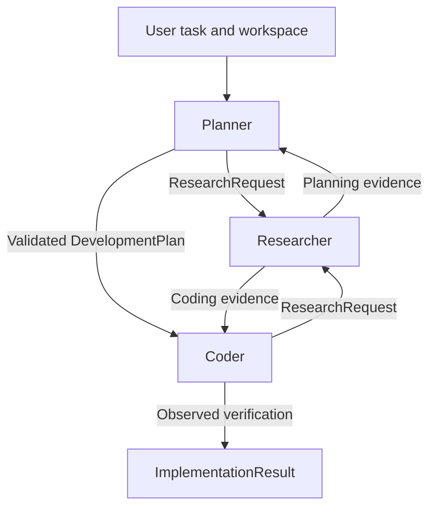

# Guide: repository-aware development agents

Guide coordinates a Planner, Researcher and Coder using LangGraph. GoModel remains
the sole owner of model routing and upstream MCP servers. The application connects
once to GoModel's aggregated `/mcp` endpoint using the existing `gateway_tools`.

## Run

Use Python 3.11+ (tested with 3.13), Node/npx, uv, and GoModel. Install application
dependencies into an isolated environment. On Windows:

```powershell
uv venv .venv
uv pip install --python .venv/Scripts/python.exe -r requirements.txt -c requirements.lock.txt
.venv/Scripts/Activate.ps1
```

The pinned lock file records the tested Python environment. GoModel installs the isolated keyless web
server through its `uv tool run` configuration; that server's MCP SDK is separate
from this application's MCP 1.x dependency.

Keep provider configuration in the ignored `.env`, and start GoModel from this
directory so it reads `.env` and `config.yaml`:

```powershell
gomodel
```

Set `GOMODEL_MASTER_KEY` in `.env` before serving MCP. Both entry points load that
file without replacing environment variables already provided by the operator.
The local integration setup generated a master key if none existed; it is never
printed or committed. Other gateway clients must use that key too. Model access
uses `GOMODEL_BASE_URL` (default `http://localhost:8080/v1`) and `GOMODEL_MODEL`
(default `router`). Provider credentials remain at GoModel.
`GOMODEL_TIMEOUT` controls the timeout per model request attempt in seconds
(default 300). Allow enough time for the gateway's upstream timeout and configured
failover. `GOMODEL_MAX_RETRIES` controls bounded SDK retries of transient model
request failures (default 2, range 0–5), using exponential backoff. These retries
do not rerun filesystem or shell tools. If all attempts time out, the CLI prints
the saved-thread resume command. Resuming keeps completed tool steps and retries
the pending model step instead of scaffolding the project again.

Run the original planning-only agent:

```powershell
python planner.py
```

Run the complete workflow:

```powershell
python workflow.py --workspace 'C:\Users\perur\Desktop\workspace' 'Implement the requested feature and verify it'
```

The chosen workspace must exist and be inside a filesystem root configured in
GoModel. `config.yaml` preserves the original workspace root and includes this
repository for isolated integration fixtures. Change these operator-controlled
roots for another deployment; do not grant the filesystem server a whole drive.
Workspace checks assume the client and gateway see the same filesystem paths.

`--workspace` is also the initial directory for every terminal command. The client
sets it inside each remote shell invocation, so GoModel can run from a different
directory. PowerShell, cmd and POSIX shells use their own path quoting. To work
inside a project subfolder, change directory and run the operation in the same
command; a later terminal call starts in the selected workspace again. Approval
requests show the initial directory. Execution records retain both the original
planned command and the actual directory-prefixed command.

Filesystem paths outside the selected workspace remain blocked. The agent receives
a tool error with the correct workspace and can retry with a valid path. Choosing
a folder outside GoModel's configured filesystem roots still requires adding that
folder (or its parent) to `config.yaml` and restarting GoModel.

The CLI prints a thread ID. Resume a paused/failed workflow using the same workspace:

```powershell
python workflow.py --workspace 'C:\Users\perur\Desktop\workspace' --thread THREAD_ID
```

`ask_user` requests accept a free-text reply or `/pause`. Shell requests require
`approve` or `reject`; `pause` exits while preserving the checkpoint. The process
exits with `0` for completed, `2` for blocked/paused, and `1` for an exception.
Standalone Planner checkpoints continue using `PLANNER_THREAD`; they are separate
from the multi-agent workflow and are not silently migrated.

Workflow plans are published under `.guide-workflow/plans/<workspace-hash>/` in
Guide's directory. They are passed to Coder as structured context and do not make
an otherwise empty application directory nonempty before scaffolding. Standalone
`planner.py` still publishes its plan into the selected workspace.

An approval applies to the displayed command, not to every later command. Before
starting another process, a worker must read the previous process's output. An
unread process produces corrective feedback without another execution or approval
prompt, preventing blind retries with changed arguments.

Build verification accepts the exact planned command after a literal `cd` into
an existing project directory inside the selected workspace. It still rejects
outside or nonexistent directories, requires an observed zero exit code after
the last file edit, and records the scoped command that actually ran.

An operator can preapprove an **exact** reviewed command:

```powershell
python workflow.py --workspace 'C:\path\to\project' --approve-command 'python -m unittest discover -s "C:\path\to\project" -v' 'Implement and test the change'
```

Do not use this as a shell sandbox. Desktop Commander explicitly does not confine
terminal commands to its allowed filesystem directories. Unattended arbitrary
execution needs an operator-managed OS/container boundary. There is no unsafe
blanket shell approval flag. Changing a command requires another review. Output
reads are automatic only for a PID started by this worker until completion is
recorded; unrelated process operations still require review. Preapproving a
command also trusts the code it executes; use OS isolation for untrusted
repositories or generated code.

## Architecture and contracts



The Researcher's return edge follows the recorded caller phase; the diagram does
not mean it calls both agents. There is no extra supervisor-model call and no
keyword-based task classification. A simple task invokes only Planner and Coder.

- `planner.py` retains the original `Plan` contract, skill and publication logic.
  `create_planner` also owns the workflow-specific planning instructions, read-only
  tool selection and bounded execution policy when supplied a workspace. Its
  standalone interface and prompt remain available.
- `researcher.py` owns `create_researcher`, the research skill and instructions,
  read-only tools, middleware and source-evidence validation. The caller supplies
  the planning or coding phase and a task-driven `ResearchRequest`.
- `coder.py` owns `create_coder`, the Quasi-Coder skill and instructions, write and
  terminal tool access, execution approvals and implementation verification.
- `contracts.py` defines the single `WorkflowState`, structured outcomes and plan
  validation. It imports no agent or orchestrator, avoiding circular dependencies.
- `workflow.py` imports the three factories and coordinates conditional edges,
  research caching, bounded loops, context handoffs, checkpointing and the CLI.
  It contains no role prompts, skill loading or agent construction internals.
  Each worker is a native `create_agent` subgraph. Per-invocation subgraphs inherit
  the parent's checkpointer; nested questions and approvals resume through native
  middleware. Prior `workflow` schema names remain readable in saved checkpoints.
- `tool_policy.py` filters the discovered catalog, validates resolved filesystem
  arguments, serializes tool invocation inside each worker, caps individual tool
  output, and records actual outcomes. It creates no MCP client or tool wrappers
  with replacement schemas. Unknown server namespaces are not granted access until
  their policy has been reviewed. Its shared `worker_policy` builds the existing
  middleware consistently; each agent chooses its own role policy. The shared
  `ask_user` tool is still exported by `planner.py` for existing callers.
- `mcp_server.py` manages the single connection, preserving real upstream schemas,
  result blocks and error statuses. It requests explicit tool discovery so an
  opaque gateway `call_tool` dispatcher cannot bypass per-tool policy.
- `skills.py` loads instruction files through the existing directory convention.
  Newly installed skills have source revisions and SHA-256 checks in the existing
  lock file; changes require an explicit lock update after review. Frontmatter
  `allowed-tools` is not a permission mechanism in this application.

All three factories accept `model`, the discovered `tools` catalog, and a keyword
`workspace`; optional `checkpointer`, `approved_commands` and `model_call_limit`
control persistence and execution policy. They return compiled LangChain agent
graphs with the native `ainvoke` interface. The orchestrator maps `WorkflowState`
to each worker's private messages and tool events, and maps structured outcomes
back to the shared state. Agents never import `workflow.py` or manage MCP sessions.
Calling `create_planner` without a workspace preserves its standalone interface.

Planner and Researcher receive read-only filesystem tools and the configured web
tools. Coder additionally receives scoped filesystem mutations and reviewed terminal
process operations. Terminal configuration, telemetry, unrestricted terminal file
access, and global process enumeration are not exposed to these workers. Tool
schemas and MCP annotations guide selection; trust is explicitly limited to the
configured `filesystem`, `web`, and reviewed `terminal` server namespaces.

The web server provides DuckDuckGo search, content fetching and link expansion,
without an API key. Its private-address URL protection stays enabled. It is rate
limited and can be unavailable or blocked; a skill never makes missing evidence
available by itself. The original filesystem and Desktop Commander entries remain
configured. Windows uv subprocesses need the explicitly forwarded non-secret temp
and profile variables because GoModel strips inherited environments.

## Reliability and limits

- SQLite checkpoints live in ignored `.guide-workflow/`, scoped by workspace.
  Sync durability records each graph step. A completed thread returns its existing
  result rather than re-running the Coder.
- Research is bounded to six requests by default and handoffs to sixteen. Each
  worker invocation has model/tool-call budgets. Repeated exact research requests
  reuse reports when phase, request and repository metadata are unchanged. Budgets
  still count repeated requests so a cached request cannot create an infinite loop.
- Caller histories are trimmed at complete human-turn boundaries; each handoff
  includes the task, plan and bounded recent research. Full MCP transcripts are not
  copied from Researcher to its caller.
- Cited research locations must have been successfully read/fetched during that
  research request, including corrective turns. This verifies access/provenance, **not** the truth of every
  interpretation or the adequacy of every citation.
- Invalid citations and incomplete verification evidence return explicit feedback
  to the responsible agent through bounded graph transitions. They are not cached
  as accepted reports or treated as success. Transport exceptions still propagate;
  the application does not retry an ambiguous side effect automatically.
- Coder completion requires recorded successful process exit evidence after its
  last filesystem edit. Desktop Commander requires a separate process-output read
  to obtain the exit code. A process merely starting/finishing is insufficient.
  Passing a command is evidence of that command, not proof of all requirements.
- Transport failures, schema failures and budget exceptions are not swallowed or
  automatically retried around mutating operations. Inspect checkpoint/tool state
  and external effects before resuming a failed mutation. Exactly-once shell/file
  execution across a crash between an effect and its checkpoint is not guaranteed.
- Sequential agent execution avoids workspace mutation races. The CLI takes an
  OS file lease to reject concurrent runs in the same workspace. Programmatic
  callers of `build_workflow` must apply equivalent serialization. SQLite is
  appropriate for a local runner; it is not a distributed job queue or multi-tenant
  authorization service.

## Skills and upstream research

The Planner skill remains byte-for-byte unchanged. Installed additions retain the
pinned upstream instruction bodies and license notices. Researcher's frontmatter
name is aliased to its local role. Coder preserves the complete upstream Quasi-Coder
file, including its `quasi-coder` name, in the local `coder` directory:

| Role | Source | Selection rationale |
|---|---|---|
| Researcher | [DeerFlow deep-research](https://github.com/bytedance/deer-flow/blob/aaca3eeaebaafe7c4ca0147f83e9738655a39b2d/skills/public/deep-research/SKILL.md) | Self-contained general research, source validation, proportional effort; no vendor API dependency |
| Coder | [GitHub quasi-coder](https://github.com/github/awesome-copilot/blob/30a0d7465b14b05e05949d6588b99f7af0c537b4/skills/quasi-coder/SKILL.md) | Interprets natural language, pseudo-code and shorthand using repository conventions and technical judgment within the Planner's scope |

Runtime prompts supply the application's research/verification contracts and
override upstream host assumptions such as tool names. Coder can correct technical
implementation details while preserving planned behavior and acceptance criteria;
unclear requirements require clarification. Consumed shorthand is replaced only
within scope, preserving legitimate arrow functions and unrelated content. Research
handoffs, tool permissions and mandatory verification still apply. Upstream and
installed-content hashes are recorded; installed files are verified at load time.

Alternatives reviewed: Superpowers executing-plans has stronger adoption and recent
maintenance but currently requires sibling skills, helper scripts, worktrees and a
ledger; those would duplicate this orchestration. Anthropic enterprise-search
search-strategy/knowledge-synthesis provide good attribution guidance but assume
enterprise connectors and do not individually cover the full research lifecycle.
Tavily's research skill is credible but adds provider-specific authentication and
dependencies. Repository activity and installation counts are selection signals,
not benchmarked reliability for this system.

Official references and implementation decisions are recorded in
[the implementation plan](plan/architecture-multi-agent-v1.md). In particular,
LangGraph recommends per-invocation subgraphs for independent worker calls, and
LangChain provides native tool review and human-response middleware. GoModel's
gateway documentation defines namespaced discovery, server lifecycle and tool
filters; the application preserves those responsibilities.

## Verification

```powershell
python -m unittest test_workflow -v
uvx ruff check planner.py researcher.py coder.py workflow.py contracts.py tool_policy.py skills.py mcp_server.py test_workflow.py --select F,I --target-version py311
```

The deterministic suite uses actual compiled agent graphs with scripted model
responses and local test tools; it does not establish model-provider or MCP
availability. It covers both research return paths, source-evidence rejection,
verification feedback, caching, process ownership across research, bounded
termination, terminal approval/rejection, SQLite reopen/resume and compatibility
with earlier checkpoint schema names. It also checks independent factory policies
and the standalone Planner contract.

Live validation uses the normal `workflow.py` CLI with an isolated workspace under
the configured filesystem roots and an exact reviewed verification command. It
requires a running GoModel and configured providers. Request Researcher
collaboration during both planning and coding to exercise both handoff paths.
Record the thread, final result, observed process exit code and independent checks;
successful discovery or scripted tests alone do not establish live completion.

Refactor validation on 2026-11-12: 17 deterministic checks and Ruff passed. A real
GoModel development run completed six handoffs, including research in both phases,
and recorded exit code 0 for the planned verification command. Its nine generated
tests passed again independently, alongside 11 additional behavioral checks.
Local evidence (ignored by Git) is in
[workflow-evidence.json](artifacts/refactor-e2e-portable/workflow-evidence.json).
An earlier attempt stopped on a shell-quoting mismatch and an out-of-workspace
interpreter-directory access. The successful fixture used a shell-neutral command;
application prompts and guards were preserved throughout.
