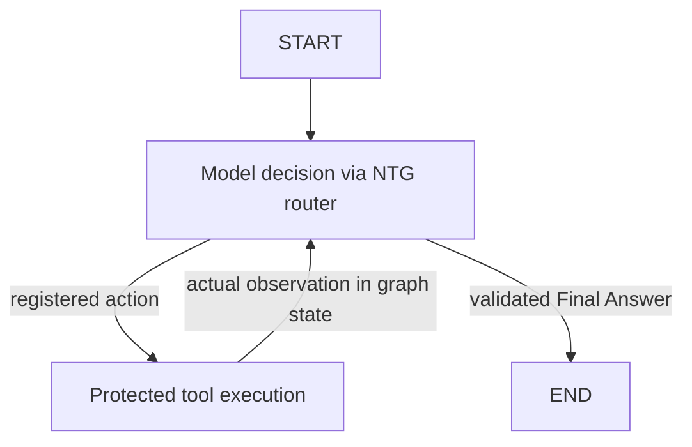

# Milestone 6 — LangGraph ReAct agent

Tool-enabled runs invoke a compiled `langgraph.graph.StateGraph` once. LangGraph
owns scheduling and state transitions. NTG supplies the model node, strict action
protocol, tool node, final validation, and protected host tools. This replaces the
classic LangChain factory/executor; there is no parallel Python agent loop.



## Dependencies and API choice

Pin `langgraph==1.2.16` and retain `langchain-core==1.6.13`. Install with
`python -m pip install -e ".[dev]"`. `langchain-classic` is removed from project
requirements. Shared `BaseChatModel`, prompts, messages and `StructuredTool`
interfaces still come from core, which LangGraph itself depends on. No provider
integration is introduced. Existing globally installed classic packages need not
be uninstalled and are not imported by this runtime.

NTG currently exposes structured text completions, not native tool calls.
A graph with explicit nodes preserves that interface without pretending to
implement `bind_tools` or changing provider capability requirements. Unlike the
previous factory, a low-level StateGraph requires application-defined action
interpretation and observation rendering. `_parse_action` and the node functions
make those responsibilities explicit; LangGraph schedules every transition.

References checked 2026-10-22: [Graph API](https://docs.langchain.com/oss/python/langgraph/graph-api),
[agent patterns](https://docs.langchain.com/oss/python/langgraph/workflows-agents),
[LangGraph package](https://pypi.org/project/langgraph/1.2.16/).

## Usage

```powershell
New-Item -ItemType Directory -Force .\agent_workspace
python main.py "Inspect the files and implement the Python helper" --workspace .\agent_workspace --max-tool-calls 8
```

```python
from ntg_llm import LLMClient, create_coder_agent, create_filesystem_registry

coder = create_coder_agent(
    LLMClient(),
    tools=create_filesystem_registry("agent_workspace"),
    max_tool_calls=8,
)
result = coder.run("Find the greeting module and update the greeting")
print(result.output.code)
print(result.output.explanation)
```

Replacement still requires both host `allow_overwrite=True` (CLI
`--allow-overwrite`) and tool argument `overwrite=true`. Direct completion APIs
and agents without tools bypass LangGraph, using a lazy runtime import.

## Model, protocol and tools

`NTGChatModel` delegates every model invocation through `LLMClient` and
`CompletionService` to the existing LiteLLM router, round-robin strategy, and
provider recovery. It adds no provider selection, retry, fallback or cache.

The existing `Answer.answer` string carries one JSON action object:

```json
{"action":"read_file","action_input":{"path":"module.py"}}
```

The optional `Action:` prefix and a JSON code fence are supported. A final response
uses `action="Final Answer"` and the caller's output object as `action_input`.
The Coder requires `code` and `explanation`, with Python syntax validation.

The parser requires complete JSON with exactly `action` and `action_input`;
arguments must be an object. Duplicate keys, lists of actions, incomplete JSON,
unknown tools and invalid final output stop with sanitized 502 errors. This is
stricter than the replaced classic parser, which could repair partial JSON or
select the first entry of a list. Protocol labels embedded in source code are
ordinary string contents. No free-form reasoning is requested or stored.

The model node validates final output before routing to END. For a tool action,
the graph schedules the tool node. Its `StructuredTool` wrapper delegates to
`ToolRegistry.execute` with original argument types and required fields. Expected
tool failures become observations for the next model decision. Unexpected handler
failures stop with partial-effect evidence. The node returns normalized actions
and actual observations as graph state; no fabricated tool result is accepted.

Workspace scoping, protected paths, link restrictions, payload bounds and overwrite
policy remain in the unchanged filesystem implementation. See
[filesystem policy](milestone5.md#workspace-policy). No shell execution is added.

## One execution ceiling

`max_tool_calls=N` maps to the graph invocation's `recursion_limit=2*N`.
The graph alternates model and tool nodes, each consuming one superstep. A final
answer terminates in a model node. Consequently there are at most N model
invocations and N tool executions, and the final decision counts toward N just
as it did with the replaced executor. Three tools plus final requires N >= 4.
Expected tool failures consume the same allowance as successful actions.

LangGraph raises `GraphRecursionError` on exhaustion; NTG maps it to 508 with
`code="tool_limit_reached"`. There is no independent action counter or extra final
turn. Tests cover N=1, 2 and 4, and final decisions at the boundary.
This mapping depends on the two-node topology; graph changes must revisit it.

No graph node retry policy, checkpoint, persistence or resume facility is enabled.
Provider retries affect only the current completion, so a completed write is not
replayed by recovery. A model may explicitly request another action. Earlier
writes remain after failure; there is no rollback or cross-restart exactly-once
promise.

## Diagnostics and privacy

Each run constructs fresh graph/model/trace instances. Graph state is ephemeral
and is not returned in `AgentResult`. Sequential and concurrent runs remain
isolated. `agent_runtime` is now `langgraph.StateGraph`.

`agent_steps`, `agent_step_count`, aggregated upstream `attempts`, `failed_attempts`
and `attempt_count` retain safe routing evidence. `tool_calls` contains generated
IDs, tool names, status/error codes, safe relative paths and byte/entry counts.
Prompts, contents, full arguments, scratchpads and reasoning are omitted.

LangSmith tracing is disabled around graph invocation, even if enabled outside.
Graph debugging is not enabled. Raw protocol/framework errors become fixed
messages; provider status, Retry-After and partial-effect evidence survive.

## Verification

Tests instrument actual `CompiledStateGraph.invoke`, typed tools, the model
adapter, existing router and real filesystem writes. Observation-dependent tests
discover random filenames/content, recover from missing files and produce final
output based on actual observations. The greeting E2E discovers and edits a
uniquely named Python module and reports its observed path.

Additional coverage includes exact ceilings, strict protocol/final validation,
provider recovery without replay, partial writes, trace privacy, direct APIs and
concurrent isolation. Providers are fake and HTTP is blocked in tests; these tests
verify integration, not live model quality.

Run `python -m pytest -q`, `python -m ruff check .`, and
`python -m ruff format --check .`.

See [feasibility](milestone6-feasibility.md). The
[previous migration plan](../plan/refactor-langchain-react-v1.md) is historical.


Verified on 2026-10-22: **218 passed, 1 skipped** in the complete offline suite
(70.60 seconds); Ruff lint/format and CLI help passed. The skip is the existing
Windows native-symlink capability case. Nine backend/routing/schema/filesystem
modules were compared byte-for-byte with the published baseline and are unchanged.
