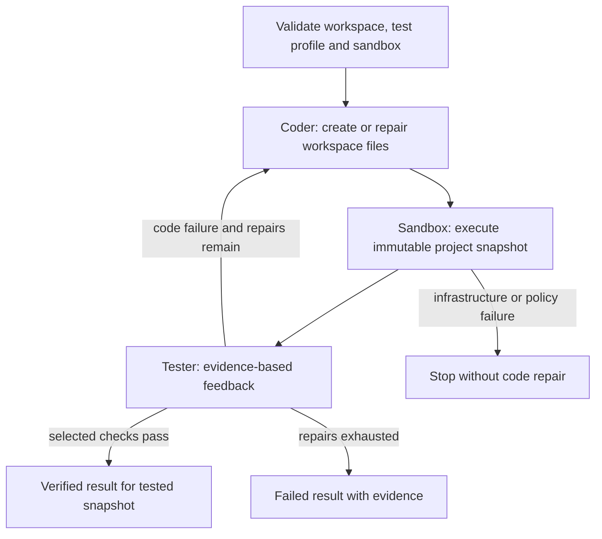

# Milestone 9 feasibility: Tester and bounded repairs

Date: 2026-10-22. Scope: assessment and implementation plan; application behavior
remains Milestone 6 until the plan is implemented and verified.

## Conclusion

Feasible with the existing LangGraph and NTG adapters. This is a new orchestration
layer and execution subsystem, not just another role prompt. The repository has
no sandbox or test runner. Milestones 7/8 specifications were not supplied and no
implementation for them was found; this plan explicitly supplies the execution
prerequisite needed by Milestone 9 without assuming those milestones are complete.

The milestone's invariant is: execute the actual generated artifact, capture real
failure evidence, let a separate Tester interpret it, repair through the Coder,
and repeat only within a finite host-controlled budget. Neither the calculator
filename nor a specific exception is a required product behavior.

## Current repository evidence

| Area | Current implementation | Consequence |
|---|---|---|
| Role abstraction | `ntg_llm/agent.py`, typed Agent/AgentResult; fresh state per run | Reuse for a tool-free Tester feedback model |
| Coder | `ntg_llm/coder.py`, CodeOutput with ast.parse validation | Valid syntax does not establish runtime behavior; Coder currently disclaims execution |
| Orchestration | `ntg_llm/tool_runtime.py`, compiled model/tools StateGraph | Keep this inner graph; add a separate project-level graph |
| Host tools | `ntg_llm/tools/filesystem.py` and registry | Read/write/list only; path policy is not process isolation |
| Backend | LLMClient -> CompletionService -> LiteLLM/round-robin | Both roles reuse provider routing, bounded retries and errors |
| Entrypoint | `main.py` | One Coder run and JSON output; no execution/test profile or repair status |
| Test suite | Temporary filesystem plus fake providers | Reuse for workflow tests; add actual sandbox integration tests |
| Execution environment | Windows; Docker CLI installed | Docker Linux engine unavailable during checks |

Read-only checks `docker version`, `docker info` and `docker image ls` all failed
because `dockerDesktopLinuxEngine` was absent. Docker availability and images
therefore cannot be claimed. A real sandbox test must run after a Linux Docker
engine and a host-approved Python image become available. No service was started,
image downloaded or generated code executed during this assessment.

## Recommended architecture

Use an outer StateGraph with coder, sandbox and tester nodes. The existing inner
Coder graph remains responsible for filesystem tools. A TesterAgent service owns
execution interpretation: a deterministic execution report establishes status;
a reusable tool-free Agent produces structured feedback on code failure. A model
cannot declare a failing process successful, select arbitrary shell commands,
change the test profile, write tests, or increase the repair allowance.

Keep the actual project workspace as source of truth. Do not automatically write
CodeOutput.code into an invented filename: current tool-enabled Coder output may
summarize a multi-file edit. Snapshot the workspace after Coder completion and
record a sorted file/hash manifest. The host selects a Python script entrypoint
or an external trusted unittest suite before the run. Tests are outside Coder's
writable workspace and fixed across repairs. A script exit of zero means that
script ran successfully, not that all task requirements were proven. Report the
verification kind and executed test count; zero collected unit tests is not pass.

For scope control, initial support is standard-library Python projects, with a
pre-provisioned Python image. Custom dependencies require a separately prepared,
host-approved image. There is no model-controlled package installation, network
access, shell tool, automatic test weakening or auto-detection of arbitrary build
commands in this milestone.

## Execution boundary

Recommend a disposable Linux Docker container using an immutable local image ID.
Use a sanitized temporary snapshot, never the live workspace or home directory,
and never the Docker socket. Mount code and external tests read-only, use a
non-root UID, drop capabilities, disable network, apply no-new-privileges, make
the root filesystem read-only, and restrict memory, CPU, processes and temporary
storage. Host control of the Docker CLI is separate from sandbox privileges.

A subprocess with cwd and timeout alone would inherit host access and is not the
requested sandbox. Docker provides a practical local isolation boundary, not a
formal guarantee against hostile kernel exploits. The initial threat model is
buggy generated Python in a trusted, non-concurrently-mutated workspace; adversarial
multi-tenant code and tamper-proof grading require stronger isolation and auditing.
Docker's documented [container controls](https://docs.docker.com/engine/containers/run/)
support the proposed network, mount, user and resource policy.

Bound captured output in bytes while reading, including output without newlines.
Timeout or output overflow must kill and remove the owned container, not merely
kill the attached Docker client. Failure to confirm cleanup is an infrastructure
failure and stops the workflow. Container startup/cleanup have their own short
host timeouts; resource limits and bounded execution are prerequisites to testing.

## Repair semantics

`max_repair_attempts` defaults to 3, accepts integers 0 through 10, and excludes
the initial Coder attempt. Thus the default permits at most four Coder runs and
four sandbox executions. A zero limit still generates and tests once.
Each Coder run retains its existing max_tool_calls limit. These limits govern
different scopes and must not be conflated. A separate derived outer graph
recursion limit guards graph bugs; it must not truncate a legitimate last test.

Only verified code/runtime/test failures, timeouts or resource failures enter
repair. Missing Docker/image, invalid paths, failed snapshot, failed startup or
uncertain cleanup stop as infrastructure/policy errors, without sending the Coder
an instruction to change working code. Provider retries remain local to model
calls and never replay sandbox execution. A Tester model outage uses bounded
structured execution evidence as fallback feedback, with the failure recorded;
it never changes a failure verdict to pass.

The Coder receives original task/context, the fixed test profile, tested snapshot
identity, and the latest structured feedback/evidence. Logs are untrusted data.
The Tester summary must reference actual report fields and cannot fabricate a
command result. Final status is passed, repair_exhausted, or blocked; provider and
validation exceptions preserve accumulated evidence through the existing error
boundary. Earlier workspace edits remain after failure and are explicitly reported.

## Cross-verification and acceptance

LangGraph supports cyclic state graphs and conditional termination using
[StateGraph](https://docs.langchain.com/oss/python/langgraph/graph-api). The existing
runtime and observation-dependent tests demonstrate this integration already.
The current Coder/Agent interfaces can be retained; the application workflow needs
new result models and explicit CLI flags rather than changing existing defaults.

Acceptance requires a real generated-project failure in the container, actual
traceback evidence reaching the Tester/Coder, a repair on disk, and a second
execution passing the unchanged check. Cover initially successful runs, exhausted
repairs, zero budget, timeouts, output floods, process cleanup, infrastructure
failure, no tests collected, and concurrent run isolation. Mocked-provider tests
prove the integration without live model expenditure; a Docker-required test lane
must fail rather than silently skip if the sandbox is unavailable. A default
local test lane may skip optional Docker integration and report that limitation.

See the [concrete implementation plan](../plan/feature-tester-milestone9-v1.md).

Baseline cross-check on 2026-10-22: `python -m pytest -q` returned **218 passed,
1 skipped** in 49.19 seconds. No production code changed during this assessment.
