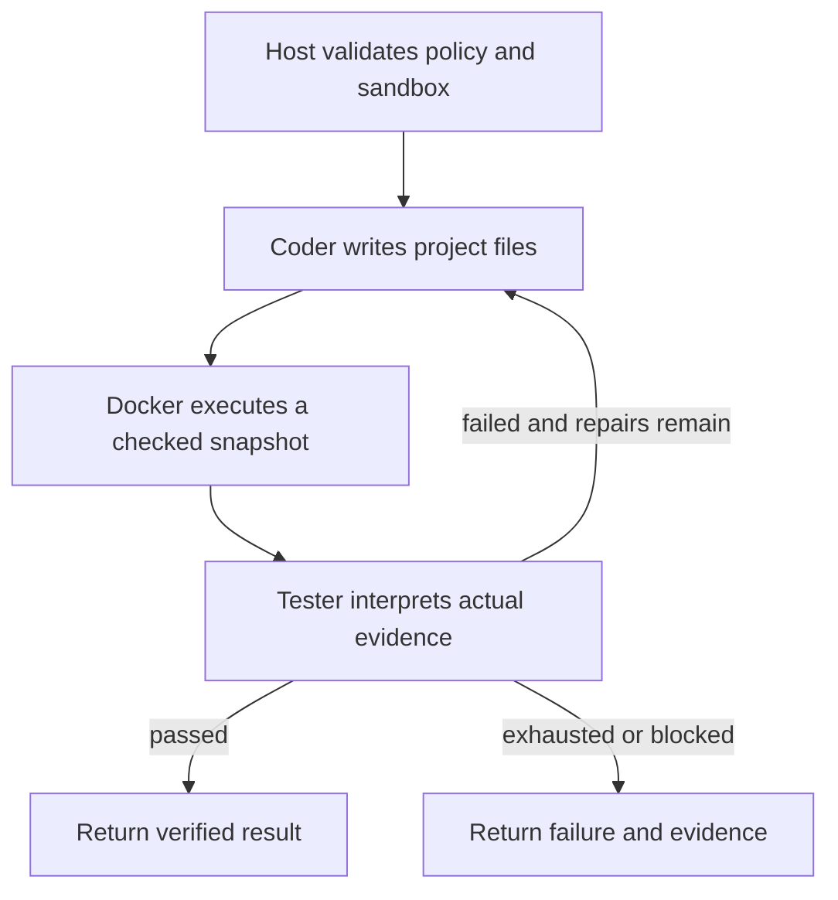

# Milestone 9 — Tester Agent and bounded repairs

The application now has an outer LangGraph workflow that generates actual files,
executes them in a disposable Docker container, asks a separate Tester model for
failure feedback, and sends that evidence back to the Coder for bounded repairs.
The existing inner Coder graph, provider router and direct completion APIs remain.



## Start the application

From the repository root:

```powershell
python -m pip install -e ".[dev]"
python main.py
```

A terminal invocation without a task now prompts `Task:`. Enter a description such
as `Write a Python function that squares a number`. You may also pass it directly:

```powershell
python main.py "Write a Python function that squares a number"
```

This default generates structured code. It does not execute generated code.
Noninteractive calls require a task argument; blank input and Ctrl+C terminate
without calling a provider. Help does not load credentials.

## Run the Tester workflow

Start Docker Desktop with its Linux engine. Provision an approved Python image
explicitly once; the application never starts the daemon or pulls images itself:

```powershell
docker pull python:3.13-slim
$ntgImage = docker image inspect python:3.13-slim --format '{{.Id}}'
New-Item -ItemType Directory -Force .\agent_workspace | Out-Null
python main.py "Create app.py that prints a greeting" --workspace .\agent_workspace --verify --entrypoint app.py --sandbox-image $ntgImage --allow-overwrite
```

For fixed external acceptance tests, use the supplied example:

```powershell
.\examples\milestone9\run.ps1
```

It creates an isolated example workspace, uses the three external label-normalizer
tests, and runs the real configured API with up to three repairs. The test files
are outside the writable Coder workspace. They are copied once and remain fixed
across repairs. Existing files in the example workspace may be overwritten because
the script explicitly grants that permission.

Custom external test directories are supported with `--test-suite` instead of
`--entrypoint`. Select exactly one. Standard-library Python is the initial scope;
projects needing extra packages require a separately provisioned image. There is
no model-selected command, shell tool, package install or runtime network access.

```python
from ntg_llm import LLMClient, ExecutionPolicy, TestProfile, run_verified_project


# image_id must be the actual immutable sha256 ID from docker image inspect.
def verify_project(image_id):
    return run_verified_project(
        LLMClient(),
        "Implement label_tools.py with normalize_label(text)",
        workspace="agent_workspace",
        profile=TestProfile(kind="unittest", tests_root="examples/milestone9/trusted_tests"),
        policy=ExecutionPolicy(image_id=image_id),
        allow_overwrite=True,
        max_repair_attempts=3,
    )
```

## Execution, evidence and repair semantics

`max_repair_attempts=3` means one initial Coder attempt plus at most three repair
attempts: four Coder runs and four executions total. Zero means generate and test
once. Values must be integers 0 through 10. Each Coder run separately retains its
`max_tool_calls` decision ceiling. The outer graph has a derived recursion guard
of `3*(max_repair_attempts+1)+1` supersteps. No graph node retries are installed.

The Coder edits the workspace using the existing protected tools. The final code
string is not automatically saved to an invented filename. A checked snapshot of
actual Python files and explicitly selected UTF-8 resources is hashed and tested.
Before reporting success, the host rechecks the manifest against the current
workspace. An external edit produces `stale_workspace` and stops the workflow.

For script profiles, zero process exit means that script executed successfully.
For unittest profiles, a trusted harness runs the fixed suite, records the test
count and verdict in a bounded tmpfs artifact, and signals readiness. The host
reads that artifact while the container is alive and then removes the container.
Project stdout is never parsed as a verdict. No collected tests is a failure.
This verifies the selected checks; it does not prove requirements absent from them.

The separate Tester is a tool-free `Agent[TesterFeedback]` over the same NTG
client. It receives bounded execution evidence and produces a summary, referenced
report fields and suggested changes. It cannot declare a failing run passed,
change the command/tests or increase the repair limit. Passing and infrastructure
reports receive deterministic feedback without an extra model call. If Tester
analysis fails, recorded execution evidence supplies fallback feedback; the failure
verdict remains. Coder/provider errors preserve completed test outcomes and flag
that workspace edits may remain. Provider retries never replay executed tools or
containers.

## Sandbox policy

Preflight requires a local Linux Docker context and an existing immutable image
ID. Remote Docker environment overrides are rejected. Missing Docker/images or
invalid policy stop before model calls. Application execution never falls back to
a host Python subprocess.

A unique container receives read-only mounts of sanitized project code, trusted
tests and the harness. It runs as UID/GID 65534, with no network, dropped Linux
capabilities, no-new-privileges and a read-only root filesystem. Defaults:

| Limit | Value |
|---|---|
| Execution | 30 seconds (`--execution-timeout`, 1–300) |
| Docker control operations | 10 seconds each |
| Retained output | 32 KiB per stream |
| Memory / memory+swap | 256 MiB / 256 MiB |
| CPU | 1 |
| Processes | 64 |
| Temporary filesystem | 64 MiB |
| Snapshot | 1,000 files, 10 MiB total, 256 KiB per file |

Snapshots exclude protected credentials/state paths and reject filesystem links,
reparse points and hard links using the existing file policy. Tests must be
outside the Coder root. Only regular Python files and explicit UTF-8 resources
enter the sandbox. Docker's disk log driver is disabled; fixed-size pipe readers
bound output, including streams without newlines. Timeout, overflow and normal
exit all lead to removal of the owned container and confirmation of absence.
Uncertain cleanup ends as infrastructure failure without another repair.
The harness also has a finite lifetime if the host disappears.

This boundary is for buggy code in a trusted project. It is not a formal malicious
code sandbox or tamper-proof grading system; Python code can tamper with in-process
Python test machinery, and containers share a kernel. Source/exception literals
may themselves contain sensitive text. Known secret files are excluded and raw
streams are kept out of ordinary routing diagnostics and trace uploads, but generic
secret detection is not claimed.

## Results and failures

Verified mode emits `ProjectRunResult`: `status`, `repairs_used`, final
`coder_result`, `reports`, `feedback`, and safe per-role `diagnostics`.
Each execution report includes its snapshot ID, verification kind, outcome, exit
code, duration, bounded sanitized stdout/stderr, test count and cleanup status.
`passed` exits 0; `repair_exhausted` or `blocked` exits 1; CLI argument errors exit 2.
Preflight/provider errors use the existing structured error boundary.

Infrastructure problems, invalid snapshots and cleanup uncertainty stop without
asking the Coder to change code. Code failures, test failures, missing generated
entrypoints, timeouts and resource/output limits can enter repair within budget.
Earlier workspace writes remain after failure; there is no rollback or resume.

## Reproduce validation

Offline providers with real Docker execution:

```powershell
$ntgImage = docker image inspect python:3.13-slim --format '{{.Id}}'
python -m pytest -q --require-sandbox --sandbox-image-id $ntgImage
python -m ruff check .
python -m ruff format --check .
```

Ordinary `pytest` skips the optional Docker lane when no image is supplied. The
required lane fails instead of skipping if Docker or the image is missing.
HTTP is blocked for the regular test suite.

To explicitly spend live provider calls on the controlled repair exercise:

```powershell
python -m scripts.live_milestone9 --sandbox-image $ntgImage --model gemini-3.5-flash-lite
```

The optional model must already exist in local configuration. The demo uses the
existing router and recovery stack with at most three deployment attempts per
completion and zero provider retries. Normal application provider settings are
unchanged. It intentionally asks the first Coder generation to preserve a broken
scaffold, then requires actual Tester feedback and a successful repair. This is
an integration exercise, not a measurement of spontaneous model bug frequency.
Full evidence is saved locally under ignored `artifacts/`.

Live verification on 2026-10-22 passed using the configured
`gemini-3.5-flash-lite` model for both Coder and Tester: initial execution failed
with NameError; one repair followed; all three unchanged tests then passed.
There were four successful Coder completion calls and one Tester completion call.
Both containers were removed. Docker engine was 29.1.3; the approved image ID was
`sha256:70729b46c69b4f1e97c4822c1af3df53a1476cf5ddc6c087c0c10bc3a5678c2f`.

The live exercise also exposed a Coder instruction conflict that could produce a
bare final code object. Tool-enabled Coder instructions now explicitly require
the Final Answer action envelope. Invalid action/final output still fails closed
with safe `invalid_agent_action` / `invalid_final_output` codes; there is no
silent JSON repair or unbounded model retry.

See [feasibility](milestone9-feasibility.md) and
[implementation plan](../plan/feature-tester-milestone9-v1.md).

Final verification on 2026-10-22: **275 passed, 1 skipped** in 123.00 seconds
with the required real-Docker lane enabled. The skip is the existing Windows
native-symlink capability test; no Docker tests were skipped. Ruff lint/format
and CLI help passed. The no-argument terminal prompt was also exercised against
a real API and returned valid source. Python in the approved image is 3.13.16.
